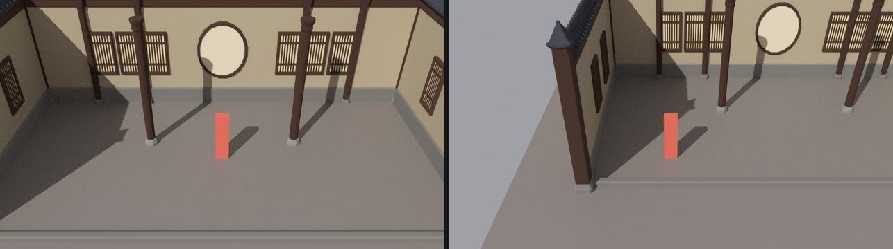

# ChatGPT 요청문: 블렌더 모형

ChatGPT에게 **블렌더로 모형을 만들게** 하는 문서다. 방의 벽 조각, 큰 가구, 돌계단과 난간, 문·정자·탑, 좌판과 배, 나무를 받는다. 그림을 받는 문서(`docs/chatgpt-scene.md`, `docs/chatgpt-people.md`, `docs/chatgpt-now.md`)와는 다른 대화방에서 쓴다. Claude가 계속 고친다(새로 필요한 것은 아래에 붙는다. 받은 항목은 주인이 말할 때까지 지우지 않는다).

2026-11-20에 새로 씀: 주인이 "ChatGPT에게 블렌더도 써서 만들게 하고 싶다"고 하셨다.

## 주인이 하실 일

1. 블렌더에 연결된 ChatGPT **새 대화**에 아래 "처음 하는 말"을 그대로 붙인다.
2. ChatGPT가 한 묶음을 다 만들면 주인 컴퓨터의 **사용자 폴더 아래 `gangho_models` 폴더**(윈도우라면 `C:\Users\내이름\gangho_models`)에 `gangho_m1.zip`이 생긴다. 그 파일을 Claude 대화에 올린다.
3. ChatGPT가 대화에 준 스크립트(`gangho_m1.py`나 코드)도 같이 올린다. 없으면 zip만 올려도 된다(스크립트가 있으면 Claude가 작은 문제를 직접 고칠 수 있다).
4. ChatGPT에게 "다음"이라고 하면 다음 묶음을 만든다.

받은 것을 검사하고 게임에 넣는 일은 Claude가 한다.

## ChatGPT에게 처음 하는 말

**방법 1 (주소)**

```text
아래 주소의 문서를 읽어 줘. 내 게임 '강호행'에 넣을 블렌더 모형 요청문이야.
https://dltkdwhdhkd-design.github.io/gangho/docs/chatgpt-blender.md
너는 내 블렌더에 연결돼 있어. 문서의 "규칙"을 지키고 문서의 "틀"을 블렌더에 불러와서, "만들 차례"의 맨 위 묶음(M1)부터 한 묶음씩 만들어 줘. 한 번에 한 묶음만. 내가 "다음"이라고 하면 다음 묶음을 만들어.
만든 다음에는 문서의 "스스로 확인"대로 [모형] 줄이 전부 OK인지 보고, 게임과 같은 각도로 화면을 찍어 보면서 모양을 다듬어 줘. 끝나면 마지막에 돌린 스크립트 전체를 파일(gangho_m1.py)이나 코드 블록 하나로 나한테 주고, 내 컴퓨터 어느 폴더에 무슨 파일이 생겼는지 알려 줘.
블렌더에 연결이 안 돼 있으면 그렇다고 말하고 스크립트만 줘. 묶음 설명에 나오는 참고 그림 주소도 열어 봐. 주소를 못 열면 나한테 그 파일을 올려 달라고 말해.
```

**방법 2 (주소를 못 열 때)**: 이 문서를 GitHub에서 열고 오른쪽 위 복사 단추(Copy raw file)로 전부 복사해 새 대화에 붙인 뒤 "너는 내 블렌더에 연결돼 있어. 이 문서대로 M1부터 한 묶음씩 만들어 줘"라고 한다. 참고 그림(`docs/ref/ws-interior.jpg`, `docs/shots/1120/wallkit_blender.jpg`)도 내려받아 함께 올린다.

**블렌더에 연결하지 않고도 된다.** 연결이 안 되는 날에는 ChatGPT가 스크립트만 써 주면 된다. 그 파일을 Claude 대화에 올리면 Claude가 여기서 블렌더로 돌려 모형으로 만든다.

---

아래부터는 ChatGPT가 읽는 내용이다.

## 이 모형이 게임에서 어떻게 쓰이나

- '강호행'은 도트 그래픽 무협 RPG다. 사람은 2D 도트 그림이고, 땅·집·벽·바위는 3D 모형이다(HD-2D. three.js로 그린다).
- 카메라는 늘 **남쪽에서 북쪽을 보며 35° 위에서 내려다본다.** 돌지 않는다. 그래서 물건의 앞면(남쪽을 보는 면)과 윗면이 주로 보인다.
- 모형에는 **모양과 재질 이름만** 있으면 된다. 도트 무늬는 게임이 재질 이름을 보고 입힌다(무늬 그림은 따로 받고 있다). 그래서 텍스처도 UV도 만들지 않는다.
- 벽, 계단, 난간 같은 조각은 게임이 칸에 맞춰 줄지어 세우고 돌려 세운다. **치수가 정확해야** 조각끼리 이어 붙는다.
- 받은 모형은 Claude가 블렌더 5.3으로(화면 없이, `python3`에서 `bpy`로) 스크립트를 다시 돌려 만들고, 치수를 검사한 뒤 게임에 넣는다. 그래서 **스크립트가 원본**이다.

벽 조각(M1)을 조립하면 이런 방이 된다. Claude가 임시로 만든 조각을 블렌더에서 조립해 게임과 같은 각도로 찍은 것이다. 빛깔은 임시고, 붉은 막대가 사람 키(22점)다.



그림 주소: https://dltkdwhdhkd-design.github.io/gangho/docs/shots/1120/wallkit_blender.jpg

## 넘기는 것

- **묶음 하나에 스크립트 하나.** 그 묶음의 모형을 전부 한 스크립트에서 만든다. 이름은 "만들 차례"의 표에 있다(`gangho_m1.py` …).
- 스크립트는 아래 "틀"(`gangho_kit.py`)을 써서 쓴다. 틀이 치수를 검사하고, 모형마다 `이름.glb`로 내보내고, 맨 끝에서 묶음을 `gangho_m1.zip` 하나로 묶는다. 파일은 블렌더가 도는 컴퓨터의 사용자 폴더 아래 `gangho_models` 폴더에 생긴다.
- **블렌더에 연결돼 있을 때**: 스크립트를 블렌더에서 실행한다 → 찍힌 `[모형] …` 줄이 전부 `OK`인지 본다 → `look()`으로 게임과 같은 각도의 화면을 차려 놓고 화면을 찍어 보며 모양을 다듬는다(고칠 때는 스크립트를 고쳐 처음부터 다시 실행한다. 블렌더 화면에서 손으로 옮기거나 고친 것은 파일에 남지 않는다) → 마지막에 돌린 스크립트 전체를 주인에게 파일이나 코드 블록 하나로 주고, 생긴 파일의 자리(`…/gangho_models/gangho_m1.zip`)를 알려 준다.
- **연결돼 있지 않을 때**: 스크립트만 준다(파일을 붙일 수 없으면 코드 블록 하나에 전부. 줄이지 말 것). 그 대신 "스스로 확인"의 셈을 손으로 해 본다.
- Claude는 받은 스크립트를 블렌더 5.3으로 다시 돌려 모형을 만든다. 그래서 **스크립트가 원본**이고, 화면이 없는 곳에서도 처음부터 끝까지 혼자 돌아야 한다.

## 규칙

### 1. 단위와 방향

- 길이의 단위는 **점**이다. 블렌더 단위 1이 1점이다(미터가 아니다). 게임의 땅 한 칸이 16점이다.
- **x는 오른쪽(동), y는 뒤(북), z는 위.** 카메라가 남쪽에 있으니 물건의 앞은 -y 쪽이다.
- 모형의 가장 낮은 곳이 z = 0(바닥)이다.
- 원점(0, 0, 0)의 자리는 묶음마다 적혀 있다. 대개 물건이 바닥에 닿는 면의 한가운데다.

### 2. 크기를 맞추는 두 가지 방식

묶음마다 어느 쪽인지 적혀 있다.

- **그대로**: 적힌 점 치수 그대로 만든다. 벽, 계단, 난간, 건물처럼 땅의 칸에 맞물리는 것. 옆 조각과 이어 붙는 축은 표의 "꼭 닿는 축"에 적혀 있고, 그 축에서는 모형이 범위의 양 끝에 정확히 닿아야 한다.
- **사람 키 15점 기준**: 가구와 소품처럼 사람과 견주어 크기가 정해지는 것. 사람 키를 15점으로 보고 만들면 게임이 사람과 같은 배율로 키운다.

어느 쪽이든 모형 전체가 표의 **x, y, z 범위 안에** 들어와야 한다.

### 3. 재질

- 텍스처(그림)와 UV를 넣지 않는다. 면마다 **재질 이름**만 단다. 이름은 아래 "재질 이름표"에서 고른다. 표에 없는 이름은 쓰지 않는다.
- 게임은 면이 보는 방향과 자리를 보고 무늬를 입힌다. 무늬의 굵기는 어디서나 같다(1점에 도트 두세 개). 모양을 길게 만들어도 무늬가 늘어나지 않는다.
- 면은 평평하게 둔다(flat shading). 둥근 것도 각진 채로 둔다.
- 이름표에 없는 빛깔이 꼭 필요하면 `m.color('이름', '#rrggbb')`로 민무늬 빛깔을 만들 수 있다. 쇠고리나 끈 같은 작은 장식에만 쓴다.

### 4. 모양

- **낮은 폴리곤.** 묶음 표에 모형마다 삼각형 한도가 있다. 둥근 것은 8~12각이면 된다.
- 조각 무늬 같은 자잘한 것은 도트 무늬가 맡는다. 모형은 **큰 덩어리와 윤곽**에 집중한다: 처마의 들림, 기둥머리, 상판의 내밂, 살의 간격.
- 0.6점보다 가는 것은 만들지 않는다(화면에서 도트 한두 개다).
- **닫힌 덩어리만** 쓴다. 두께 없는 면 한 장(평면)은 쓰지 않는다. 천, 종이, 차양도 0.4점쯤 두께를 준다.
- 서로 다른 덩어리의 면이 같은 평면에서 겹치면 화면에서 깜빡인다. 0.2점 넘게 어긋나게 한다.
- 덩어리끼리 파고드는 것은 괜찮다(불리언으로 합칠 필요가 없다).
- 바닥에 닿는 밑면은 틀이 알아서 지운다.
- 위에서 내려다보는 게임이라 윗면과 앞면이 가장 잘 보인다. 뒷면은 묶음 설명에 "네 면이 보인다"는 말이 없으면 평평하게 막기만 한다.

### 5. 넣지 않는 것

텍스처, UV, 카메라, 조명, 애니메이션, 뼈대, 부드러운 음영(smooth shading), 세분화 곡면(Subdivision Surface). 틀이 내보낼 때 이런 것은 빠지거나 문제를 일으킨다.

### 6. 블렌더 기능을 쓸 때

- 틀의 모양 함수(`box`, `cyl`, `lathe`, `prism`, `poly`, `bar`, `mesh`)만으로 대부분 된다.
- 블렌더의 다른 기능으로 만든 오브젝트도 넣을 수 있다: `bpy.data`와 `bmesh`로 만든 그물, 수정자(Bevel, Array, Mirror, Solidify, Boolean)를 단 오브젝트를 `m.add(오브젝트, '재질 이름')`으로 넘기면 틀이 수정자와 위치·회전·크기를 적용해 넣는다.
- 화면이 있어야 도는 연산자(편집 모드의 `bpy.ops.mesh.*`, `bpy.ops.view3d.*`, `bpy.ops.transform.*`)는 쓰지 않는다. Claude 쪽에서는 화면 없이 돌린다.
- 블렌더 판마다 달라지는 것(재질 노드, 내보내기 옵션)은 틀이 대신 한다. 스크립트에서는 모양만 만든다.

### 7. 스스로 확인

- `m.save(lim=…, exact=…, tris=…)`에 묶음 표의 범위, 꼭 닿는 축, 삼각형 한도를 그대로 넣는다. 실행하면 모형마다 한 줄이 찍힌다:

  ```text
  [모형] rw_wall  x -8.0~8.0  y -2.5~7.5  z 0.0~64.0  삼각형 314  OK
  ```

  `OK` 대신 `문제: …`가 찍히면 고쳐서 다시 돌린다. 맨 끝 줄이 `문제 0개`여야 한다.
- 실행할 수 없으면: 모형마다 x, y, z의 가장 작은 값과 큰 값을 손으로 셈해 범위 안인지, 꼭 닿는 축의 양 끝에 닿는지 확인하고, 그 값을 답에 적는다.
- 블렌더 화면을 볼 수 있으면 게임과 같은 눈으로 본다: 모형을 다 `save()`한 뒤에 `look(사람 키)`를 부르면 틀이 모형들을 옆으로 늘어놓은 채 높이를 1.22배로 늘려 보이게 하고(게임이 그렇게 세운다), 남쪽 위에서 35° 내려다보는 정사영 카메라 `gangho_cam`을 세우고, 오른쪽 끝에 사람 키만 한 붉은 막대를 둔다. 이 카메라로 본 화면에서는 가로 1점과 높이 1점이 같은 길이다. 사람 키는 묶음 제목에 적혀 있다(22, 16, 15). 화면에서 살필 것: 사람 막대와 견준 크기, 윗면과 앞면의 윤곽, 너무 가늘어 안 보이는 부분, 깜빡이는 겹친 면.
- 블렌더를 처음 열면 있는 기본 큐브·조명·카메라는 지워도 되고 그대로 둬도 된다(틀은 자기가 만든 것만 내보낸다).

## 재질 이름표

<!-- gen:palette -->
| 재질 이름 | 무엇 |
|---|---|
| `wl_field` | 방 벽의 넓은 면(방 종류에 따라 회벽·판자·벽돌·흙벽으로 게임이 바꾼다) |
| `wl_base` | 방 벽의 아랫단(막돌, 다듬은 돌, 판자 굽도리) |
| `wl_beam` | 방 벽 맨 위의 들보 |
| `wl_post` | 방의 기둥 |
| `wl_roof` | 방 벽 위의 기와 덮개 |
| `wood_dark` | 짙은 나무(가구, 문틀, 창살) |
| `wood_red` | 붉은 칠을 한 나무 |
| `wood_pine` | 칠하지 않은 밝은 나무 |
| `wood_black` | 검은 칠을 한 나무 |
| `plank` | 널빤지(마루, 판자, 배의 바닥) |
| `bamboo` | 대나무 |
| `paper` | 종이, 창호지 |
| `win_paper` | 불빛이 비치는 창호지(밤에 게임이 밝힌다) |
| `lantern` | 등불의 갓(밤에 게임이 밝힌다) |
| `stone` | 다듬은 잿빛 돌(계단, 난간, 기단, 석등) |
| `stone_rough` | 막돌, 자연석 쌓기 |
| `stone_dark` | 짙은 돌 |
| `brick` | 잿빛 전돌, 벽돌 |
| `plaster` | 누런 회벽 |
| `plaster_white` | 흰 회벽 |
| `earth` | 흙벽, 다진 흙 |
| `tile` | 기와 |
| `thatch` | 짚, 이엉 |
| `rock_grey` | 잿빛 바위 |
| `rock_brown` | 갈색 바위 |
| `bark` | 나무 껍질 |
| `leaf_pine` | 솔잎 뭉치 |
| `leaf_broad` | 넓은 잎 뭉치 |
| `leaf_plum` | 매화 꽃 뭉치 |
| `metal` | 쇠(칼날, 솥, 못, 경첩) |
| `gold` | 금빛 장식 |
| `rope` | 밧줄, 새끼줄 |
| `cloth_red` | 붉은 천 |
| `cloth_blue` | 쪽빛 천 |
| `cloth_white` | 흰 천, 삼베 |
| `cloth_black` | 검은 천 |
| `cloth_yellow` | 누런 천 |
<!-- /gen:palette -->

`win_paper`와 `lantern`은 밤에 게임이 밝힌다. 등불이 있는 모형은 불빛 자리도 `m.lamp(x, y, z)`로 알려 준다.

## 틀 (`gangho_kit.py`)

파일 주소: https://dltkdwhdhkd-design.github.io/gangho/tools/blender/gangho_kit.py

이 파일을 **고치지 않고** 불러 쓴다. 스크립트는 늘 아래 머리말로 시작하고 `done('묶음 파일 이름')`으로 끝난다. 머리말은 한 글자도 바꾸지 않는다: 틀을 위 주소에서 받아 `gangho_models` 폴더에 두고 불러온다(받지 못하면 스크립트 옆이나 그 폴더에 있는 틀을 쓴다).

```python
# ---- 머리말(그대로 둔다): 틀(gangho_kit.py)을 불러온다. 옆에 없으면 받아 온다 ----
import importlib, os, sys, urllib.request
_d = os.path.join(os.path.expanduser('~'), 'gangho_models')
os.makedirs(_d, exist_ok=True)
try:
    _src = urllib.request.urlopen('https://dltkdwhdhkd-design.github.io/gangho/tools/blender/gangho_kit.py', timeout=15).read()
    open(os.path.join(_d, 'gangho_kit.py'), 'wb').write(_src)
except Exception:
    pass
sys.path[:0] = ([os.path.dirname(os.path.abspath(__file__))] if '__file__' in globals() else []) + [_d]
import gangho_kit
importlib.reload(gangho_kit)
from gangho_kit import *
# ---- 머리말 끝 ----

# … 모형들 …

look(22)                # 블렌더 화면으로 살필 때만. 사람 키는 묶음 제목에 있다
done('gangho_m1')       # 묶음 파일 이름(확장자 없이). gangho_m1.zip으로 묶인다
```

주소에서 틀을 받을 수 없는 곳(인터넷이 막힌 실행 환경)에서는 아래 "틀 전문"을 `gangho_kit.py`라는 파일로 스크립트 옆에 저장해 두면 된다. 머리말은 그대로 둔다.

내보내는 폴더는 사용자 폴더 아래 `gangho_models`다(환경 변수 `GANGHO_OUT`이 있으면 그 폴더).

| 쓰는 법 | 무엇 |
|---|---|
| `m = Model('이름')` | 모형 하나를 시작한다. 이름이 파일 이름이 된다(`이름.glb`) |
| `m.box(재질, (x0, y0, z0), (x1, y1, z1))` | 상자. 맞은편 두 모서리 |
| `m.cyl(재질, (x, y), 반지름, z0, z1, n=8, r1=None)` | 세운 기둥. `r1`을 주면 위쪽 반지름이 달라진다 |
| `m.lathe(재질, (x, y), [(반지름, 높이), …], n=8, ring=False)` | 세로 축 둘레로 돌려 만든 모양(항아리, 북, 향로, 지붕 꼭지). `ring=True`면 고리(우물전, 바퀴 테) |
| `m.prism(재질, [(y, z), …], x0, x1)` | 옆에서 본 단면을 x 방향으로 민 모양(지붕, 처마, 계단의 옆모습) |
| `m.poly(재질, [(x, y), …], z0, z1)` | 위에서 본 윤곽을 세운 모양(여섯모 단, 배의 바닥) |
| `m.bar(재질, (x, y, z), (x, y, z), 폭, 두께=None, n=4)` | 두 점을 잇는 막대(버팀목, 난간, 창대, 가지). `n=4`는 네모, 6 이상은 둥근 막대 |
| `m.mesh(재질, [(x, y, z), …], [(꼭짓점 번호, …), …])` | 아무 그물. 면의 앞뒤는 틀이 바깥으로 맞춘다 |
| `m.add(오브젝트, 재질=None)` | 블렌더로 만든 오브젝트를 넣는다(수정자와 변환을 적용하고 원래 오브젝트는 지운다) |
| `with m.at((x, y, z), rz=0, rx=0, ry=0, scale=1):` | 이 안에서 더한 모양을 그 자리로 옮기고 돌린다(도 단위). 겹쳐 쓸 수 있다 |
| `m.lamp(x, y, z)` | 불빛 자리 |
| `m.color('이름', '#rrggbb')` | 이름표에 없는 민무늬 빛깔. 돌려주는 이름을 재질로 쓴다 |
| `m.save(lim=((x0, x1), (y0, y1), (z0, z1)), exact='x', tris=500)` | 검사하고 `이름.glb`로 내보낸다. 모형마다 한 번 |
| `look(사람 키)` | 블렌더 화면에서 게임과 같은 각도로 보게 카메라 `gangho_cam`과 사람 키 막대를 차린다. `save()`를 다 한 뒤에 부른다. 내보낸 파일은 바뀌지 않는다 |
| `done('gangho_m1')` | 스크립트 맨 끝에 한 번. 만든 모형 수와 문제 수를 찍고, 이번에 만든 `.glb`를 `gangho_m1.zip`으로 묶는다 |

`cyl`, `lathe`의 반지름은 **축에서 평평한 면까지의 거리**다. `n`이 4의 배수(4, 8, 12, 16 …)이면 가로와 깊이가 정확히 반지름의 두 배가 된다(`n=4`는 축에 나란한 네모 기둥). 6각이나 10각은 좌우 폭이 반지름의 두 배이고 앞뒤는 조금 더 크다(6각은 15%, 10각은 5%).

### 본보기 스크립트

서 있는 등 하나를 만드는 스크립트다(만들 차례에는 없는 물건이다. 쓰는 법만 본다).

```python
# (맨 위에 머리말)

m = Model('ex_lampstand')                                             # 본보기: 서 있는 등(사람 키 15점 기준)
m.lathe('stone', (0, 0), [(2.2, 0), (2.2, 1), (1.4, 1.8)], n=8)       # 돌 받침: 아래가 넓은 여덟모
m.cyl('wood_dark', (0, 0), .6, 1.8, 15, n=8)                          # 기둥
m.bar('wood_dark', (0, 0, 14.2), (3.4, 0, 14.2), .8)                  # 옆으로 뻗은 팔
m.bar('wood_dark', (.5, 0, 12), (2.4, 0, 13.9), .6)                   # 팔을 받치는 버팀목
with m.at((3.2, 0, 9.4)):                                             # 팔 끝에 매달린 등롱: 이 안의 좌표는 (3.2, 0, 9.4)에서 잰다
    m.bar('rope', (0, 0, 3.6), (0, 0, 4.6), .6)
    m.lathe('wood_black', (0, 0), [(1, 3.2), (1.3, 3.6)], n=8)        # 뚜껑
    m.lathe('lantern', (0, 0), [(1, 0), (1.6, .8), (1.6, 2.6), (1, 3.2)], n=8)   # 종이 갓: 밤에 게임이 밝힌다
    m.lathe('wood_black', (0, 0), [(1, -.4), (1, 0)], n=8)            # 밑받침
    m.lamp(0, 0, 1.6)                                                 # 불빛 자리
m.save(lim=((-2.5, 5), (-2.5, 2.5), (0, 15.2)), tris=400)
look(15)
done('gangho_ex')
```

돌리면 이렇게 찍힌다:

```text
[모형] ex_lampstand  x -2.2~4.8  y -2.2~2.2  z 0.0~15.0  삼각형 218  OK
묶음 파일: …/gangho_models/gangho_ex.zip
== 끝: 모형 1개, 문제 0개, 폴더 …/gangho_models ==
```

M1의 벽 조각은 Claude가 같은 틀로 임시로 만들어 둔 스크립트가 있다: https://dltkdwhdhkd-design.github.io/gangho/tools/blender/walls.py — 묶음 하나를 어떻게 쓰는지 볼 수 있다. 상자와 막대 몇 개로 치수만 맞춘 것이니, **M1은 이것보다 나은 모양으로** 만든다(기와 덮개의 기왓골과 처마, 기둥머리의 받침, 주춧돌의 깎임, 창살의 짜임).

### 틀 전문

<!-- gen:kit -->
```python
# ==== 강호행 틀 v1 시작 (이 줄부터 "틀 끝"까지는 고치지 않는다) ====
# 강호행(무협 게임)에 넣을 블렌더 모형을 만드는 틀. 설명서: docs/chatgpt-blender.md
# 길이는 "평면도 점"(게임의 땅 한 칸이 16점). 좌표: x 오른쪽(동), y 뒤(북), z 위. 카메라는 남쪽(-y)에서 본다.
# 무늬(텍스처)와 UV는 넣지 않는다. 재질 "이름"만 달면 게임이 그 이름을 보고 도트 무늬를 입힌다.
import bpy, bmesh, math, os, json
from contextlib import contextmanager
from mathutils import Matrix, Vector

KIT = 1
OUT = os.environ.get('GANGHO_OUT') or os.path.join(os.path.expanduser('~'), 'gangho_models')
# 재질 이름표: 이름 -> (무엇, 임시 빛깔). 게임이 이 이름을 보고 무늬를 입힌다. 표에 없는 이름은 쓰지 않는다
PALETTE = {
    'wl_field': ('방 벽의 넓은 면(방 종류에 따라 회벽·판자·벽돌·흙벽으로 게임이 바꾼다)', '#b8aa8c'),
    'wl_base': ('방 벽의 아랫단(막돌, 다듬은 돌, 판자 굽도리)', '#7d7a74'),
    'wl_beam': ('방 벽 맨 위의 들보', '#4a3020'),
    'wl_post': ('방의 기둥', '#40281a'),
    'wl_roof': ('방 벽 위의 기와 덮개', '#3a3c44'),
    'wood_dark': ('짙은 나무(가구, 문틀, 창살)', '#4a3020'),
    'wood_red': ('붉은 칠을 한 나무', '#8a2a20'),
    'wood_pine': ('칠하지 않은 밝은 나무', '#b08a58'),
    'wood_black': ('검은 칠을 한 나무', '#24201e'),
    'plank': ('널빤지(마루, 판자, 배의 바닥)', '#6a4a30'),
    'bamboo': ('대나무', '#8a9a50'),
    'paper': ('종이, 창호지', '#e6dcc0'),
    'win_paper': ('불빛이 비치는 창호지(밤에 게임이 밝힌다)', '#ecdcb0'),
    'lantern': ('등불의 갓(밤에 게임이 밝힌다)', '#e8a050'),
    'stone': ('다듬은 잿빛 돌(계단, 난간, 기단, 석등)', '#8e8c88'),
    'stone_rough': ('막돌, 자연석 쌓기', '#7a766e'),
    'stone_dark': ('짙은 돌', '#4c4a50'),
    'brick': ('잿빛 전돌, 벽돌', '#7c7e80'),
    'plaster': ('누런 회벽', '#b8aa8c'),
    'plaster_white': ('흰 회벽', '#d8d0bc'),
    'earth': ('흙벽, 다진 흙', '#9a7a50'),
    'tile': ('기와', '#3a3c44'),
    'thatch': ('짚, 이엉', '#b09a58'),
    'rock_grey': ('잿빛 바위', '#8a8478'),
    'rock_brown': ('갈색 바위', '#7a6450'),
    'bark': ('나무 껍질', '#5a4634'),
    'leaf_pine': ('솔잎 뭉치', '#2f5a34'),
    'leaf_broad': ('넓은 잎 뭉치', '#4a7a3a'),
    'leaf_plum': ('매화 꽃 뭉치', '#d8a0b0'),
    'metal': ('쇠(칼날, 솥, 못, 경첩)', '#5a5e66'),
    'gold': ('금빛 장식', '#c8a040'),
    'rope': ('밧줄, 새끼줄', '#a08a60'),
    'cloth_red': ('붉은 천', '#a02820'),
    'cloth_blue': ('쪽빛 천', '#2c4a7a'),
    'cloth_white': ('흰 천, 삼베', '#d8d0c0'),
    'cloth_black': ('검은 천', '#22222a'),
    'cloth_yellow': ('누런 천', '#c8a040'),
}
_report, _cursor = [], [0.0]


def _lin(h):
    h = h.lstrip('#')
    return tuple(c / 12.92 if c <= .04045 else ((c + .055) / 1.055) ** 2.4 for c in (int(h[i:i + 2], 16) / 255 for i in (0, 2, 4)))


def _material(name, hexrgb):
    m = bpy.data.materials.get(name) or bpy.data.materials.new(name)
    rgba = (*_lin(hexrgb), 1)
    m.diffuse_color = rgba
    try:
        m.use_nodes = True
    except Exception:
        pass
    nt = getattr(m, 'node_tree', None)
    for n in (nt.nodes if nt else []):
        if n.type == 'BSDF_PRINCIPLED':
            n.inputs['Base Color'].default_value = rgba
            n.inputs['Roughness'].default_value = 1
    return m


def _collection():
    c = bpy.data.collections.get('gangho')
    if not c:
        c = bpy.data.collections.new('gangho')
        bpy.context.scene.collection.children.link(c)
    return c


def _fix(bm):
    """덩어리마다 면의 앞뒤를 바깥쪽으로 맞춘다. 닫히지 않은(두께 없는) 덩어리의 수를 돌려준다"""
    bm.normal_update()
    seen, open_n = set(), 0
    for f in list(bm.faces):
        if f in seen:
            continue
        isl, stack = [], [f]
        seen.add(f)
        while stack:
            g = stack.pop()
            isl.append(g)
            for e in g.edges:
                for h in e.link_faces:
                    if h not in seen:
                        seen.add(h)
                        stack.append(h)
        closed = all(len(e.link_faces) == 2 for g in isl for e in g.edges)
        bmesh.ops.recalc_face_normals(bm, faces=isl)
        if closed:
            vol = sum(g.verts[0].co.dot(g.verts[i].co.cross(g.verts[i + 1].co)) for g in isl for i in range(1, len(g.verts) - 1))
            if vol < 0:
                bmesh.ops.reverse_faces(bm, faces=isl)
        else:
            open_n += 1
    bm.normal_update()
    return open_n


class Model:
    """모형 하나. 모양을 더한 다음 save()로 검사하고 <이름>.glb로 내보낸다"""

    def __init__(s, name):
        s.name, s.bm, s.lamps, s.mx, s.custom, s.notes = name, {}, [], [Matrix.Identity(4)], {}, []

    def _b(s, mat):
        if mat not in PALETTE and mat not in s.custom and f"재질 이름 '{mat}'은 이름표에 없다" not in s.notes:
            s.notes.append(f"재질 이름 '{mat}'은 이름표에 없다")
        if mat not in s.bm:
            s.bm[mat] = bmesh.new()
        return s.bm[mat]

    def color(s, name, hexrgb):
        """이름표에 없는 민무늬 빛깔을 하나 만든다(작은 장식에만 쓴다). 돌려주는 이름을 재질 이름으로 쓴다"""
        s.custom['c_' + name] = hexrgb
        return 'c_' + name

    @contextmanager
    def at(s, move=(0, 0, 0), rz=0, rx=0, ry=0, scale=1):
        """with m.at((x, y, z), rz=각도): 안에서 더한 모양을 그 자리로 옮기고 돌린다(도 단위, 겹쳐 쓸 수 있다)"""
        sc = scale if isinstance(scale, (tuple, list)) else (scale, scale, scale)
        M = Matrix.Translation(Vector(move)) @ Matrix.Rotation(math.radians(rz), 4, 'Z') @ Matrix.Rotation(math.radians(ry), 4, 'Y') @ Matrix.Rotation(math.radians(rx), 4, 'X') @ Matrix.Diagonal((*sc, 1))
        s.mx.append(s.mx[-1] @ M)
        try:
            yield s
        finally:
            s.mx.pop()

    def mesh(s, mat, verts, faces):
        """아무 그물: 꼭짓점 [(x, y, z)…]과 면 [(꼭짓점 번호…)…]. 면의 앞뒤는 save()가 맞춘다"""
        b, M = s._b(mat), s.mx[-1]
        vs = [b.verts.new(M @ Vector(v)) for v in verts]
        for f in faces:
            try:
                b.faces.new([vs[i] for i in f])
            except ValueError:
                pass

    def box(s, mat, a, b):
        """상자: 맞은편 두 모서리 a=(x, y, z), b=(x, y, z)"""
        x0, x1 = sorted((a[0], b[0])); y0, y1 = sorted((a[1], b[1])); z0, z1 = sorted((a[2], b[2]))
        s.mesh(mat, [(x0, y0, z0), (x1, y0, z0), (x1, y1, z0), (x0, y1, z0), (x0, y0, z1), (x1, y0, z1), (x1, y1, z1), (x0, y1, z1)],
               [(0, 3, 2, 1), (4, 5, 6, 7), (0, 1, 5, 4), (1, 2, 6, 5), (2, 3, 7, 6), (3, 0, 4, 7)])

    def lathe(s, mat, c, prof, n=8, ring=False):
        """돌려 만든 모양(항아리, 북, 향로, 둥근 기둥): 세로 축 c=(x, y), 옆 윤곽 prof=[(반지름, 높이)…]을 아래에서 위로.
        n각형으로 돌린다. 반지름은 축에서 평평한 면까지의 거리이고 평평한 면이 좌우(±x)를 본다. n이 4의 배수(4, 8, 12, 16…)이면
        앞뒤(±y)도 평평한 면이라 가로와 깊이가 정확히 반지름의 두 배다(n=4는 축에 나란한 네모). 반지름 0은 뾰족한 끝.
        ring=True면 윤곽의 끝을 처음과 이어 고리를 만든다(우물전, 바퀴 테, 북의 테): prof=[(안, 아래), (밖, 아래), (밖, 위), (안, 위)]"""
        cx, cy = c
        k = 1 / math.cos(math.pi / n)
        verts, rings = [], []
        for r, z in prof:
            if r <= 1e-6:
                rings.append([len(verts)]); verts.append((cx, cy, z))
            else:
                rings.append(list(range(len(verts), len(verts) + n)))
                verts += [(cx + r * k * math.cos(2 * math.pi * (i + .5) / n), cy + r * k * math.sin(2 * math.pi * (i + .5) / n), z) for i in range(n)]
        faces = []
        for A, B in zip(rings, rings[1:] + ([rings[0]] if ring else [])):
            for i in range(n):
                j = (i + 1) % n
                if len(A) == 1 and len(B) == 1:
                    continue
                faces.append((A[0], B[j], B[i]) if len(A) == 1 else (A[i], A[j], B[0]) if len(B) == 1 else (A[i], A[j], B[j], B[i]))
        if not ring and len(rings[0]) > 1:
            faces.append(tuple(reversed(rings[0])))
        if not ring and len(rings[-1]) > 1:
            faces.append(tuple(rings[-1]))
        s.mesh(mat, verts, faces)

    def cyl(s, mat, c, r, z0, z1, n=8, r1=None):
        """세운 기둥: 축 c=(x, y), 반지름 r(축에서 면까지), 높이 z0~z1. r1을 주면 위쪽 반지름이 r1(위가 좁거나 넓은 기둥)"""
        s.lathe(mat, c, [(r, z0), (r if r1 is None else r1, z1)], n)

    def prism(s, mat, prof, x0, x1):
        """옆에서 본 단면 prof=[(y, z)…]을 x0~x1로 민 모양(지붕, 처마, 쇠시리, 계단의 옆모습)"""
        k = len(prof)
        s.mesh(mat, [(x0, y, z) for y, z in prof] + [(x1, y, z) for y, z in prof],
               [tuple(range(k)), tuple(reversed(range(k, 2 * k)))] + [(i, k + i, k + (i + 1) % k, (i + 1) % k) for i in range(k)])

    def poly(s, mat, outline, z0, z1):
        """위에서 본 윤곽 outline=[(x, y)…]을 z0~z1로 세운 모양(여섯모 단, 배의 바닥)"""
        k = len(outline)
        s.mesh(mat, [(x, y, z0) for x, y in outline] + [(x, y, z1) for x, y in outline],
               [tuple(reversed(range(k))), tuple(range(k, 2 * k))] + [(i, (i + 1) % k, k + (i + 1) % k, k + i) for i in range(k)])

    def bar(s, mat, p0, p1, w, h=None, n=4):
        """두 점 p0, p1을 잇는 막대(비스듬한 버팀목, 난간, 창대, 가지). 폭 w(옆으로), 두께 h(위아래. 안 주면 w). n=4는 네모, 6 이상은 둥근 막대"""
        a, b = Vector(p0), Vector(p1)
        d = b - a
        if d.length < 1e-6:
            return
        d.normalize()
        side = d.cross(Vector((0, 0, 1)))
        if side.length < 1e-6:
            side = Vector((1, 0, 0))
        side.normalize()
        top = side.cross(d).normalized()
        h = w if h is None else h
        k = 1 / math.cos(math.pi / n)
        ring = [(-w / 2, -h / 2), (w / 2, -h / 2), (w / 2, h / 2), (-w / 2, h / 2)] if n == 4 else [(w / 2 * k * math.cos(2 * math.pi * (i + .5) / n), h / 2 * k * math.sin(2 * math.pi * (i + .5) / n)) for i in range(n)]
        s.mesh(mat, [tuple(p + side * u + top * v) for p in (a, b) for u, v in ring],
               [tuple(reversed(range(n))), tuple(range(n, 2 * n))] + [(i, (i + 1) % n, n + (i + 1) % n, n + i) for i in range(n)])

    def add(s, obj, mat=None):
        """블렌더로 만든 오브젝트를 그대로 넣는다(수정자와 위치·회전·크기를 적용한다). 넣은 오브젝트는 지운다.
        mat을 주면 전부 그 재질, 안 주면 오브젝트에 달린 재질 이름을 쓴다(이름표의 이름이어야 한다)"""
        bpy.context.view_layer.update()
        ev = obj.evaluated_get(bpy.context.evaluated_depsgraph_get())
        me = bpy.data.meshes.new_from_object(ev)
        W, slots, vmap = obj.matrix_world.copy(), obj.material_slots, {}
        for p in me.polygons:
            sm = slots[p.material_index].material if p.material_index < len(slots) else None
            nm = mat or (sm.name.split('.')[0] if sm else 'wood_dark')
            b, M, vs = s._b(nm), s.mx[-1] @ W, []
            for i in p.vertices:
                if (nm, i) not in vmap:
                    vmap[(nm, i)] = b.verts.new(M @ me.vertices[i].co)
                vs.append(vmap[(nm, i)])
            try:
                b.faces.new(vs)
            except ValueError:
                pass
        bpy.data.meshes.remove(me)
        bpy.data.objects.remove(obj, do_unlink=True)

    def lamp(s, x, y, z):
        """불빛 자리. 밤에 게임이 여기에 등불을 켠다(등롱, 석등, 촛대)"""
        s.lamps.append(tuple(round(v, 2) for v in s.mx[-1] @ Vector((x, y, z))))

    def save(s, lim=None, exact='', tris=None):
        """검사하고 <이름>.glb로 내보낸다. lim=((x0, x1), (y0, y1), (z0, z1))은 모형이 들어가야 하는 범위,
        exact='x'처럼 축 이름을 주면 그 축은 범위의 양 끝에 꼭 닿아야 한다(옆 조각과 이어 붙는 축). tris는 삼각형 수 한도"""
        os.makedirs(OUT, exist_ok=True)
        coll, bad, objs, ntri, open_n = _collection(), list(s.notes), [], 0, 0
        lo, hi = [1e9] * 3, [-1e9] * 3
        for o in [o for o in bpy.data.objects if o.name.startswith(s.name + '__') or o.name == 'lamps']:
            bpy.data.objects.remove(o, do_unlink=True)
        for mat, bm in s.bm.items():
            open_n += _fix(bm)
            bmesh.ops.delete(bm, geom=[f for f in bm.faces if f.normal.z < -.99 and all(abs(v.co.z) < 1e-4 for v in f.verts)], context='FACES')  # 땅에 닿는 밑면은 보이지 않는다
            if not bm.faces:
                continue
            for v in bm.verts:
                for i in range(3):
                    lo[i], hi[i] = min(lo[i], v.co[i]), max(hi[i], v.co[i])
            ntri += sum(len(f.verts) - 2 for f in bm.faces)
            me = bpy.data.meshes.new(s.name + '__' + mat)
            bm.to_mesh(me)
            bm.free()
            for p in me.polygons:
                p.use_smooth = False
            ob = bpy.data.objects.new(s.name + '__' + mat, me)
            coll.objects.link(ob)
            ob.data.materials.append(_material(mat, s.custom.get(mat) or PALETTE.get(mat, ('', '#ff00ff'))[1]))
            objs.append(ob)
        s.bm = {}
        if not objs:
            print(f'[모형] {s.name} 문제: 면이 하나도 없다')
            _report.append((s.name, True))
            return False
        if s.lamps:
            em = bpy.data.objects.new('lamps', None)
            em['pts'] = json.dumps([list(p) for p in s.lamps])
            coll.objects.link(em)
            objs.append(em)
        if abs(lo[2]) > .05:
            bad.append(f'바닥이 z=0이 아니다(가장 낮은 곳 z={lo[2]:.2f})')
        if lim:
            for i, ax in enumerate('xyz'):
                a, b = lim[i]
                if lo[i] < a - .05 or hi[i] > b + .05:
                    bad.append(f'{ax}가 범위 {a}~{b}를 벗어난다({lo[i]:.2f}~{hi[i]:.2f})')
                elif ax in exact and (abs(lo[i] - a) > .05 or abs(hi[i] - b) > .05):
                    bad.append(f'{ax}가 {a}~{b}에 꼭 닿아야 한다({lo[i]:.2f}~{hi[i]:.2f})')
        if tris and ntri > tris:
            bad.append(f'삼각형이 {ntri}개로 한도 {tris}개를 넘는다')
        if open_n:
            bad.append(f'두께 없는 면(닫히지 않은 덩어리)이 {open_n}개 있다')
        path = os.path.join(OUT, s.name + '.glb')
        for o in bpy.context.view_layer.objects:
            o.select_set(False)
        for o in objs:
            o.select_set(True)
        bpy.context.view_layer.objects.active = objs[0]
        want = dict(filepath=path, export_format='GLB', export_yup=True, export_apply=True, use_selection=True, export_cameras=False, export_lights=False,
                    export_extras=True, export_animations=False, export_texcoords=False, export_normals=True)
        have = bpy.ops.export_scene.gltf.get_rna_type().properties.keys()
        bpy.ops.export_scene.gltf(**{k: v for k, v in want.items() if k in have})
        for o in objs:
            if o.name == 'lamps':
                bpy.data.objects.remove(o, do_unlink=True)
            else:
                o.location.x += _cursor[0] - lo[0]  # 블렌더 화면에서 모형들이 겹치지 않게 옆으로 늘어놓는다(내보낸 파일과는 상관없다)
        _cursor[0] += hi[0] - lo[0] + 12
        print(f'[모형] {s.name}  x {lo[0]:.1f}~{hi[0]:.1f}  y {lo[1]:.1f}~{hi[1]:.1f}  z {lo[2]:.1f}~{hi[2]:.1f}  삼각형 {ntri}  ' + ('OK' if not bad else '문제: ' + ' / '.join(bad)))
        _report.append((s.name, bool(bad)))
        return not bad


def look(person=15):
    """게임과 같은 눈으로 보게 장면을 차린다(블렌더 화면으로 모양을 살필 때 쓴다. 내보낸 파일은 바뀌지 않는다).
    만든 모형들을 높이 1.22배로 늘려 보이게 하고(게임이 그렇게 세운다), 남쪽 위 35도에서 내려다보는 정사영 카메라 gangho_cam을 세우고,
    오른쪽 끝에 사람 키(person점)만 한 붉은 막대를 둔다. 이 카메라로 보면 가로 1점과 높이 1점이 화면에서 같은 길이다"""
    coll = _collection()
    objs = [o for o in coll.objects if o.type == 'MESH' and '__' in o.name]
    if not objs:
        return
    for n in ('gangho_view', 'gangho_person', 'gangho_cam'):
        if bpy.data.objects.get(n):
            bpy.data.objects.remove(bpy.data.objects[n], do_unlink=True)
    k = 1 / math.cos(math.radians(35))
    root = bpy.data.objects.new('gangho_view', None)
    coll.objects.link(root)
    root.scale = (1, 1, k)
    lo, hi = [1e9] * 3, [-1e9] * 3
    for o in objs:
        o.parent = root
        for c in o.bound_box:
            p = Vector((c[0] + o.location.x, c[1] + o.location.y, c[2] * k))
            for i in range(3):
                lo[i], hi[i] = min(lo[i], p[i]), max(hi[i], p[i])
    bm = bmesh.new()
    bmesh.ops.create_cube(bm, size=1)
    for v in bm.verts:
        v.co = Vector((v.co.x * 7 + hi[0] + 10, v.co.y * 4 + lo[1], (v.co.z + .5) * person))
    me = bpy.data.meshes.new('gangho_person')
    bm.to_mesh(me)
    bm.free()
    man = bpy.data.objects.new('gangho_person', me)
    coll.objects.link(man)
    man.parent = root
    man.data.materials.append(_material('gangho_person', '#c83a2a'))
    hi[0] += 14
    hi[2] = max(hi[2], person * k)
    cam = bpy.data.cameras.new('gangho_cam')
    cam.type, cam.clip_end = 'ORTHO', 100000
    a = math.radians(35)
    cam.ortho_scale = max(hi[0] - lo[0], ((hi[2] - lo[2]) * math.cos(a) + (hi[1] - lo[1]) * math.sin(a)) * 16 / 9) * 1.12
    co = bpy.data.objects.new('gangho_cam', cam)
    coll.objects.link(co)
    co.rotation_euler = (math.radians(90) - a, 0, 0)
    co.location = Vector(((lo[0] + hi[0]) / 2, (lo[1] + hi[1]) / 2, (lo[2] + hi[2]) / 2)) + Vector((0, -math.cos(a), math.sin(a))) * (hi[0] - lo[0] + hi[2] + 200)
    bpy.context.scene.camera = co
    try:
        for win in bpy.context.window_manager.windows:
            for area in win.screen.areas:
                if area.type == 'VIEW_3D':
                    area.spaces.active.region_3d.view_perspective = 'CAMERA'
    except Exception:
        pass


def done(pack=None):
    """맨 끝에 한 번 부른다. 만든 모형 수와 문제 수를 찍는다. pack='gangho_m1'처럼 묶음 이름을 주면 이번에 만든 .glb를 <이름>.zip 하나로 묶는다
    (같은 폴더에 <이름>.py가 있으면 그것도 넣는다)"""
    if pack and _report:
        import zipfile
        with zipfile.ZipFile(os.path.join(OUT, pack + '.zip'), 'w', zipfile.ZIP_DEFLATED) as z:
            for name in dict.fromkeys(r[0] for r in _report):
                if os.path.exists(os.path.join(OUT, name + '.glb')):
                    z.write(os.path.join(OUT, name + '.glb'), name + '.glb')
            if os.path.exists(os.path.join(OUT, pack + '.py')):
                z.write(os.path.join(OUT, pack + '.py'), pack + '.py')
        print(f'묶음 파일: {os.path.join(OUT, pack + ".zip")}')
    print(f'== 끝: 모형 {len(_report)}개, 문제 {sum(1 for r in _report if r[1])}개, 폴더 {OUT} ==')
    del _report[:]
# ==== 강호행 틀 끝 ====
```
<!-- /gen:kit -->

## 만들 차례

<!-- gen:order -->
| 차례 | 묶음 | 파일 이름 | 모형 |
|---|---|---|---|
| 1 | **M1** 방의 벽 조각 | `gangho_m1.py` | `rw_wall`, `rw_post`, `rw_pillar`, `rw_column`, `rw_sill`, `rw_window`, `rw_emblem` |
| 2 | **M2** 큰 가구 1: 탁자와 앉는 것 | `gangho_m2.py` | `fn_table`, `fn_altar`, `fn_counter`, `fn_teatable`, `fn_chair`, `fn_stool`, `fn_bench`, `fn_bed` |
| 3 | **M3** 큰 가구 2: 세워 두는 것 | `gangho_m3.py` | `fn_bookcase`, `fn_drawers`, `fn_shelf`, `fn_screen`, `fn_rack`, `fn_chest`, `fn_dummy`, `fn_drum`, `fn_stove` |
| 4 | **M4** 돌계단, 난간, 축대 | `gangho_m4.py` | `st_stair`, `st_cheek`, `st_rail`, `st_railpost`, `st_wall`, `st_cap` |
| 5 | **M5** 눈에 띄는 것: 문, 정자, 탑, 석등 | `gangho_m5.py` | `lm_paifang`, `lm_pavilion`, `lm_pagoda`, `lm_stele`, `lm_lantern`, `lm_censer`, `lm_well` |
| 6 | **M6** 장터와 나루 | `gangho_m6.py` | `mk_stall`, `mk_cart`, `mk_boat`, `mk_junk`, `mk_crates`, `mk_barrels` |
| 7 | **M7** 나무 (시험 삼아 한 그루) | `gangho_m7.py` | `tr_pine` |
<!-- /gen:order -->

표의 x, y, z는 모형이 들어가야 하는 범위(점)다. "꼭 닿는 축"에 적힌 축은 범위의 양 끝에 정확히 닿아야 한다.

### M1. 방의 벽 조각 (그대로. 방 안 사람 키 22점)

<!-- gen:M1 -->
방 안의 벽을 이 조각들로 조립한다. 방 북쪽 줄을 따라 `rw_wall`을 한 칸(16점)마다 세우고, 서쪽과 동쪽 벽은 같은 조각을 90° 돌려 세운다. 남쪽(카메라 쪽) 벽은 세우지 않고 `rw_sill`만 놓는다. 벽에 붙는 조각은 모두 같은 약속을 따른다: **벽의 앞면(방 안을 보는 넓은 면)이 y = 0 평면이고, 방 안쪽이 -y, 벽의 몸은 +y 쪽으로 두께 5.** 방 안에서는 사람 키가 22점이라, 벽 높이 60점은 사람 키의 2.7배다. 만들려는 방은 기준 그림 https://dltkdwhdhkd-design.github.io/gangho/docs/ref/ws-interior.jpg 과 같은 방이다(높은 회벽, 모서리의 짙은 기둥, 세로 살창, 가운데의 둥근 문양판).

| 모형 | 무엇 | x | y | z | 꼭 닿는 축 | 삼각형 한도 |
|---|---|---|---|---|---|---|
| `rw_wall` | 벽 한 칸 | -8~8 | -2.5~7.5 | 0~64 | x | 500 |
| `rw_post` | 벽 사이기둥 | -2.5~2.5 | -3.5~1 | 0~57 | 없음 | 250 |
| `rw_pillar` | 모서리 기둥 | -4.5~4.5 | -4.5~4.5 | 0~70 | 없음 | 300 |
| `rw_column` | 방 안 두리기둥 | -3.5~3.5 | -3.5~3.5 | 0~60 | z | 300 |
| `rw_sill` | 문지방 돌 | -8~8 | -2~2 | 0~2.5 | x | 40 |
| `rw_window` | 세로 살창 | -7~7 | -1.6~0 | 0~23 | 없음 | 400 |
| `rw_emblem` | 둥근 문양판 | -15~15 | -1.6~0 | 0~30 | 없음 | 300 |

- **`rw_wall` 벽 한 칸**: 가로 16(x -8~8). 양 끝은 평평하게 잘려 옆 칸과 이어 붙는다. 아래에서부터 ① 아랫단 `wl_base`: z 0~9, 넓은 면보다 0.8 앞으로 나온다(y -0.8~5) ② 넓은 면 `wl_field`: z 9~52, y 0~5. 아무것도 없는 평평한 면이어야 한다(창과 장식은 게임이 여기에 붙인다) ③ 들보 `wl_beam`: z 52~57, 1 앞으로 나온다(y -1~5) ④ 기와 덮개 `wl_roof`: z 57~64. 벽 위를 덮는 낮은 맞배 덮개로, 앞 처마 끝이 y -2.5, 마루가 y 2.5에서 가장 높고, 뒤 처마 끝이 y 7.5다. 수키와 줄(둥근 등)이 앞뒤 방향으로 4점마다 한 줄(x -6, -2, 2, 6), 마루를 따라 x 방향으로 긴 용마루. 뒷면(y 5 쪽)은 보이지 않으니 평평하게 막기만 한다.
- **`rw_post` 벽 사이기둥**: 벽 앞면에 반쯤 묻혀 서는 기둥. 서너 칸마다 벽 칸 사이에 선다. 원점은 벽 앞면(y = 0) 위, 기둥의 가로 가운데. ① 주춧돌 `wl_base`: z 0~3, 가로 5, y -3.5~1 ② 기둥 몸 `wl_post`: z 3~52, 굵기 3.5의 네모나 여덟모(x -1.75~1.75, y -2.75~0.75) ③ 기둥머리 `wl_post`: z 52~57, 들보를 받치는 받침. 몸보다 조금 넓게(가로 4.5).
- **`rw_pillar` 모서리 기둥**: 벽이 꺾이는 모서리와 옆벽의 남쪽 끝에 서는 굵은 네모 기둥. 네 면이 다 보일 수 있다. 원점은 기둥 축의 바닥. ① 주춧돌 `wl_base`: z 0~4, 9 × 9 ② 몸 `wl_post`: z 4~62, 7 × 7 ③ 머리 `wl_roof`: z 62~70, 9 × 9에서 가운데로 모이는 낮은 사모 덮개(기와).
- **`rw_column` 방 안 두리기둥**: 넓은 방 한가운데에 서는 둥근 기둥. 원점은 기둥 축의 바닥. ① 주춧돌 `stone`: z 0~3, 지름 7의 여덟모 돌 ② 몸 `wl_post`: z 3~55, 지름 4.8의 둥근 기둥(10각) ③ 기둥머리 `wl_post`: z 55~60, 위로 갈수록 넓어지는 받침(지름 7까지). 지붕을 걷어 낸 방이라 꼭대기는 평평하게 잘린 채로 둔다.
- **`rw_sill` 문지방 돌**: 방 남쪽 가장자리(카메라 쪽)에 벽 대신 놓는 낮은 턱. 가로 16, 깊이 4, 높이 2.5. 윗모서리를 살짝 깎는다.
- **`rw_window` 세로 살창**: 벽의 넓은 면에 붙이는 세로로 긴 살창(가로 14, 높이 23). 원점은 창 아래 가운데, 벽에 붙는 면(y = 0). 벽에 구멍을 내지 않고 벽 앞에 얹는 것이라 y -1.6~0 안에 들어온다. ① 창틀 `wood_dark`: 폭 1.5의 네모 테, 깊이 1.6 ② 창호지 `win_paper`: 틀 안쪽을 채우는 판(y -0.5~0). 밤에는 게임이 이 면을 밝힌다 ③ 창살 `wood_dark`: 창호지 앞에 세로 살 여섯(굵기 0.7), 가로 띠살 둘(위에서 4분의 1, 아래에서 4분의 1 자리).
- **`rw_emblem` 둥근 문양판**: 뒷벽 가운데에 거는 둥근 판(지름 30). 원점은 원판 맨 아래, 벽에 붙는 면(y = 0). ① 원판 `paper`: 지름 27, 두께 0.8, 20각의 민무늬 판. 글자는 게임이 문파마다 다르게 얹으니 아무것도 새기지 않는다 ② 테 `wood_dark`: 원판을 두르는 폭 1.5, 두께 1.6의 고리.
<!-- /gen:M1 -->

### M2. 큰 가구 1: 탁자와 앉는 것 (사람 키 15점 기준)

<!-- gen:M2 -->
**사람 키 15점 기준**으로 만든다(게임이 방 안에서는 1.45배, 바깥에서는 1.05배로 사람과 함께 키운다). 원점은 물건이 바닥에 닿는 면의 한가운데, 앞(-y)이 카메라 쪽이다. 사람이 2~3등신 도트라서 가구도 실제보다 굵고 낮아야 어울린다: 다리와 살은 굵기 0.8 이상. 위에서 내려다보니 상판과 윗면이 가장 잘 보인다.

| 모형 | 무엇 | x | y | z | 꼭 닿는 축 | 삼각형 한도 |
|---|---|---|---|---|---|---|
| `fn_table` | 긴 탁자 | -16~16 | -4.5~4.5 | 0~7.2 | 없음 | 300 |
| `fn_altar` | 제상 | -15~15 | -4~4 | 0~8.6 | 없음 | 400 |
| `fn_counter` | 계산대 | -16~16 | -4.5~4.5 | 0~8.8 | 없음 | 300 |
| `fn_teatable` | 차 탁자 | -6~6 | -6~6 | 0~6.2 | 없음 | 300 |
| `fn_chair` | 의자 | -4.2~4.2 | -4~4 | 0~12.5 | 없음 | 400 |
| `fn_stool` | 북 걸상 | -3~3 | -3~3 | 0~4.8 | 없음 | 250 |
| `fn_bench` | 긴 걸상 | -13~13 | -2.6~2.6 | 0~4.8 | 없음 | 200 |
| `fn_bed` | 침상 | -12~12 | -6.5~6.5 | 0~9.5 | 없음 | 400 |

- **`fn_table` 긴 탁자**: 가로 32 × 깊이 9 × 높이 7. 두께 0.9의 상판(네 변이 다리보다 0.6 나온다), 굵기 1.1의 다리 넷, 상판 바로 아래에 폭 1.4의 치마널, 긴 변 쪽 다리 사이에 낮은 가로대. 상판 위에는 아무것도 놓지 않는다(물건은 게임이 따로 올린다).
- **`fn_altar` 제상**: 향로와 촛대를 올리는 긴 상(가로 30 × 깊이 8 × 높이 8). `wood_red` 몸에 `gold` 가는 띠. 상판 양 끝이 위로 살짝 들리고(끝 1.5점이 0.6 올라간다), 다리 사이를 막는 앞판은 아래가 구름 모양으로 파였다. 굵은 다리 넷.
- **`fn_counter` 계산대**: 객잔과 가게의 계산대(가로 32 × 깊이 9 × 높이 8.5). 앞과 양옆이 널로 막힌 대. 앞판과 옆판은 `plank`, 두꺼운 상판은 `wood_dark`(앞으로 0.8 나온다). 앞판에 세로 띠 셋, 바닥에 굽도리.
- **`fn_teatable` 차 탁자**: 둘이 마주 앉는 네모 차 탁자(12 × 12 × 높이 6). 상판, 다리 넷, 다리 사이 가로대 넷.
- **`fn_chair` 의자**: 등받이와 팔걸이가 있는 명나라식 의자. 가로 8 × 깊이 7.5, 앉는 면 높이 4.5, 등받이 꼭대기 12. 등받이는 뒤쪽(+y)에 있고 앉는 사람은 카메라 쪽(-y)을 본다. 등받이 가운데에 세로 널 하나, 양옆 팔걸이, 다리 넷, 앞쪽에 발 받침 가로대.
- **`fn_stool` 북 걸상**: 북 모양 둥근 걸상(지름 5.5, 높이 4.5). 가운데가 불룩한 8각 통, 위아래에 띠.
- **`fn_bench` 긴 걸상**: 식당과 객잔의 긴 걸상(가로 26 × 깊이 5 × 높이 4.5). 널 한 장, 다리 넷, 가로대.
- **`fn_bed` 침상**: 한 사람이 눕는 나무 침상(가로 24 × 깊이 12). 머리가 왼쪽(-x). 침상 틀 `wood_dark`(높이 4), 요 `cloth_white`(두께 1), 발치 쪽 절반을 덮는 이불 `cloth_blue`(두께 0.8, 살짝 불룩하게), 베개 `cloth_white`, 머리맡과 뒤쪽(+y)에 낮은 가림널(높이 9까지).
<!-- /gen:M2 -->

### M3. 큰 가구 2: 세워 두는 것 (사람 키 15점 기준)

<!-- gen:M3 -->
M2와 같은 약속이다(사람 키 15점 기준, 원점은 바닥 한가운데, 앞이 -y). 대개 벽에 등을 대고 서니 앞면(-y)과 윗면에 공을 들이고, 뒷면은 평평하게 막는다.

| 모형 | 무엇 | x | y | z | 꼭 닿는 축 | 삼각형 한도 |
|---|---|---|---|---|---|---|
| `fn_bookcase` | 책장 | -11~11 | -3.2~3.2 | 0~18.5 | 없음 | 700 |
| `fn_drawers` | 약장 | -11~11 | -3.2~3.2 | 0~16.5 | 없음 | 700 |
| `fn_shelf` | 물건 선반 | -11~11 | -3.2~3.2 | 0~16.5 | 없음 | 700 |
| `fn_screen` | 병풍 | -18~18 | -2.5~2.5 | 0~19.5 | 없음 | 300 |
| `fn_rack` | 병기 걸이 | -11~11 | -3~3 | 0~18 | 없음 | 600 |
| `fn_chest` | 궤 | -5.2~5.2 | -3.4~3.4 | 0~6.4 | 없음 | 250 |
| `fn_dummy` | 목인장 | -4~4 | -4~4 | 0~16.5 | 없음 | 350 |
| `fn_drum` | 큰북 | -6.5~6.5 | -4.5~4.5 | 0~15.5 | 없음 | 450 |
| `fn_stove` | 부뚜막 | -10~10 | -5~5 | 0~8.5 | 없음 | 400 |

- **`fn_bookcase` 책장**: 가로 22 × 깊이 6 × 높이 18. 틀 `wood_dark`: 옆판 둘, 뒤판, 선반 넷(다섯 칸). 칸마다 책을 채운다: 세워 꽂은 책 뭉치와 눕혀 쌓은 책 뭉치를 섞어, `cloth_blue`·`cloth_white`·`cloth_yellow`·`paper`의 낮은 상자로(한 권 한 권이 아니라 서너 권씩 한 덩어리). 칸의 2~3할은 비워 둔다.
- **`fn_drawers` 약장**: 작은 서랍이 줄지어 있는 약장(가로 22 × 깊이 6 × 높이 16). 몸 `wood_dark`. 앞면에 서랍 6열 × 5행: 서랍마다 0.3 앞으로 나온 판(`wood_pine`)과 가운데의 작은 쇠고리(`metal`, 0.6 크기의 덩어리). 맨 위에 상판, 아래에 짧은 다리.
- **`fn_shelf` 물건 선반**: 가게와 창고의 선반(가로 22 × 깊이 6 × 높이 16). 틀 `wood_pine`: 기둥 넷, 선반 셋, 뒤판 없음. 선반 위에 물건: 단지 서넛(`earth`나 `stone_dark`, 돌려 만든 모양), 나무 상자 둘(`plank`), 두루마리 묶음(`paper`), 천 꾸러미(`cloth_red`).
- **`fn_screen` 병풍**: 여섯 폭 병풍(펼친 가로 36, 높이 19). 폭 하나가 가로 6이고 지그재그로 접혀 선다(이웃한 폭의 이음매가 y로 ±1.5씩 어긋난다). 폭마다 `wood_dark` 테(폭 0.6)와 `paper` 판(민무늬. 그림은 게임이 얹는다), 아래 5분의 1은 `wood_dark` 굽널. 두께 0.5.
- **`fn_rack` 병기 걸이**: 창과 칼을 세워 두는 걸이(가로 22 × 깊이 5). 틀 `wood_dark`: 바닥 받침 둘, 기둥 둘(높이 9), 가로대 둘(높이 3과 8.5). 가로대에 기대 세운 병기 다섯: 창 둘(자루 `wood_pine` 높이 17, 날 `metal`, 붉은 술 `cloth_red`), 언월도 하나(높이 17), 봉 하나(`wood_pine`, 높이 15), 검 하나(칼집 `wood_black`, 손잡이 `cloth_red`, 높이 11).
- **`fn_chest` 궤**: 옷과 물건을 넣는 나무 궤(가로 10 × 깊이 6.5 × 높이 6). 몸 `wood_dark`, 몸보다 살짝 큰 뚜껑, 모서리와 앞 가운데에 `metal` 장석(0.2 나온 얇은 판), 양옆에 쇠고리.
- **`fn_dummy` 목인장**: 권법 수련용 나무 인형(높이 16). 십자 받침 `wood_dark`, 굵은 통나무 몸 `wood_pine`(지름 3, 8각), 몸에서 앞(-y)과 양옆으로 뻗은 팔 셋(굵기 0.9, 길이 3.5), 아래쪽에 앞으로 꺾인 다리 하나.
- **`fn_drum` 큰북**: 나무 틀에 건 큰북(가로 12 × 깊이 8 × 높이 15). 틀 `wood_red`: 받침 둘, 기둥 둘, 위 가로대. 북은 기둥 사이에 걸린 통(지름 9, 길이 5, 축이 y 방향이라 북면이 카메라 쪽을 본다): 몸통 `wood_red`, 북면 둘 `paper`, 북면 둘레에 `metal` 못 띠.
- **`fn_stove` 부뚜막**: 식당의 부뚜막(가로 20 × 깊이 10 × 몸 높이 6). 몸 `earth`(모서리를 깎은 흙 덩어리), 앞면(-y)에 아궁이 구멍 둘(안쪽은 `stone_dark`, 그 안에 `lantern` 재질의 작은 불 덩어리와 불빛 자리 `m.lamp`), 위에 뚜껑 덮인 무쇠 솥 둘(`metal`, 지름 7, 뚜껑 높이 2.5).
<!-- /gen:M3 -->

### M4. 돌계단, 난간, 축대 (그대로. 바깥 사람 키 16점)

<!-- gen:M4 -->
문파와 절의 높낮이를 잇는 것들. 게임의 땅은 한 단이 9점씩 높아지고, 계단 한 칸(가로 16 × 깊이 16)이 한 단을 오른다. 축대와 난간은 단의 가장자리 선을 따라 한 칸씩 이어 세운다: **가장자리 선이 y = 0, 낮은 쪽(카메라 쪽)이 -y.** 재질은 모두 `stone`. 바깥이라 사람 키는 16점이다.

| 모형 | 무엇 | x | y | z | 꼭 닿는 축 | 삼각형 한도 |
|---|---|---|---|---|---|---|
| `st_stair` | 돌계단 한 칸 | -8~8 | 0~16 | 0~9 | x, y, z | 150 |
| `st_cheek` | 소맷돌 | -3~0 | 0~16 | 0~12.5 | y, z | 60 |
| `st_rail` | 돌난간 한 칸 | -8~8 | -1.5~1.5 | 0~11 | x | 300 |
| `st_railpost` | 난간 기둥 | -2.2~2.2 | -2.2~2.2 | 0~15 | 없음 | 250 |
| `st_wall` | 축대 한 칸 | -8~8 | -1.6~0.5 | 0~9 | x, z | 200 |
| `st_cap` | 축대 갓돌 | -8~8 | -2.2~0.5 | 0~2 | x | 40 |

- **`st_stair` 돌계단 한 칸**: 한 단(9점)을 오르는 계단 한 칸. 남쪽 끝(y 0)이 낮고 북쪽 끝(y 16)이 높다. 디딤판 넷, 깊이 4씩이고 윗면 높이는 남쪽부터 1.1, 3.4, 5.6, 7.9(2.25씩 오른다). 맨 북쪽 0.4점은 높이 9까지 올린다(위 단의 땅과 이어지는 마지막 턱). 디딤판 앞 모서리는 0.4쯤 깎아 닳은 느낌을 낸다. 양옆과 뒤는 평평하게 막는다. 여러 단을 오를 때는 이 조각을 y로 16, z로 9씩 옮겨 이어 놓는다.
- **`st_cheek` 소맷돌**: 계단 왼쪽 가에 붙는 비스듬한 돌(오른쪽은 게임이 뒤집어 쓴다). 두께 3(x -3~0). 옆에서 보면 남쪽 끝(y 0)에서 높이 0~3.5, 북쪽 끝(y 16)에서 높이 0~12.5인 네모꼴이고, 윗면은 계단 비탈과 나란히 오른다. 윗면의 바깥 모서리를 0.5 깎는다. 계단을 이어 놓으면 이 돌도 이어진다.
- **`st_rail` 돌난간 한 칸**: 단 가장자리에 세우는 돌난간 한 칸(가로 16). 아래 받침돌(z 0~1.5, 깊이 3), 가운데 판(z 1.5~8, 두께 1.2. 가로로 긴 네모 구멍 둘을 뚫거나 0.3 깊이로 무늬를 판다), 위 손잡이 돌(z 8~11, 깊이 2.6, 윗모서리를 깎아 둥글게). 양 끝(x ±8)은 평평하게 잘린다(난간 기둥이 가린다).
- **`st_railpost` 난간 기둥**: 난간 칸 사이와 끝에 서는 돌기둥. 네모 몸(3.4 × 3.4, z 0~11.5, 모서리를 0.4 깎는다), 잘록한 목(z 11.5~12.3), 연꽃 봉오리 머리(z 12.3~15, 돌려 만든 8각).
- **`st_wall` 축대 한 칸**: 단의 가장자리에 세우는 돌 축대 한 칸, 높이 한 단(9). 큰 다듬은 돌을 세 켜로 엇갈려 쌓은 면: 돌마다 앞면이 y -1.0~-1.5 사이에서 조금씩 들쭉날쭉하고, 돌 사이 줄눈은 0.3 들어간다. 양 끝(x ±8)과 위아래 끝에서는 앞면을 y -1.2에 맞춰 옆 칸, 위 칸과 이어 붙게 한다. 뒤(y 0.5)는 평평하게 막는다. 두 단 이상의 축대는 이 조각을 위로 쌓는다.
- **`st_cap` 축대 갓돌**: 축대 맨 위에 얹는 갓돌(가로 16, 높이 2). 축대 면보다 0.7 앞으로 나온다(y -2.2~0.5). 앞 윗모서리를 둥글게 깎는다.
<!-- /gen:M4 -->

### M5. 눈에 띄는 것: 문, 정자, 탑, 석등 (그대로. 바깥 사람 키 16점)

<!-- gen:M5 -->
마을과 문파의 얼굴이 되는 큰 것들. 적힌 점 그대로 만든다(한 칸 16점, 사람 키 16점). 원점은 바닥 한가운데, 앞(-y)이 카메라 쪽. 위에서 35°로 내려다보니 지붕이 가장 넓게 보인다: 지붕의 윤곽(들린 처마, 용마루, 기왓골)에 공을 들인다.

| 모형 | 무엇 | x | y | z | 꼭 닿는 축 | 삼각형 한도 |
|---|---|---|---|---|---|---|
| `lm_paifang` | 패루(문파 들머리의 문) | -40~40 | -7~7 | 0~62 | 없음 | 2500 |
| `lm_pavilion` | 정자 | -20~20 | -20~20 | 0~48 | 없음 | 2500 |
| `lm_pagoda` | 오층탑 | -13~13 | -13~13 | 0~76 | 없음 | 2500 |
| `lm_stele` | 비석 | -6~6 | -5~5 | 0~28 | 없음 | 500 |
| `lm_lantern` | 석등 | -5~5 | -5~5 | 0~22 | 없음 | 500 |
| `lm_censer` | 큰 향로 | -7~7 | -7~7 | 0~20 | 없음 | 600 |
| `lm_well` | 우물 | -10~10 | -10~10 | 0~24 | 없음 | 700 |

- **`lm_paifang` 패루(문파 들머리의 문)**: 세 칸짜리 문(牌樓), 가로 80. 돌 주춧돌(`stone`, 6 × 6 × 5) 위에 붉은 기둥 넷(`wood_red`, 굵기 4): 가운데 두 기둥은 x ±14(높이 46), 바깥 두 기둥은 x ±34(높이 36). 기둥 사이를 잇는 가로 들보 두 줄(`wood_red`에 `gold` 띠), 가운데 칸의 두 들보 사이에 현판 판(`wood_black` 민무늬, 가로 20 × 높이 7. 글자는 게임이 얹는다). 칸마다 기와지붕(`tile`): 가운데 지붕이 가장 높고(z 62까지) 양옆 지붕은 한 단 낮다(z 50까지). 지붕은 앞뒤로 흐르는 맞배에 처마 끝이 살짝 들리고, 용마루 양 끝이 솟는다. 사람이 가운데 칸으로 지나가니 x -12~12, z 0~34는 비워 둔다.
- **`lm_pavilion` 정자**: 사모지붕 정자. 돌 기단(`stone`, 34 × 34 × 높이 3, 남쪽 가운데에 디딤돌 두 단), 붉은 기둥 넷(`wood_red`, 굵기 3, 간격 26, z 3~26), 기둥 사이 낮은 난간(`wood_red`, 높이 6. 남쪽은 가운데 10을 틔운다), 기둥 위 창방(`wood_red`)과 `gold` 띠, 기와지붕(`tile`): 처마가 기단보다 넓게 뻗고(한 변 40) 네 귀가 위로 들린 사모지붕, 꼭대기(z 44~48)에 절병통(`metal`). 사람이 들어가 설 수 있게 기단 위(z 3~24)의 안쪽은 비워 둔다.
- **`lm_pagoda` 오층탑**: 오층 전탑. 돌 기단(`stone`, 24 × 24 × 4), 그 위에 다섯 층: 층마다 몸(`brick`, 여덟모나 네모. 아래층 폭 16에서 위층 폭 9까지 줄어든다)과 그 위의 기와 처마(`tile`, 몸보다 2.5씩 뻗고 귀가 살짝 들린다). 층 높이는 아래층 13에서 위층 9까지 줄어든다. 1층 남쪽에 문 구멍(`stone_dark`), 층마다 남쪽에 작은 감실. 꼭대기에 상륜(`metal`, 높이 8: 받침, 구슬 셋, 뾰족한 끝).
- **`lm_stele` 비석**: 문파의 내력을 새긴 비석. 두 단 돌 받침(`stone`, 10 × 8 × 4), 비 몸(`stone_dark`, 7 × 2 × 18의 판. 앞면은 민무늬), 머릿돌(`stone`, 9 × 3 × 6, 위가 둥글다).
- **`lm_lantern` 석등**: 뜰에 서는 석등(`stone`, 여섯모나 여덟모). 받침(지름 8, 높이 2), 기둥(지름 3, z 2~10), 연꽃 받침(z 10~12, 지름 6), 불집(z 12~16.5, 지름 5, 네 면에 창. 창 안은 `lantern`), 지붕(z 16.5~20, 지름 9, 귀가 들린다), 보주(z 20~22). 불집 가운데에 불빛 자리 `m.lamp(0, 0, 14)`.
- **`lm_censer` 큰 향로**: 본전 앞마당의 큰 청동 향로(`metal`). 돌 받침(`stone`, 지름 12, 높이 2), 세 발(굵기 1.6), 배가 불룩한 둥근 솥 몸(지름 11, z 5~11), 양쪽 귀 손잡이, 그 위에 기둥 넷으로 받친 작은 지붕(z 13~19, 지름 10), 꼭지.
- **`lm_well` 우물**: 마을 우물. 둥근 돌 우물전(`stone_rough`, 바깥 지름 12, 안 지름 8, 높이 5의 고리. 안쪽 바닥은 `stone_dark`로 어둡게 막는다), 양옆 나무 기둥 둘(`wood_dark`, x ±7, 높이 18), 기둥 위 가로대, 작은 맞배지붕(`thatch`, 18 × 14, z 18~24), 가로대에서 내려온 줄(`rope`)과 우물전에 걸친 두레박(`plank`).
<!-- /gen:M5 -->

### M6. 장터와 나루 (사람 키 15점 기준)

<!-- gen:M6 -->
M2와 같은 약속이다(사람 키 15점 기준, 원점은 바닥 한가운데, 앞이 -y). 배는 물에 뜬 윗부분만 만든다(z = 0이 물낯).

| 모형 | 무엇 | x | y | z | 꼭 닿는 축 | 삼각형 한도 |
|---|---|---|---|---|---|---|
| `mk_stall` | 좌판 | -9~9 | -6~6 | 0~16.5 | 없음 | 700 |
| `mk_cart` | 손수레 | -9.5~9.5 | -5~5 | 0~9.5 | 없음 | 600 |
| `mk_boat` | 나룻배 | -16~16 | -4.5~4.5 | 0~5 | 없음 | 500 |
| `mk_junk` | 돛단배 | -22~22 | -6.5~6.5 | 0~42 | 없음 | 1500 |
| `mk_crates` | 짐 더미 | -7~7 | -5~5 | 0~9.5 | 없음 | 400 |
| `mk_barrels` | 술통 | -7~7 | -4.5~4.5 | 0~8.5 | 없음 | 500 |

- **`mk_stall` 좌판**: 장터의 좌판(가로 18 × 깊이 11). 널 상판(`plank`, 높이 5)과 다리 넷(`wood_pine`), 뒤쪽 긴 기둥 둘(높이 16)과 앞쪽 짧은 기둥 둘(높이 12)에 걸친 비스듬한 차양(`cloth_blue`, 두께 0.4, 앞이 낮고 앞 끝이 상판보다 2 나온다), 상판 위에 물건 대여섯 덩어리(`plank` 상자, `earth` 단지, `cloth_red` 꾸러미, `leaf_broad` 푸성귀 더미).
- **`mk_cart` 손수레**: 짐 실은 손수레(길이 18). 손잡이가 오른쪽(+x). 널 짐칸(`plank`, 11 × 7, 바닥 높이 3.5, 낮은 옆널), 바퀴 둘(`wood_dark`, 지름 6, 두께 0.8, 8각, 살 넷, y ±4.2), 굴대, 오른쪽으로 뻗은 손잡이 채 둘(`wood_pine`, 끝이 바닥 쪽으로 처진다), 짐칸에 자루 둘(`cloth_white`)과 상자 하나(`plank`).
- **`mk_boat` 나룻배**: 강을 건네는 나룻배(길이 32, 폭 8.5). 뱃머리가 오른쪽(+x). 바닥이 평평하고 앞뒤가 위로 들린 널배(`plank`): 뱃전 높이 2.5, 뱃머리와 고물은 4.5까지 들린다. 안에 가로 널 셋(앉는 자리), 고물에 긴 노 하나(`wood_pine`, 물 쪽으로 비스듬히).
- **`mk_junk` 돛단배**: 돛 하나 단 강배(길이 44, 폭 12). 뱃머리가 오른쪽(+x). 선체(`plank`, 뱃전 높이 5, 뱃머리 8, 고물 9), 고물 쪽 작은 선실(`plank` 벽에 `thatch` 뜸 지붕, 10 × 8 × 높이 6), 가운데 돛대(`wood_dark`, 높이 40), 가로 대나무 살 다섯(`bamboo`)으로 받친 네모 돛(`cloth_yellow`, 16 × 26, 두께 0.4), 뱃머리에 닻줄(`rope`).
- **`mk_crates` 짐 더미**: 나루와 창고 앞에 쌓인 짐. 나무 상자 셋(`plank`, 한 변 4~5, 띠는 `wood_dark`): 둘은 바닥에, 하나는 그 위에 비뚤게 얹는다. 옆에 곡식 자루 둘(`cloth_white`, 불룩한 덩어리, 하나는 기대 세운다).
- **`mk_barrels` 술통**: 술통 셋. 가운데가 불룩한 나무통(`wood_dark`, 지름 5.5, 높이 7, 10각, 쇠테 `metal` 둘) 둘을 세우고 하나를 그 앞에 눕힌다. 세운 통 하나의 뚜껑에 붉은 딱지(`cloth_red`).
<!-- /gen:M6 -->

### M7. 나무 (시험 삼아 한 그루. 그대로)

<!-- gen:M7 -->
스크립트로 만든 나무가 도트 그림과 어울리는지는 게임에 넣어 봐야 안다. 그래서 **한 그루만 먼저** 만든다. 어울리면 고목, 매화, 대나무를 이어서 정한다.

| 모형 | 무엇 | x | y | z | 꼭 닿는 축 | 삼각형 한도 |
|---|---|---|---|---|---|---|
| `tr_pine` | 굽은 소나무 | -16~16 | -16~16 | 0~46 | 없음 | 900 |

- **`tr_pine` 굽은 소나무**: 문파 뜰에 서는 굽은 소나무(높이 44쯤). 줄기(`bark`): 밑동 지름 4.5에서 위 2까지 가늘어지며, 한 번 왼쪽으로 휘었다가 오른쪽으로 올라간다(6각 막대 대여섯 마디를 잇는다). 굵은 가지 셋넷이 옆으로 뻗는다. 가지 끝마다 납작한 솔잎 층(`leaf_pine`): 가로 14~20, 두께 3~4의 납작하고 울퉁불퉁한 덩어리(위가 평평하고 가장자리가 들쭉날쭉한 낮은 다면체) 네댓 층을 서로 어긋나게 놓는다. 밑동 둘레에 드러난 뿌리 두엇.
<!-- /gen:M7 -->

---

## 받은 뒤 (Claude가 하는 일)

1. 받은 스크립트를 읽어 본다(남이 쓴 코드다).
2. `python3 tools/blender/gpt.py run gangho_m1.py`로 돌린다. `.glb`만 받았으면 `python3 tools/blender/gpt.py check <폴더>`로 검사한다. 치수, 꼭 닿는 축, 삼각형 수, 재질 이름을 `tools/blender/spec.json`과 견준다.
3. 작은 문제(재질 이름 오타, 범위를 0.몇 점 넘은 것, 블렌더 판 차이로 안 도는 줄)는 Claude가 스크립트를 직접 고친다. 모양을 다시 잡아야 하는 큰 문제만 ChatGPT에게 돌려보낼 말을 주인께 드린다.
4. `--install`로 `assets/hd2d/models/`에 넣고, 게임 화면에서 찍어 본다. 임시 조각(`tools/blender/walls.py`)과 나란히 견주어 나은 쪽을 쓴다.
5. 받은 스크립트는 `art-src/blender/`에 그대로 둔다.

이 문서의 표와 틀은 `tools/blender/spec.json`과 `tools/blender/gangho_kit.py`에서 뽑는다(`python3 tools/blender/gpt.py doc`). 치수를 바꿀 때는 `spec.json`을 고치고 다시 뽑는다.
