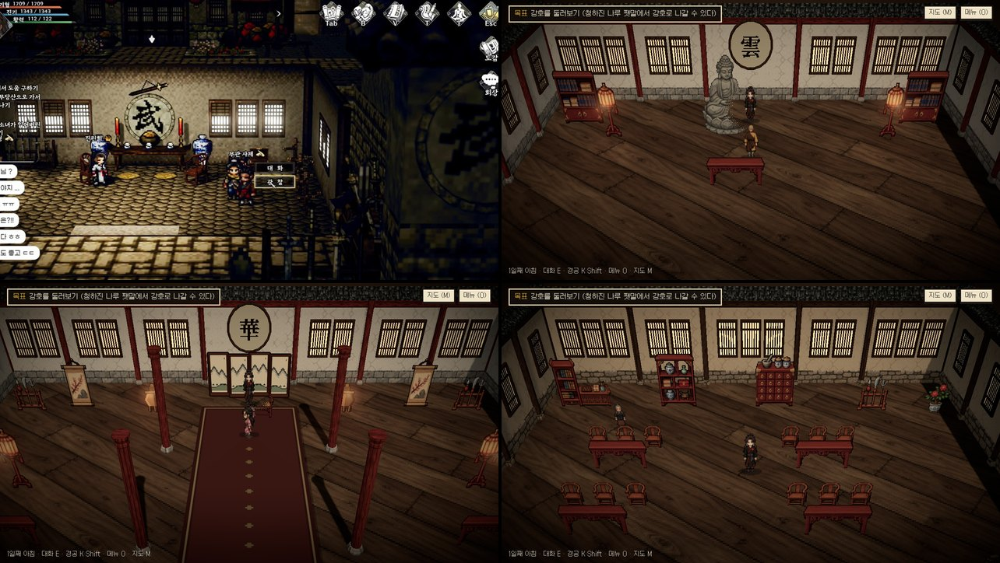
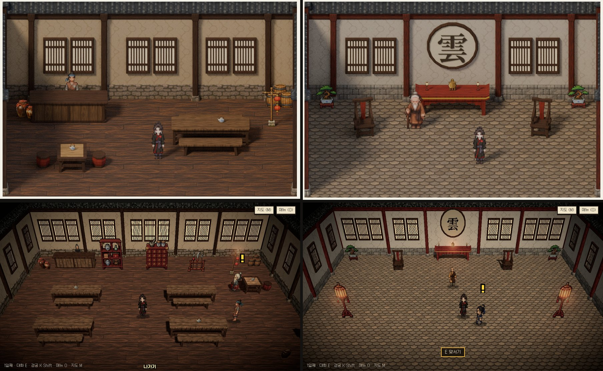
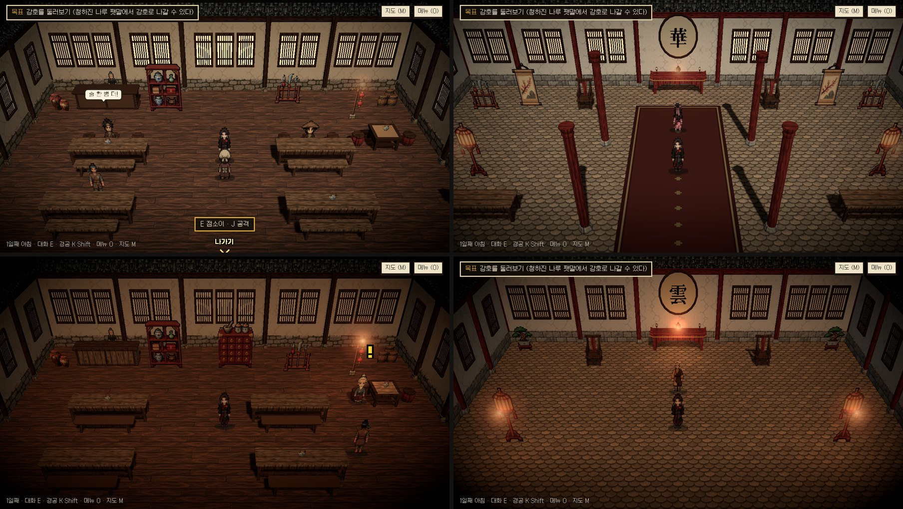
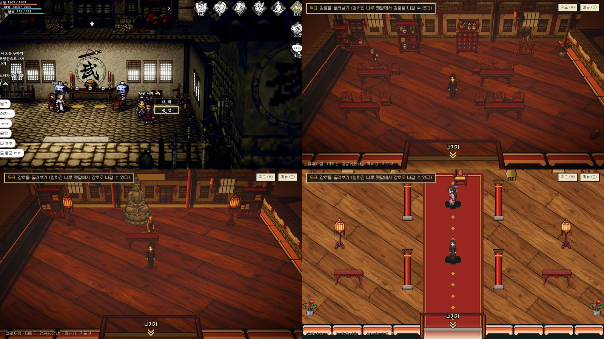

# 강호행 겉모습 정리 (2026-11-20)

**2026-11-21 덧붙임.** 주인 컴퓨터에서 일검풍운결을 직접 켜서 쟀다(`docs/ws-study.md`). 그 값으로 낮과 방의 빛을 고쳤고, ChatGPT 요청서를 처음부터 한 줄 차례표로 다시 썼다(`docs/gpt/index.md`). 카메라는 그 게임이 훨씬 낮지만(15°. 우리는 35°) 우리 지도에서는 낮추면 사람이 가려져서 방 안부터 낮추기로 했다.

주인이 "지금까지 기획한 것, 앞으로 할 것, 모자란 것, 손볼 것, 채울 것을 겉모습 중심으로 적어 달라"고 하셔서 쓴 문서다. 게임 속 장치(전투 셈, 이야기, 저장, 시험)는 Claude가 맡으므로 맨 끝에 한 묶음으로만 적었다. 일하는 차례와 끝난 기준은 `docs/checklist.md`에 있고, 이 문서는 그것을 겉모습만 골라 한눈에 보게 줄인 것이다. 숫자는 화면을 찍어서 잰 값이고, 셈으로 낸 것은 "셈으로는"이라고 적었다.

목표는 그대로다: **일검풍운결과 거의 같은 느낌, 그만한 완성도.** 자는 `docs/ref/`의 기준 그림 다섯 장이다.

---

## 1. 한눈에

| 무엇 | 기준 그림 | 지금 | 상태 |
|---|---|---|---|
| 사람 크기(화면 높이에 대한 키) | 마을 1/8.5, 방 1/7.7 | 마을 1/8.2, 방 1/7.2~8.1(서 있는 자리에 따라), 전투 1/8.0, 큰 지도 1/7.7 | 됨(방은 11-20 낮에 맞춤) |
| 땅의 기울기 | 바닥이 뒤로 눕는다 | 카메라 각도 그대로 눕혔다 | 됨(11-20) |
| 낮 빛깔 | 직접 잰 낮: 밝기 95~125, 올리브빛 50~80%, 주황 1~13% (전의 기준은 어두운 홍보 그림 한 장이었다) | **11-21에 고쳤다.** 밝기 87~128, 올리브빛 45~94%, 주황 3~34%. 전에는 밝기 50~73, 주황 75~93% | 됨(`docs/ws-study.md`) |
| 밤 빛깔 | 푸른빛 44% | 푸른빛 2%, 주황 73% | **손볼 것** |
| 건물 바깥 | 모형 | 집 모형 14가지, 문파마다 벽 그림 27벌 | 됨. 지붕 장식과 현판이 없다 |
| **건물 안의 벽** | 사람 키 2.7배의 벽, 창, 문양판, 옆벽 | **11-20 낮에 세웠다.** 방 537곳이 다 새 화면으로 뜨고, 사람 키 2.7배의 벽과 옆벽, 줄지은 살창, 본전의 문양판(문파 글자)이 선다. 조각은 ChatGPT가 블렌더로 만든 것(M1), 무늬는 임시다 | 됨. 벽 그림(`WL1` `WL2` `WL3`)이 오면 무늬를 바꿔 끼운다(2장) |
| 방 바닥 | 작은 돌을 깐 돌바닥 | **11-20 오후에 깔았다.** ChatGPT가 그린 바닥 여섯 가지(`FL1`)를 방 종류마다: 본전·사당은 비늘 돌바닥, 객잔·가게는 짙은 마루, 숙소·민가는 누런 마루, 서고·약방은 전돌, 초가는 돗자리, 관아·대장간은 판석. 비늘 하나가 사람 키의 4분의 1쯤 | 됨 |
| 방 살림 | 한 화면에 20개 넘게, 12가지 | 5~24개(대개 6~12개). 11-20 오후에 큰 가구 여덟 가지가 블렌더 조각으로 바뀌었고(M2), 달맞이 객잔과 창운문 본전, 만들어지는 객잔을 ChatGPT의 배치 예시대로 다시 짰다 | **채울 것**(나머지 방) |
| 땅의 높낮이 | 산길과 문파마다 단과 계단 | 바깥 지도 64곳 가운데 3곳 | **채울 것** |
| 바위와 산 | 덩어리 | 블렌더 모형 42개 | 됨(11-20) |
| 절벽 | 덩어리 | 블렌더 조각을 면을 따라 쌓는다 | 됨. 빛깔이 갈색 하나뿐 |
| 나무와 덤불 | 덩어리 | 그림 판을 세운 것 | **바꿀 것** |
| 물 | 잔물결 | 받아 둔 물 그림 셋 | 됨(11-20) |
| 문파 터 | 돌계단과 난간, 단마다 건물 | 평평한 벽돌 마당(33곳 모두) | **채울 것** |
| 고을 | 사람 예닐곱, 좌판, 짐 | 구화성 광장이 비어 있다 | **채울 것** |
| 먼 곳 | 먼 산, 안개, 하늘 | 지도 끝이 안개 띠로 빈다 | **채울 것** |
| 큰 지도(강호 전도) | — | 산은 모형. 땅 그림이 사람보다 3.2배 거칠다 | 손볼 것 |
| 사람 도트 | — | 새 도트 56명. 16가지는 비슷한 사람 그림으로 대신 | 그림 받는 중 |
| 대화 얼굴 | — | 화산귀환 인물 39명 얼굴이 없다 | 그림 받을 것 |
| 대화창 | 화면을 덜 가린다 | 전신 초상 둘이 화면 절반을 덮는다 | 손볼 것 |
| 전투 | 둘레가 차 있다 | 바닥이 한 무늬이고 화면 아래 절반이 빈 바닥. 검기 그림이 없다 | 손볼 것, 그림 받을 것 |
| 메뉴 | — | 글자 목록, 탭 열다섯 개가 한 줄 | 손볼 것 |

---

## 2. 건물 안 — 이번에 말씀하신 것

**11-20 낮에 한 것(아래 글은 하기 전에 쓴 계획이다).** 벽을 세웠고 모든 방이 새 화면으로 뜬다.

왼쪽 위가 기준 그림, 오른쪽 위가 창운문 본전, 왼쪽 아래가 화산파 연화전(전에는 옛 2D 화면으로 떴다), 오른쪽 아래가 달맞이 객잔이다. 방 종류마다 벽이 다르다: `shots/1120/room_kinds.jpg`. 밤: `shots/1120/room_night.jpg`.

**11-20 오후: 바닥과 가구, 객잔과 본전의 배치.** ChatGPT가 블렌더로 만든 큰 가구 여덟 가지(M2)와 바닥 무늬 여섯(`FL1`)을 받아 넣고, 함께 온 배치 예시대로 달맞이 객잔과 창운문 본전을 다시 짰다. 위 줄이 ChatGPT의 예시, 아래 줄이 지금 게임이다.

예시와 다른 점: 게임의 방이 더 넓어(18칸. 예시는 11칸쯤) 가구가 화면에서 작게 보이고, 달맞이 객잔은 이야기 때문에 긴 탁자 넷을 그대로 두었다. 가구의 나뭇결은 아직 임시 무늬다(`WL3`이 오면 바뀐다). 아래는 만들어지는 객잔과 본전(화산파 연화전), 밤의 두 방이다.

| "이렇게 바꾼다"의 번호 | 상태 |
|---|---|
| 1 모든 방을 새 화면으로 | **됨.** 537곳 전부 |
| 2 벽을 다시 세운다 | **됨(ChatGPT의 M1 조각).** 용마루까지 사람 키의 2.7배. 아랫단, 넓은 면, 들보, 기와 덮개, 기둥. 벽의 겉은 방 종류에 따라 여섯 가지 |
| 3 옆벽도 같은 높이로 | **됨** |
| 4 벽에 박고 거는 것 | **창과 문양판은 됨**(문양판에는 문파의 한 글자). 족자와 걸린 검은 남았다 |
| 5 방을 얕고 넓게 | **미룸.** 카메라를 기준 그림의 사람 크기에 맞추고 주인공을 화면 아래쪽에 세우니, 지금 깊이로도 방 가운데까지는 벽이 통째로 보인다. 문 앞에 서면 벽 위쪽 3분의 1이 잘린다 |
| 6 바닥 | **됨(11-20 오후).** 받은 바닥 그림(`FL1`) 여섯 가지를 방 종류마다 깔았다. 깔개는 그 위에 따로 얹는다 |
| 7 빛 | 임시로 맞췄다: 주황 91~94% → 61~64%, 밝기 65~72 → 46~48(기준 48). 거의 검정은 17%로 기준(48%)에 한참 못 미친다 |
| 8 벽 너머와 화면 앞 | 안 함 |
| 9 살림 채우기 | **시작(11-20 오후).** 큰 가구 여덟 가지(M2)가 조각으로 서고, 객잔과 창운문 본전을 예시대로 짰다. 가구 위에 찻주전자·촛대·향로를 얹는다. 나머지 방과 M3 가구(책장, 약장, 선반, 병풍…)가 남았다 |

**11-20 낮에 ChatGPT가 블렌더로 만든 벽 조각(M1)을 받아 넣었다.** 치수 검사를 다 통과했고, Claude의 임시 조각보다 주춧돌의 층, 기둥머리, 기와 덮개의 골, 모서리 기둥의 지붕이 낫다. 위 그림은 받은 조각으로 찍은 것이다. 무늬는 아직 **임시**다: 그림 요청서의 `WL1` `WL2` `WL3`이 오면 갈아 끼운다(파일 이름이 같아서 넣기만 하면 바뀐다).

왼쪽 위가 주신 기준 그림, 오른쪽 위가 달맞이 객잔, 왼쪽 아래가 창운문 본전, 오른쪽 아래가 화산파 연화전(옛 2D 화면으로 뜬다).

### Claude가 틀렸던 것

11-19에도 주신 그림이다. 그때는 "방을 꾸미라"는 뜻으로만 읽고 살림을 늘릴 계획만 세웠다. 벽은 체크리스트에 "이미 높고 괜찮다. 카메라가 바닥만 보고 있어서 안 보였을 뿐"이라고 적었다. 틀린 말이었다. 카메라를 고친 뒤에도 벽은 화면 맨 위의 얇은 띠이고, 방 대부분은 벽이 서 있지도 않다. 그림을 받고도 벽 높이를 재 보지 않은 탓이다.

### 기준 그림을 재 보면

| 무엇 | 기준 그림 | 지금 우리 방 |
|---|---|---|
| 뒷벽 높이 | 사람 키의 2.7배. 화면 높이의 35%를 차지한다 | 사람 키의 2배가 안 된다(1.8배). 방 가운데에 서면 화면에는 1~2할만 보이고 윗부분은 잘린다 |
| 벽의 자리 | 벽 밑동이 화면 가운데보다 조금 아래(위에서 59%) | 방 가운데에 서면 화면 맨 위(위에서 20%쯤) |
| 벽의 생김 | 거친 누런 회벽, 아랫단은 돌, 모서리에 짙은 나무 기둥, 위에 기와 | 집 **바깥** 벽 그림(창과 문이 그려진 것)을 옆으로 되풀이해 붙였다 |
| 창 | 세로로 긴 살창 다섯(폭이 사람 키의 0.65, 높이 1.0). 종이 뒤로 빛이 비친다 | 벽 그림에 그려진 창뿐 |
| 벽에 건 것 | 지름이 사람 키 1.4배인 둥근 문양판(武), 그 위에 걸린 검 | 없다. 족자도 바닥에 서 있다 |
| 옆벽 | 뒷벽과 같은 높이로 카메라 쪽까지 이어진다 | 사람 무릎 높이(0.55배)의 낮은 턱 |
| 벽 너머 | 뒤 건물의 지붕, 꽃밭, 등롱이 보인다 | 검은 빈 곳 |
| 방의 깊이 | 방 안 바닥이 사람 키의 3배쯤. 그 앞은 바깥 박석 | 걸어 다니는 바닥이 사람 키의 5~9배. 넓은 마루가 화면을 차지한다 |
| 바닥 | 작은 둥근 돌을 비늘처럼 깔았다(돌 하나가 사람 키의 4분의 1) | 붉은 마루 한 가지. 널 하나의 폭이 사람 키만 하다 |
| 살림 | 한 화면에 20개 넘게, 12가지(제단, 촛대 둘, 향로, 청화백자 둘, 의자 둘, 방석 둘, 병기 걸이, 수련 인형 …) | 방마다 5~24개(대개 6~12개), 2~10가지 |
| 빛깔 | 누런빛 34%, 거의 검정 48%, 주황 8% | 주황 90~97% |
| 새 화면으로 뜨는 방 | 전부 | 537곳 가운데 14곳. 문파와 고을의 방 468곳, 민가와 사당 54곳, 내 집은 들어가면 옛 2D 화면으로 바뀐다 |

기준 그림의 방은 **넓고 얕은 무대**다. 벽이 주인공이고 바닥은 그 앞의 좁은 띠다. 우리 방은 거꾸로 바닥이 주인공이다.

### 이렇게 바꾼다

1. **모든 방을 새 화면으로.** 방 크기와 종류에 맞춰 벽을 조립하게 해서 537곳이 다 새 화면으로 뜨게 한다.
2. **벽을 다시 세운다(블렌더).** 높이를 사람 키의 2.7배로. 아랫단(돌이나 판자) → 넓은 면(회벽, 판자, 벽돌, 흙벽, 짙은 돌) → 들보 → 기와. 모서리와 서너 칸마다 기둥.
3. **옆벽도 같은 높이로** 카메라 쪽까지 잇는다. 앞벽(카메라 쪽)은 세우지 않는다.
4. **벽에 박고 거는 것.** 세로로 긴 살창을 줄지어 박고, 뒷벽 가운데에 그 방의 얼굴을 건다: 본전은 문양판과 검, 서고는 책장 벽, 약방은 약장, 객잔은 술독 선반. 문양판의 글자는 게임이 문파마다 다르게 얹는다.
5. **방을 얕고 넓게 다시 짠다.** 걸어 다니는 깊이를 일곱 칸 안팎(본전과 관아는 아홉 칸)으로 줄이고 가로를 두세 칸 늘린다. 이 깊이면 어디에 서 있어도 벽이 밑동부터 기와까지 화면에 다 들어온다(셈으로는 벽이 화면 높이의 40%, 바닥이 43%. 만들어서 확인한다). 지금 깊이(대개 여덟~열두 칸)로는 남쪽에 서면 벽이 화면 밖으로 나간다. 방 스물여덟 가지(손으로 지은 것 14, 만들어지는 것 14)의 살림과 사람 자리를 다시 놓아야 하는 큰일이라, 본보기 한 곳(창운문 본전)부터 해서 보여 드린다.
6. **바닥.** 방 종류마다 다른 바닥을 사람 도트와 같은 굵기로 깐다: 본전은 큰 판석, 무관과 대장간은 돌바닥, 객잔과 살림집은 마루, 약방과 서고는 전돌, 초가는 돗자리.
7. **빛.** 방을 지금보다 어둡게 하고 창과 촛불 둘레만 밝힌다. 붉은 기를 뺀다(주황 40% 아래, 거의 검정 30~50%).
8. **벽 너머와 화면 앞.** 벽 뒤에 이웃 지붕과 나무를 흐리게 세우고, 화면 앞쪽에 어둡고 흐린 병기 걸이나 기둥을 건다. 사람을 가리지 않는 자리에만.
9. **살림 채우기.** 방마다 24개 이상, 12가지 이상.

### 여기에 필요한 그림 (ChatGPT에서 받아 주실 것)

요청서: https://dltkdwhdhkd-design.github.io/gangho/docs/chatgpt-scene.md — 이 주소를 새 대화에 그대로 주시면 된다. 문서 맨 위 "처음 하는 말"에 붙일 글이 있다.

| 차례 | 장 | 무엇 | 블렌더와 게임에서 |
|---|---|---|---|
| 1 | `WL1` | 방 벽 무늬 여섯(누런 회벽, 흰 회벽, 판자 벽, 벽돌, 흙벽, 짙은 돌) | 벽의 넓은 면에 입힌다 |
| 2 | `FL1` **받음(11-20)** | 방 바닥 무늬 여섯(비늘 돌바닥, 짙은 마루, 누런 마루, 전돌, 돗자리, 큰 판석) | 방바닥. 깔았다 |
| 3 | `WL2` | 벽 아랫단 셋과 들보 셋 | 벽 맨 아래와 맨 위의 띠 |
| 4 | `WL3` | 나무 무늬 여섯(짙은 나무, 붉은 칠, 생나무, 검은 칠, 대나무, 창호지) | 기둥, 문틀, 탁자와 선반 모형 |
| 5 | `IN8` | 창과 문 여섯 | 벽에 박는다. 밤에는 게임이 창을 밝힌다 |
| 6 | `IN1` | 벽 장식 여섯(둥근 문양판, 현판, 족자 둘, 주련, 걸린 검) | 벽에 건다 |

이 여섯 장이 오면 벽이 기준 그림의 결이 된다. **그림이 오기 전에도 벽은 세울 수 있다**: 모양(높이, 기둥, 옆벽, 창 자리)과 "모든 방을 새 화면으로"는 그림 없이 되는 일이라 먼저 하고, 겉무늬는 지금 있는 집 벽 그림에서 회벽과 돌 부분만 잘라 임시로 입혀 둔다. 그림이 오면 무늬만 갈아 끼운다.

### 블렌더로 만들 것 (방)

- 벽 조각: 한 칸짜리 벽(아랫단, 넓은 면, 들보, 기와 덮개가 한 몸), 모서리와 사이의 기둥, 벽 끝 마감. 창과 문, 벽 장식은 따로 벽에 박고 건다. 벽 종류 여섯 가지에 같은 조각을 무늬만 바꿔 쓴다. 게임이 방 크기에 맞춰 조립한다(절벽 조각을 면을 따라 쌓는 것과 같은 방법).
- 큰 가구: 탁자, 제단, 계산대, 책장, 약장, 선반, 침상, 병풍, 병기 걸이. 처음에는 지금처럼 그림을 세워 두고, 벽을 세운 뒤에 종이처럼 보이는 것부터 모형으로 바꾼다.
- 작은 살림(도자기, 촛대, 향로, 찻잔, 방석, 의자)은 그림 그대로 세운다. 사람 도트와 같은 방식이라 어색하지 않다.

---

## 3. 손볼 것 (있는데 어색한 것)

| 무엇 | 지금 | 어떻게 | 그림 |
|---|---|---|---|
| 낮 빛깔 | 어디서 찍어도 주황이 8~9할. 풀이 풀빛으로 안 보인다 | 아침 빛 설정에서 출발해 해를 높이고 그늘을 푸르게 | 필요 없음 |
| 밤 | 등불 빛이 온 화면을 데워 주황이다 | 등불 둘레만 주황, 나머지는 푸르게 | 필요 없음 |
| 하루의 빛 | 시계는 아침·낮·저녁·밤인데 빛은 낮과 밤 둘뿐 | 넷을 시계에 잇고 10초에 걸쳐 섞는다 | 필요 없음 |
| 방 바닥 | (11-20 오후에 고침) 붉은 마루 한 가지이고 널 하나가 사람만 했다 | 방 종류마다 다른 바닥을 사람 도트와 같은 굵기로 깔았다 | `FL1` 받음 |
| 절벽 무늬 | 가까이서 쌓은 돌담처럼 읽히는 데가 있다. 빛깔이 갈색 하나 | 무늬를 바꾸고 산마다 빛깔을 달리 | `HK4` |
| 낮은 땅 | 골짜기 땅은 어두운데 거기 선 나무와 사람은 밝다 | 같이 어둡게 | 필요 없음 |
| 남쪽 성벽 | 구화성 남쪽 성벽 가까이 서면 성벽이 화면 아래 절반을 덮는다 | 가까이 가면 걷어 내거나 낮춘다 | 필요 없음 |
| 지도 북쪽 끝 | 끝에 서면 화면 위 15~30%가 안개 띠로 빈다 | 먼 산과 하늘을 세운다 | 필요 없음(있는 그림) |
| 큰 지도 땅 | 땅 그림이 사람보다 3.2배 거칠다 | 사람과 같은 굵기로 다시 깐다 | 필요 없음 |
| 큰 지도 이름표 | 고을 들머리에 서면 이름표가 주인공 얼굴을 가린다 | 이름표를 위로 올리거나 가까우면 흐리게 | 필요 없음 |
| 넓은 흙마당 | 흑풍채 마당처럼 넓은 흙바닥에 수레 자국 줄무늬가 온통 깔린다 | 넓은 곳은 자국 없는 흙 무늬로 | 필요 없음 |
| 소품 크기 | 문짝, 독, 등롱, 울타리의 크기가 사람과 안 맞는 것이 섞여 있다 | 소품마다 "사람 키의 몇 배"를 뽑아 벗어난 것만 고친다 | 필요 없음 |
| 대화창 | 높이가 화면의 83%인 전신 초상 둘이 화면 절반을 덮는다 | 말하는 사람만 크게, 듣는 쪽은 작고 어둡게 | 필요 없음 |
| 선택지 | 운명이 갈리는 선택과 보통 선택이 같은 네모 단추 | 갈리는 선택에 표식, 붓글씨 띠 꼴로 | 필요 없음 |
| 메뉴 | 탭이 한 줄에 열다섯 개, 글자 목록뿐 | 여섯 묶음으로. 왼쪽에 주인공 그림, 물건에 아이콘 | 옷·신발 아이콘(요청문 아직 없음) |
| 전투 바닥 | 무대마다 한 무늬이고 화면 아래 절반이 빈 바닥 | 얼룩과 낙엽, 싸움판 밖 낮은 소품, 화면 앞 가림, 무대마다 불빛 하나 | 필요 없음 |
| 전투 몸짓 | 평타 세 번이 같은 몸짓 | 타마다 발과 기울기와 궤적을 달리, 맞으면 젖히고 쓰러지면 눕힌다 | 동작 칸(사람 요청서) |
| 옛 2D 방의 그림자 | 사람 발밑 그림자가 크고 까맣다 | 방을 새 화면으로 옮기면 없어진다(2장) | 필요 없음 |

---

## 4. 모자란 것, 채울 것 (아직 없는 것)

**땅과 지형**
- 높낮이가 있는 지도는 바깥 지도 64곳 가운데 3곳(청하진 나루, 동쪽 산길, 화산 절벽길)이다. 나머지 산길과 골짜기(대숲길, 청풍골, 월하곡, 비단길, 빙궁 설산, 천산 입구)가 평지다.
- 계단은 북쪽으로 오르는 것만 된다. 동·서·남쪽 계단, 난간과 울짱, 계단 옆 축대가 없다.
- 낭떠러지 아래의 안개, 아래쪽 나무 꼭대기, 폭포가 없다.
- 날씨(비, 눈, 안개)가 없다.

**나무와 풀**
- 나무와 덤불이 모두 그림 판이다. 바위 다음 차례로 블렌더 모형으로 바꾼다: 줄기와 가지는 모형, 잎은 잎 뭉치 그림을 가지에 여러 장 꽂는다. 먼저 지금 있는 나무 그림으로 시험해 보고, 모자라면 `TR1`, `TR2`를 받는다.

**문파 터**
- 만들어지는 문파 33곳과 창운산, 소림사가 모두 평평한 벽돌 마당이다. 기준 그림은 돌계단과 난간으로 단을 오르내리고, 아래 단의 지붕이 화면 앞에 걸린다.
- 필요한 것: 돌계단·난간·기단 조각(블렌더), 단을 넣은 문파 틀, 마당 바닥 여러 가지. 그림은 `HT1`(돌계단과 난간), `HT2`(돌바닥 무늬), `HT3`(소나무, 정원석, 석등).

**고을**
- 구화성 광장이 비어 있다(소품이 칸 100개에 2.6개. 청하진은 12.6개). 사람, 좌판, 수레, 짐, 깃발을 채운다. 받아 둔 좌판(`HP6`)과 배(`HP5`) 그림은 모형의 무늬로 쓴다.
- 강가 네 고을이 같은 배치다. 지붕 빛, 물길, 다리, 시장 자리를 고을마다 달리 준다.
- 건물 지붕의 장식과 현판이 없다(`HE1`). 문파 지붕 무늬도 한 벌 더 필요하다(`HR3`).

**지도마다 채울 것** (소품 가짓수. 기준은 한 지도에 25가지 이상)
- 가짓수가 열 가지 남짓인 곳: 대숲길 11, 동쪽 산길 11, 흑풍채 15, 화산 절벽길 9, 비단길 10, 빙궁 설산 7, 천산 입구 10, 흑운궁 11, 내 문파 9.
- 눈에 띄는 것(큰 나무, 탑, 다리, 폭포, 석상, 누각)이 지도마다 둘은 있어야 하는데 대부분 없다.

**사람**
- 대화 얼굴: 화산귀환 인물 39명(도트는 있다).
- 사람 도트: 동료와 히로인 6명, 운명이 갈리는 사람 11명, 이름 없는 적 10가지(지금은 옛 작은 도트), 청하진 사람들, 새 이야기 인물들. 열여섯 가지는 비슷한 다른 사람 그림으로 대신하고 있다.
- 동작 칸(준비, 내지름, 거둠, 맞음, 쓰러짐, 경공): 한 사람도 없다.

**전투 효과**
- 검기 9장, 화산 매화 10장이 없어서 코드로 그은 선과 점이다.

**그 밖**
- 방 안 살림 그림 7장(`IN2`~`IN7`, `IN9`), 산길에 놓는 것(`HK5`).
- 옷·신발 아이콘(머리, 상의, 하의, 신발 스물다섯 벌). 요청문을 아직 안 썼다.
- 이벤트 장면 그림(`docs/cg-list.md`)은 자리만 잡아 두었다.

---

## 5. 앞으로 할 차례 (겉모습)

"주인"은 ChatGPT에서 그림을 받아 주시는 일, "Claude"는 블렌더와 게임에 넣는 일이다. 그림을 기다리는 동안 Claude는 그림 없이 되는 것을 먼저 한다.

| 차례 | 무엇 | 주인 | Claude |
|---|---|---|---|
| 1 | **건물 안의 벽**(2장) | `WL1` `FL1` `WL2` `WL3` `IN8` `IN1`, 블렌더 조각 M1(`docs/chatgpt-blender.md`) | **벽 세우기와 모든 방을 새 화면으로는 됨(11-20).** 그림과 조각이 오면 갈아 끼운다 |
| 2 | 빛깔(낮, 밤, 하루의 빛, 방의 빛) | — | 숫자만 고치면 된다. 벽과 같이 한다 |
| 3 | 살림 채우기(방을 얕게 짜는 일은 미룸) | `IN2`~`IN7`, `IN9`, 블렌더 가구 M3(M2는 받음) | 본보기 둘(창운문 본전, 달맞이 객잔)은 ChatGPT의 배치 예시대로 짰다(11-20 오후). 다음 가구가 오는 대로 나머지 방에 펼친다 |
| 4 | 나무를 모형으로 | (시험 뒤) `TR1` `TR2` | 지금 나무 그림으로 먼저 시험 |
| 5 | 문파 터의 돌계단과 단 | `HT1` `HT2` `HT3` | 계단·난간 조각, 본보기는 창운산 |
| 6 | 나머지 산길과 골짜기의 높낮이 | `HK4` `HK5` | 대숲길, 청풍골부터 |
| 7 | 고을 채우기 | `HE1` `HR3` | 좌판·배 모형, 사람과 짐 |
| 8 | 전투 화면(무대 채우기, 몸짓, 효과) | 검기 9장, 매화 10장, 동작 칸 | 그림 없이 되는 것부터 |
| 9 | 대화창과 메뉴 | 화산귀환 얼굴 39장, 옷 아이콘 | 대화창부터 |
| 10 | 새 화면을 기본으로 | — | 위가 끝나면 주소에 `?hd2d=1`을 안 붙여도 새 화면이 뜨게 |

본보기를 먼저 만드는 까닭은 전과 같다. 한꺼번에 얕게 손대면 또 "대충"이 된다. 한 곳을 기준 그림만큼 만들어 보여 드리고, 그 품질을 자로 삼아 펼친다.

---

## 6. 받아 주실 그림 전부 (차례대로)

**2026-11-21: 받는 차례를 한 줄로 다시 세웠다.** 주소 하나로 시작한다: https://dltkdwhdhkd-design.github.io/gangho/docs/gpt/index.md (그 문서의 "처음 하는 말"을 ChatGPT에 붙이고 "다음"으로 이어 간다). 아래 표는 그 전의 정리다.

받는 차례와 문서 주소는 `docs/chatgpt-todo.md`에도 같은 내용이 있다. **문서 하나는 대화방 하나**에서 받는다(대화방이 바뀌면 그림체가 달라진다).

| 차례 | 묶음 | 장 수 | 문서 주소 |
|---|---|---|---|
| 1 | 방의 벽과 바닥: `WL1` `FL1` `WL2` `WL3` `IN8` `IN1` | 6 | https://dltkdwhdhkd-design.github.io/gangho/docs/chatgpt-scene.md |
| 2 | 방 안 살림: `IN2`~`IN7`, `IN9` | 7 | 같은 문서(이어서 "다음") |
| 3 | 문파 돌계단과 마당: `HT1` `HT2` `HT3` | 3 | 같은 문서 |
| 4 | 산길: `HK4` `HK5` | 2 | 같은 문서 |
| 5 | 나무: `TR1` `TR2` (Claude가 시험해 본 뒤) | 2 | 같은 문서 |
| 6 | 화산귀환 인물 얼굴 | 39 | https://dltkdwhdhkd-design.github.io/gangho/docs/chatgpt-fan.md |
| 7 | 검기 | 9 | https://dltkdwhdhkd-design.github.io/gangho/docs/chatgpt-swordfx.md |
| 8 | 화산 매화 | 10 | https://dltkdwhdhkd-design.github.io/gangho/docs/chatgpt-hwasan.md |
| 9 | 사람 도트와 일러스트, 동작 칸 | 사람마다 1~3 | https://dltkdwhdhkd-design.github.io/gangho/docs/chatgpt-people.md |
| 10 | 지붕 장식과 현판 `HE1`, 문파 지붕 무늬 `HR3` | 2 | https://dltkdwhdhkd-design.github.io/gangho/docs/chatgpt-now.md |

받은 그림은 파일 이름 그대로 저장소 `art-src/chatgpt/`에 올리시거나 Claude 대화에 붙이시면 된다.

---

## 7. 블렌더 모형 (된 것과 만들 것)

**11-20 덧붙임: 모형도 ChatGPT에게 맡긴다.** 요청서는 https://dltkdwhdhkd-design.github.io/gangho/docs/chatgpt-blender.md (새 대화에 주소를 주면 된다. 그림 대화방과는 따로). ChatGPT가 블렌더 스크립트를 써 주면 Claude가 돌려 모형으로 만들고 치수를 검사해 넣는다. 아래 "만들 것" 가운데 방 벽 조각, 큰 가구, 돌계단과 난간, 눈에 띄는 것, 배와 좌판이 그 요청서의 M1~M6이고, 나무는 한 그루만 시험한다(M7). 받기 전에는 Claude가 같은 규격의 임시 조각을 만들어 쓴다.

| 무엇 | 상태 |
|---|---|
| 집 14가지, 문파마다 벽 그림을 바꾼 27벌 | 됨 |
| 전투 무대 11곳 | 됨 |
| 바위, 바위 무더기, 바위산 셋(잿빛·눈·붉은 것), 벼랑바위, 절벽 조각: 42개 | 됨(11-20) |
| 방 벽 14곳(방마다 통째로 구운 것) | 조각으로 바꾸면서 지웠다(11-20). 동굴만 남았다 |
| 방 벽 조각 일곱(벽 한 칸, 사이기둥, 모서리 기둥, 두리기둥, 문지방 돌, 살창, 문양판) | 됨(11-20). ChatGPT가 만든 M1을 받아 넣었다(`art-src/blender/gangho_m1.py`) |
| 나무(소나무, 고목, 매화, 대나무, 덤불) | 만들 것 |
| 돌계단, 난간, 난간 끝 기둥, 축대, 건물 기단 | 만들 것 |
| 큰 가구(탁자, 제단, 계산대, 책장, 약장, 침상, 병풍, 병기 걸이) | 만들 것(종이처럼 보이는 것부터) |
| 나룻배, 돛단배, 좌판, 수레 | 만들 것 |
| 다리, 누각, 탑, 폭포 바위 같은 "눈에 띄는 것" | 만들 것 |

---

## 8. 지금까지 정해 둔 것 (겉모습의 틀)

- 화면: 비스듬히 내려다보는 원근 카메라(35도). 땅은 눕히고, 건물·바위·절벽·벽은 블렌더 모형, 사람과 작은 살림은 도트 그림을 세운다.
- 그림은 ChatGPT가, 입체 모형은 블렌더가 맡는다. Claude는 그림을 그리지 않는다. 그림이 없을 때는 있는 그림으로 임시 틀을 세워 두고, 그림이 오면 갈아 끼운다.
- 사람은 건물, 소품, 벽, 효과, 글자에 가려지면 안 된다. 주인공이 뒤로 가면 그 건물을 걷어 보인다. 높은 땅은 늘 북쪽에 둔다.
- 사람 키는 화면 높이의 1/8쯤. 해상도는 1920×1080, 컴퓨터만.
- 본보기 한 곳을 기준 그림만큼 만든 뒤에 나머지로 펼친다.
- 옛 2D 화면은 일부러 바꾸는 것 말고는 그대로 둔다.
- 2D 그림 판을 세워 어색한 큰 것(바위산, 절벽, 벽, 나무)은 모형으로 바꾼다(11-20 말씀).

---

## 9. Claude가 알아서 할 것 (게임 속 장치)

겉모습이 아니어서 여기에는 제목만 적는다. 자세한 것은 `docs/checklist.md`의 2단계, 5~7단계.

- 전투: 싸움판 크기 고르게, 새 화면 싸움판으로 보스 세기 다시 재기.
- 이야기: 얇은 부부터 분량 채우기(본편이 지금 6.6만 자, 목표 20만 자), 통독, 나머지 세 길.
- 소리: 효과음 늘리기, 곡 배치.
- 제품 꼴: 실제 컴퓨터 성능, 첫 화면, 저장 안내, 설치판.
- 시험: 값을 찍기만 하는 시험 23개에 통과 조건 달기.
