# 강호행 기획서 (2026-11-19): 지금 상태, 고칠 것, 나아갈 방향

목표는 한 줄이다. **일검풍운결(逸劍風雲決, Wandering Sword)과 거의 같은 느낌, 그만한 완성도.**

- 누가 읽나: 주인(무엇이 모자라고 어디로 가는지), Claude Opus 5.5(이 글과 `docs/checklist.md`를 보고 실제로 고치는 사람).
- 이 글의 강호행 숫자는 2026-11-19에 코드, 자동 시험, 찍은 그림으로 직접 센 것이다. 직접 확인하지 못한 것은 "확인 못 함"이라고 따로 적었다.
- 읽는 순서: 이 글(왜, 무엇) → `docs/checklist.md`(차례, 끝난 기준) → `docs/master-plan.md` 0장(약속, 시험, 코드 길잡이) → `docs/story-plan.md`(이야기) → `docs/chatgpt-todo.md`(받을 그림).
- **2026-11-19 오후에 고침.** 주인이 기준 그림 셋(높낮이 지형, 꾸민 방 안, 문파의 돌계단)을 더 주시며 "지금처럼 대충 하지 말라"고 하셨다. 2.1장을 새로 넣고 1·5·6·7·8장을 고쳤다.
- **2026-11-20에 고침.** 주인이 "가장 자연스럽게 땅을 진행해. 미뤄 둔 것은 써야 하면 당연히 써", "바위산도 입체적으로 모델링으로 만들어. 2D 그림을 세워 두니 위화감이 든다"고 하셨다. 땅 눕히기와 카메라를 기본값으로 넣었고, 바위·바위산·절벽을 블렌더 모형으로 바꿨고, 높낮이 지형의 첫 두 곳(동쪽 산길, 화산 절벽길)을 만들었다. 1장, 5.5장, 8장의 해당 줄을 고쳤다. 자세한 것은 `docs/checklist.md`의 1-가, 1-나와 "잰 기록".
- **2026-11-20 오전에 더 고침.** 주인이 방 안 기준 그림(`docs/ref/ws-interior.jpg`)을 다시 주시며 "건물 안에도 이렇게 벽을 세우라는 것"이라고 하셨다. 겉모습 전체를 주인이 보시게 줄인 글을 `docs/look.md`에 새로 썼고, 방의 벽을 블렌더 조각으로 다시 세우는 계획을 체크리스트 1-다(N1, N8, N11)에 넣었고, 요청서(`docs/chatgpt-scene.md`)에 벽과 바닥의 무늬 넉 장을 더했다. 게임 속 장치는 Claude가 맡기로 하셨다.
- **2026-11-20 낮에 더 고침.** 주인이 "ChatGPT에게 블렌더도 써서 만들게 하고 싶다", "ChatGPT는 블렌더와 연결할 수 있다"고 하셨다. 블렌더 모형 요청서(`docs/chatgpt-blender.md`)와 ChatGPT가 쓰는 틀, 받은 것을 검사해 넣는 도구를 만들었다. 같은 날 방의 벽을 조각으로 세워 방 537곳이 다 새 화면으로 뜨게 했다(조각과 무늬는 임시. `docs/look.md` 2장, `docs/checklist.md` N1·N8).
- `docs/review-2026-11.md`(11-17 검토)를 이어받았다. 그 뒤에 들어간 것(방 14곳, 큰 지도, 무대 모형, 경맥, 장비, 본편 첫 벌 채우기)을 넣어 다시 쟀다.

---

## 1. 한눈에

**끝까지 돌아간다.** 자동 시험 37개가 모두 끝까지 돌고, 네 길(정파·사파·마교·낭인)이 모두 결말까지 자동으로 진행되며, 그동안 오류가 없다. 다만 37개 가운데 값이 틀리면 실패로 끝나는 시험은 14개이고, 나머지는 장면을 끝까지 돌리며 값을 찍기만 한다(3.2장).

**일검풍운결과 가장 먼 다섯 가지** (하는 사람이 느끼는 순서)

1. **화면.** 여섯 가지가 겹쳐 있다.
   - ~~마을 카메라가 기준보다 1.5배 가깝다.~~ 11-20에 뒤로 뺐다(사람 키 1/5.4 → 1/8.2).
   - ~~땅이 눕지 않아서 바닥이 화면을 차지한다(2.1장).~~ 11-20에 진짜 비율로 눕혔다.
   - 광장·방·전투는 화면의 8~9할이 주황 한 빛이다(풀밭이 많은 곳은 5~6할).
   - **땅에 높낮이가 없다.** 바깥 지도 64곳 가운데 한 곳(청하진 나루)뿐이었다. 11-20에 동쪽 산길과 화산 절벽길을 바위 절벽과 돌계단이 있는 지형으로 만들어 세 곳이 되었다. 나머지 예순한 곳은 아직 평지다.
   - **방 안이 비어 있다.** 방 하나에 소품이 대개 6~12개다. 창운문 본전은 6개다.
   - **문파가 평평한 벽돌 마당이다.** 돌계단도 난간도 단도 없다.
2. **사람이 싸우는 동작 그림이 한 장도 없다.** 검기와 타격 그림도 아직 없다(코드로 그은 선과 점이다).
3. **본편이 약 6.6만 자다.** 낮춰 잡은 목표 20만 자의 3분의 1이고, 주인이 바란 "아홉 부, 한 부에 4~5시간"에는 어림으로 6분의 1쯤이다.
4. **대화창과 메뉴가 게임 화면보다 문서에 가깝다.**
5. **소리.** 공용 음악 20곡, 효과음 34개.

**앞서는 것은 그대로다.** 자유 강호(문파·전쟁·세월·내 문파), 갈림과 그 까닭을 메뉴에 남겨 보여 주는 것, 처음부터 한국어로 쓴 글, 자동 시험.

**이번에 같이 고친 것.** 강호 큰 지도 카메라. 11-18에 내가 마을 카메라를 당기면서 큰 지도까지 당겨 버려서 땅이 뭉개지고 좁게 보였다. 큰 지도만 예전 거리로 돌렸다(5장 A1).

**주인이 정할 것**은 8장에 일곱 가지다. 답이 없으면 거기 적은 "기본"대로 간다.

---

## 2. "일검풍운결의 결"을 숫자로

"같은 느낌"을 말로만 두면 손댈 때마다 흔들린다. 저장소에 있는 기준 그림 두 장(`docs/ref/wandering-sword-day.png`, `docs/ref/wandering-sword-night.png`)을 재서 자로 삼는다. 화면을 손댄 뒤에는 같은 자로 다시 잰다.

| 무엇 | 기준(일검풍운결) | 강호행 지금 | 판정 |
|---|---|---|---|
| 걸어 다닐 때 사람 키 | 화면 높이의 1/8.5 | 마을 1/5.4, 방 1/6.8, 큰 지도 1/7.5 | **마을이 1.5배 가깝다** |
| 싸울 때 사람 키 | 화면 높이의 1/10 | 1/8 | 비슷 |
| 걷다가 싸움으로 넘어갈 때 사람 크기 | 기준 그림 두 장으로 보면 거의 그대로(1.2배) | 마을에서 싸움으로 가면 1.45배 작아진다 | 어긋남 |
| 한 화면에 담기는 것 | 초가 한 채가 지붕까지(집 높이 = 사람의 3~4배), 그 둘레, 먼 산이나 바다 | 집이 문 높이까지만 보이고 지붕이 잘린다 | 좁다 |
| 땅이 눕는 정도 | 바닥이 깊이 쪽으로 눌려 보인다. 그래서 뒷벽, 뒤의 건물, 앞쪽 지붕이 화면에 들어온다 | 평면도의 한 칸이 화면에서도 거의 정사각형이다. 바닥이 화면을 차지한다 | **눕지 않는다** |
| 땅의 높낮이 | 바위 단, 돌계단, 축대, 낭떠러지 | 바깥 지도 64곳 가운데 한 곳(청하진 나루) | **없다** |
| 방 안 | 한 화면에 물건 스무 개 넘게, 열두 가지. 뒷벽이 화면의 3분의 1 | 방 하나에 대개 6~12개. 뒷벽이 잘린다 | **빈다** |
| 소품 크기(사람 키를 1로) | 상자 0.6, 독 0.35~0.65 | 11-18에 맞춤(독 0.47) | 맞음 |
| 낮 빛깔 | 주황 24%, 올리브 30%, 거의 검정 37% | 주황 90%, 올리브 3%, 거의 검정 5% | **한 빛** |
| 밤 빛깔 | 푸른빛 44%, 거의 검정 39% | 푸른빛 2%, 주황 73% | **밤이 푸르지 않다** |
| 하루의 빛 | 낮과 밤이 뚜렷이 다르다 | 시계는 아침·낮·저녁·밤 넷인데 빛은 낮과 밤 둘뿐 | 어긋남 |
| 깊이 | 앞(어둡고 흐린 덤불·울타리), 가운데(또렷한 사람), 뒤(흐린 산·하늘) 세 겹 | 앞가림과 흐림은 있다. 카메라가 가까워 뒤 겹이 거의 안 보인다 | 모자람 |
| 싸움터 둘레 | 소품 열 가지 이상, 땅 재질 서넛, 높낮이, 불빛 | 뒤 담과 건물은 있다. 바닥이 한 무늬이고 화면 아래 절반이 빈 바닥 | 빈다 |
| 도트 굵기 | 사람과 배경이 같은 굵기 | 마을과 전투 무대는 같다. 방 바닥과 큰 지도 땅은 사람보다 3.2배 거칠다 | 일부 어긋남 |
| 대화창 | 왼쪽 아래 작은 흉상(화면 높이의 28%)과 이름표, 아래 글 띠. 장면이 다 보인다 | 양쪽에 큰 전신 초상(화면 높이의 83%). 화면의 절반을 덮는다 | 다르다 |
| 사람 동작 | 걷기, 휘두르기, 맞기, 쓰러지기가 따로 있다 | 걷기만. 공격은 몸을 기울여 흉내 | **크게 모자람** |
| 소리 | 전용 음악 | 공용 음악 20곡 | 크게 모자람 |

- 기준 그림은 모두 다섯 장이다. 위 두 장에 더해 11-19 오후에 주인이 준 셋(`docs/ref/ws-terrain.jpg`, `ws-interior.jpg`, `ws-stairs.jpg`)이 있다. 그 셋은 2.1장에서 따로 견준다.
- 재는 법: 사람 키와 싸움판 크기는 `tools/dev/tour.cjs`가 장면마다 찍으면서 적어 준다. 지도마다 놓인 소품 수와 높낮이는 `tools/dev/mapstat.cjs`. 빛깔은 `python3 tools/tone.py <그림들>`이 기준 두 장과 나란히 찍어 준다.
- 견준 그림은 `docs/shots/1119/`에 있다. 이 장 끝에 붙였다.
- 기준 그림에서 읽은 것 말고 일검풍운결 평에서 되풀이되는 말: 깊이감과 넉넉한 불빛, 곳마다 다른 맛, 지역 사이를 돌아다니는 사람들, 세밀한 도트 동작. 불만으로는 메뉴가 어수선하다는 말이 있다(맨 아래 출처).

**"느낌"에 크게 걸리는 순서**(내 판단. 11-19 오후에 고침): ① 카메라 거리와 땅이 눕는 정도(한 화면에 무엇이 담기는가) ② 땅의 높낮이와 방 안 꾸밈, 문파 터(주인이 짚은 셋) ③ 빛깔과 하루의 빛 ④ 장면 사이의 고르기(방, 큰 지도, 전투) ⑤ 사람 동작 ⑥ 대화창과 메뉴 ⑦ 소리. ①~④는 그림을 새로 받지 않고도 코드와 블렌더, 있는 그림으로 시작할 수 있어서 맨 앞에 둔다.

**전투 방식은 일부러 다르다.** 일검풍운결은 칸 위에서 턴제와 실시간을 오가고, 강호행은 실시간 액션이다(주인이 정한 방향). 맞출 것은 방식이 아니라 "그 자리에서, 같은 크기로, 꽉 찬 화면에서 싸운다"는 보이는 쪽이다.

**견준 그림**

사람 크기: 왼쪽이 기준, 가운데가 지금 마을, 오른쪽이 카메라를 뒤로 뺀 것(8장 첫째)
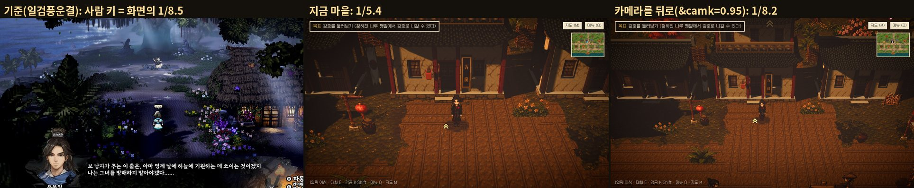

빛 설정 넷: 지금은 낮 내내 오른쪽 위 그림으로 보인다(8장 둘째)
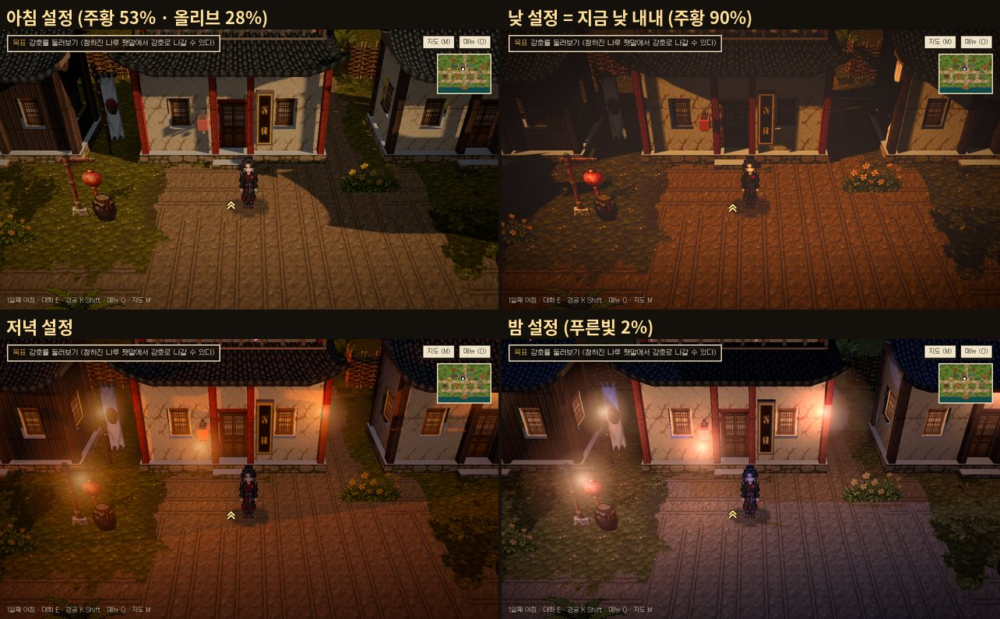

전투: 왼쪽이 기준
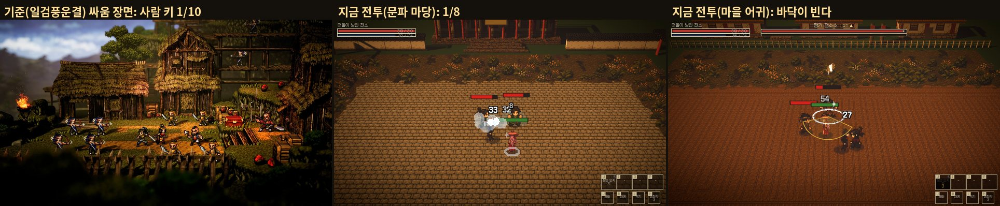

대화창: 왼쪽이 기준(8장 넷째)
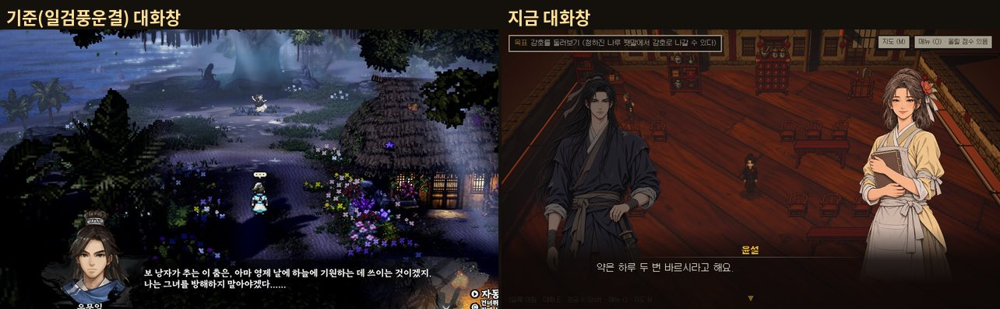

새 화면 주소에서도 옛 2D로 뜨는 방(오른쪽)
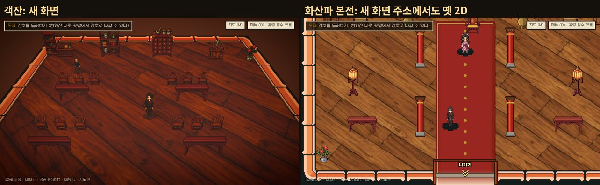

큰 지도: 고치기 전과 뒤
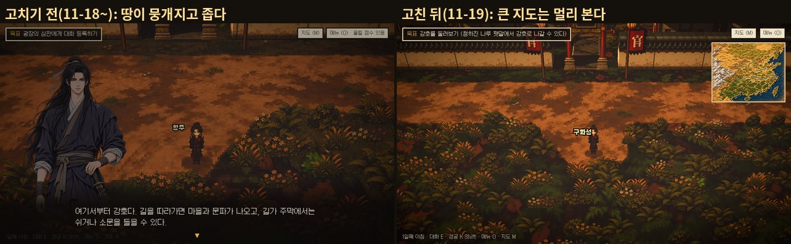

### 2.1 주인이 11-19 오후에 준 기준 그림 셋

"이런 지형도 해 놓아야 한다. 건물 내부는 이렇게 꾸미고, 문파 안 길은 이렇게 높낮이가 있어야 한다. 지금처럼 대충 하지 말 것."

| | 기준 그림 | 강호행 지금 | 할 일(체크리스트) |
|---|---|---|---|
| **지형** `docs/ref/ws-terrain.jpg` | 바위 단이 서너 겹으로 쌓여 있다. 한 단이 사람 키의 0.8~1.5배다. 길은 벼랑 허리를 따라가고 아래는 어둠과 안개로 꺼진다. 단마다 풀과 꽃, 죽은 나무. 비가 온다. 사람 키는 화면의 1/9.3 | 높낮이가 있는 지도는 바깥 지도 64곳 가운데 청하진 나루 한 곳이다. "화산 절벽길"은 풀밭에 길 한 줄이다(소품 49개, 9가지). 날씨가 없다 | 1-나(H1~H7) |
| **방 안** `ws-interior.jpg` | 뒷벽이 화면 높이의 3분의 1을 차지하고 거기에 둥근 문양판, 걸린 검, 창 다섯이 있다. 제단과 촛불, 향로, 청화백자 둘, 의자 둘, 방석, 병기 걸이, 수련 인형. 한 화면에 물건이 스무 개 넘게, 열두 가지쯤. 바닥은 두 가지 돌. 화면 앞에 어둡고 흐린 병기 걸이가 걸치고, 벽 너머로 바깥 뜰이 보인다 | 넓은 마루가 화면을 차지하고 뒷벽은 화면 위로 잘린다. 소품은 방 하나에 5~24개(대개 6~12개), 2~10가지다. 창운문 본전은 석상 하나, 등 둘, 탁자 하나, 책장 둘이 전부다. 방 전체가 붉은 한 빛이다(객잔에서 재면 주황 97%. 기준은 누런빛 34%, 거의 검정 48%, 주황 8%) | 1-다(N1~N10) |
| **문파 터** `ws-stairs.jpg` | 돌계단이 사람 키의 서너 배를 오르내린다. 계단과 단 가장자리에 조각한 돌난간. 계단 옆에 이끼 낀 바위와 소나무. 아래 단의 기와지붕이 화면 앞에 흐리게 걸친다. 골짜기에 안개. 사람 키는 화면의 1/10.5 | 문파 서른세 곳과 창운산, 소림사가 모두 평지다. 마당 한가운데 서면 화면이 벽돌 바닥뿐이다 | 1-라(M1~M6) |

확인해 보니 이렇다.

- **높낮이를 다루는 틀은 이미 있다.** 지도에 단을 정하고 계단 칸을 놓으면 새 화면이 땅을 들어 올리고 축대를 세우고, 사람과 소품과 건물을 그 높이에 세운다. 다만 딱 한 곳(청하진 나루)에만 썼고, 계단은 매끈한 비탈이고, 축대는 어디서나 같은 돌무늬다. 오늘 창운산에 단 셋과 계단 둘을 시험 삼아 얹어 보니 오류 없이 섰다. 그러니 "못 하는 것"이 아니라 "안 해 놓은 것"이다.
- **방 벽은 이미 높게 지어져 있다**(사람 키의 두 배쯤이고 창살과 기둥, 들보가 있다. 기준 그림은 2.4배쯤). 카메라가 바닥만 내려다봐서 안 보였다.
- **화면이 다른 큰 까닭 하나를 새로 찾았다: 땅이 눕지 않는다.** 지금은 평면도의 한 칸이 화면에서도 거의 정사각형으로 보인다. 위에서 내려다본 지도처럼 바닥이 넓게 깔려서 마당도 방도 전투도 바닥이 화면을 차지한다. 기준 그림은 바닥이 깊이 쪽으로 눌려 있고, 그만큼 뒷벽과 건물, 먼 산, 앞쪽 지붕이 화면에 들어온다. 숫자 하나로 눕힐 수 있고, 주소로 미리 보게 해 두었다.
- 받아 둔 절벽 그림(HK3: 절벽 앞면, 모서리, 바위 계단, 이끼 바위)이 있다. "입혀"라고 하실 때까지 미뤄 둔 것이다.
- 방 안 소품과 돌계단·난간 그림은 모자란다. 요청서를 새로 썼다(`docs/chatgpt-scene.md`, 14장).
- **있는 그림만으로 창운문 본전을 채워 봤다**(실행 중에 얹어서 찍은 밑그림이다. 게임에는 넣지 않았다). 소품이 6개에서 35개로, 4가지에서 17가지로 늘었고, 새 그림 없이도 빈 마루가 본전처럼 보인다. 다만 빛깔은 그대로다(주황 87% → 86%). 소품만 채워서는 안 되고 바닥과 불빛을 같이 손봐야 기준(주황 8%, 거의 검정 48%)에 가까워진다.
- **화산 절벽길에 단만 얹어 봤다.** 틀은 선다. 그런데 축대 면이 회색 자갈 띠로만 보여서 절벽이 아니라 계단식 밭처럼 읽힌다. 절벽 면 그림, 들쭉날쭉한 가장자리, 낭떠러지 아래의 어둠과 안개가 있어야 절벽이 된다(H1~H3).

**카메라를 빼고, 땅을 눕히고, 아침 빛으로 바꾼 것**(그림도 모형도 손대지 않았다). 위가 청하진, 아래가 창운산 산문이다. 주소로 직접 보려면 https://dltkdwhdhkd-design.github.io/gangho/?hd2d=1&camk=0.95&gk=0.6&time=morning
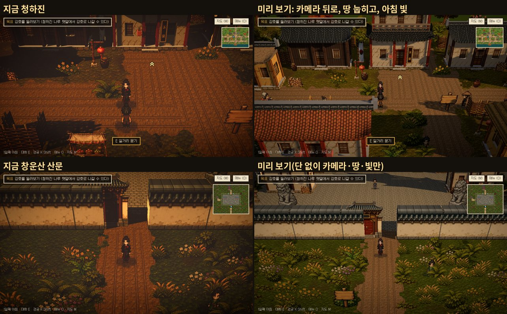

지형: 왼쪽이 기준, 가운데가 지금, 오른쪽은 카메라·땅·빛만 바꾼 것(보기는 좋아지지만 여전히 평지다)
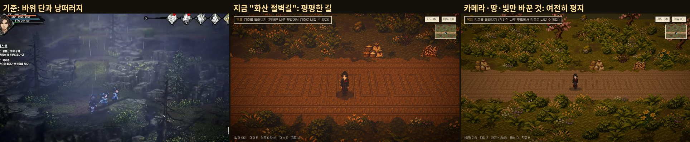

방 안: 왼쪽이 기준, 가운데가 지금, 오른쪽은 카메라·땅·빛만 바꾼 것(뒷벽이 보이지만 비어 있다)
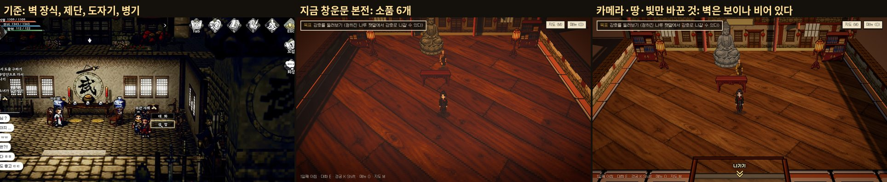

문파 터: 왼쪽이 기준, 가운데가 지금, 오른쪽은 시험 삼아 단을 올리고 카메라·땅·빛을 바꾼 것
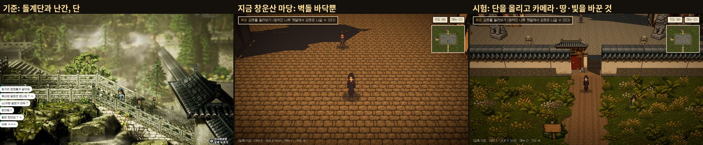

본보기 방 밑그림: 왼쪽이 기준, 가운데가 지금, 오른쪽이 있는 그림만 놓아 본 것(땅 눕힌 값으로 찍음)
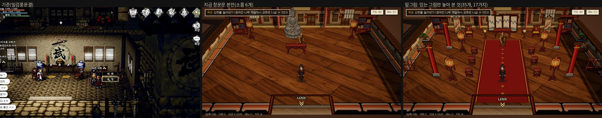

절벽길: 왼쪽이 기준, 가운데가 지금, 오른쪽이 지금 틀로 단만 얹어 본 것
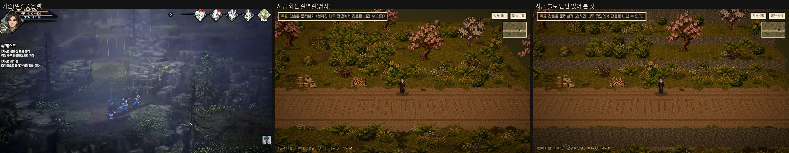

지금 방 아홉 곳(창운문 본전, 장서각, 대장간 / 약방, 만물상, 복운전 / 정천맹 객관, 객잔, 장경각)
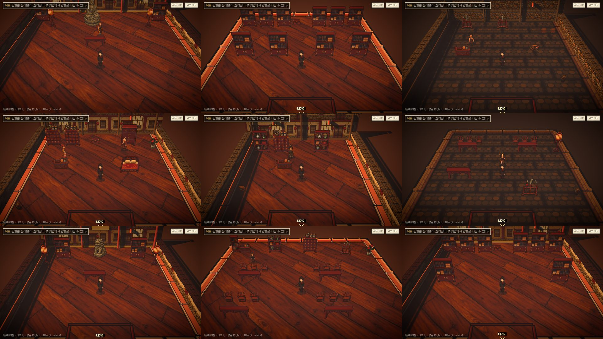

땅이 눌리는 정도 셋
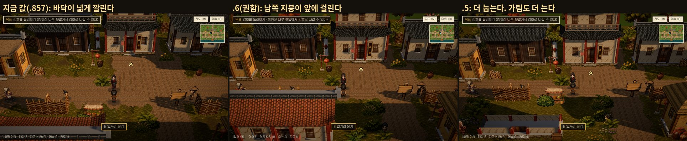

전투와 큰 지도도 같은 값으로 찍은 것
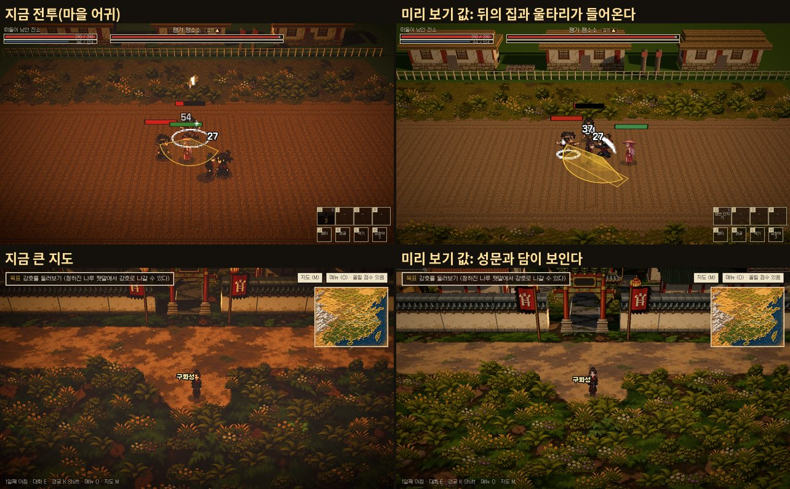

**이 셋을 만드는 방법: 본보기부터.** 지도 여든 곳에 한꺼번에 얕게 손대면 또 "대충"이 된다. 기준 그림 셋과 하나씩 짝이 맞는 세 곳(화산 절벽길, 창운문 본전, 창운산)을 기준 그림만큼 끝까지 만들고, 기준 그림과 나란히 붙여 주인께 보인 뒤에, 같은 기준으로 나머지에 펼친다. 펼칠 때는 처음 하는 사람이 가장 먼저 보는 1부의 곳(달맞이 객잔, 대숲길, 동쪽 산길, 흑풍채)부터 한다. 한 장이 채워야 할 것은 체크리스트 1단계의 "지도 한 장의 기준" 표에 숫자로 적었다(높낮이 세 단, 눈에 띄는 것 둘, 소품 25가지, 방은 24개·12가지 …).

---

## 3. 지금 상태

### 3.1 규모

| 무엇 | 숫자 |
|---|---|
| 코드 | `js/` 84개 파일, 약 1만 6천 줄. 올린 횟수 140여 번 |
| 자동 시험 | `tools/*_test.cjs` 37개(오늘 `branch_test.cjs` 추가) + 끝까지 자동 진행(`playthrough.cjs`) |
| 지도 | 78곳(바깥 64, 방 14)과 걸어 다니는 큰 지도. 78곳 모두 새 화면으로 뜬다. 문파·고을 안 방과 민가는 들어갈 때 만들어지는데 이쪽은 옛 2D다. 높낮이가 있는 지도는 한 곳(청하진 나루) |
| 블렌더 모형 | 67개: 건물 41, 방 14, 전투 무대 11, 대웅전 1 |
| 그림 | 대화 일러스트 104장, 사람 도트 시트 54명(화산귀환 39명 포함), 받아 둔 ChatGPT 원본 136장 |
| 없는 그림 | 사람 동작 칸 0장, 검기·타격 그림 0장(`assets/fx2/fx.json`이 비어 있다), 화산귀환 인물 얼굴 39장 |
| 소리 | 음악 20곡, 효과음 34개 |
| 글 | 대사·지문·선택지 약 9.6만 자. 그중 본편 6.6만, 인연·곁가지 1.1만, 자유 강호 1.9만 |
| 싸움 | 이야기에서 부르는 싸움 167군데 |
| 크기 | 게임이 읽는 것 57MB. 저장소에 올라가는 것 381MB(그림 원본 295MB 포함) |
| 설치판 | `desktop/`에 Electron 껍데기와 자동 빌드 틀이 있다. 한 번도 내 본 적은 없다(태그 0개) |

### 3.2 시험 (2026-11-19)

- 오늘 손댄 것을 다 넣은 뒤에 `*_test.cjs` 37개와 끝까지 자동 진행을 처음부터 다시 돌렸고 모두 끝 값 0으로 끝났다.
- **"통과"가 37개 모두에 같은 뜻은 아니다**(11-19 오후에 시험 파일을 다 훑어서 알았다). 오전에는 끝 값만 보고 "모두 통과"라고 적었다.
  - 값이 틀리면 실패로 끝나는 시험: 오전까지 9개(`branch`, `fan`, `part2c`, `part3a`, `part6a`, `battle3d`, `fate`, `meridian`, `realm`). 오후에 다섯을 고쳐 14개가 되었다(`world`, `edge`, `door`, `reach`, `door_loop`).
  - 나머지 23개는 장면을 끝까지 돌리며 값을 찍기만 한다. 도는 중에 터지면 실패하지만, 찍힌 값이 틀려도 실패하지 않는다. 값이 맞는지는 기록을 읽어야 안다.
  - 그래서 마지막으로 다 돌린 기록 38개를 오류 낱말로 훑고, 찍기만 하는 시험의 기록을 읽어 봤다. 문제로 보이는 줄은 셋이었고 셋 다 따라가 보니 게임이 아니라 시험 쪽 문제였다(5.4장). 셋 다 시험을 고쳤다. 찍힌 값 하나하나가 맞는지까지 가린 것은 아니다.
  - 시험을 한꺼번에 돌리는 스크립트(`tools/dev/run_tests.sh`)도 고쳤다. 끝 값이 0이어도 기록에 오류 줄이 있으면 실패로 적는다.
  - 남은 일: 찍기만 하는 23개에 통과 조건 달기(체크리스트 Q7).
- 끝까지 자동 진행: 정파(결말 `jeong_burn`, 레벨 40), 사파(`sa_vice`), 마교(`ma_awake`), 낭인(`end`) 모두 끝. 갈림의 둘째 보기로 돈 정파(`jeong_clan`), 사파(`sa_lord`)도 끝. 오류 0.
- 새로 넣은 장면의 둘째 보기 일곱 군데(`tools/branch_test.cjs`) 통과.
- 둘러보기(`tools/dev/tour.cjs`) 동안 못 읽은 파일 0, 콘솔 오류 0.
- 자동 진행은 옛 2D 화면으로 그리면서 돈다. 오늘 싸움판만 새 화면 크기로 좁혀서(`HDB=1`) 정파 길을 끝까지 돌렸고 통과했다. 새 화면 그리기까지 켠 채로 끝까지 돌려 본 적은 없다(시험 환경에서는 너무 느리다).

### 3.3 화면별 상태

| 장면 | 새 화면인가 | 사람 키 | 도트 굵기(사람과 견줘) | 빛깔 | 한 줄 평 |
|---|---|---|---|---|---|
| 마을·문파 바깥 64곳 | 예 | 1/5.4 | 같다 | 광장은 주황 90~93%. 풀밭이 많은 청풍골은 주황 51%, 올리브 32% | 급은 가깝다. 가깝고, 어둡고, 한 빛 |
| 고정 방 14곳(객잔, 약방, 대장간 …) | 예 | 1/6.8 | 바닥이 3.2배 거칠다 | 주황 97% | 벽 모형은 좋다. 온통 붉다 |
| 문파·고을 안 방(`r_…`), 민가(`h_…`), 내 집 | **아니오(옛 2D)** | — | — | 밝고 납작 | 들어가는 순간 다른 게임이 된다 |
| 강호 큰 지도 | 예 | 1/7.5 | 땅이 3.2배 거칠다 | 주황 60%, 올리브 30% | 오늘 카메라를 되돌렸다. 고을 이름표가 주인공 얼굴을 가린다 |
| 전투 무대 11곳 | 예 | 1/8 | 같다 | 주황 79~87% | 뒤 배경은 생겼다. 바닥이 빈다 |
| 대화 | — | 초상 높이 596점(화면의 83%) 둘 | — | — | 그림은 좋다. 장면을 덮는다 |
| 메뉴 | — | — | — | — | 탭 15개, 양피지 판에 글. 아이콘이 거의 없다 |

주소에 `?hd2d=1`을 붙이지 않으면 이 모든 것이 꺼지고 옛 2D로 뜬다. 설치판도 그냥 열기 때문에 옛 2D다.

### 3.4 본편 분량

글자 수는 `python3 tools/count_text.py`가 센 것이다(대사·지문·선택지, 공백 빼고). 목표는 `docs/story-plan.md`가 낮춰 잡은 "한 장 4천~5천 자"로 계산했다.

| 부 | 지금 | 목표 | 채운 정도 |
|---|---|---|---|
| 1부 객잔의 낭인 | 1.3만 | 2.25만 | 6할 |
| 2부 구름 위의 칼 | 0.9만 | 2.25만 | 4할 |
| 3부 강호 유람 | 0.7만 | 2.25만 | 3할 |
| 4~5부 전쟁(열 장. 다른 길의 장 일부가 섞여 세어졌다) | 1.5만 | 4.5만 | 3할 |
| 6부 달이 진 골짜기 | 0.3만 | 2.25만 | **1할 반** |
| 7부 붉은 달 | 0.7만 | 2.25만 | 3할 |
| 8부 서역의 달 | 0.4만 | 2.25만 | **2할** |
| 9부 낙월 | 0.46만 | 2.25만 | **2할** |
| 본편 합계 | **6.6만** | **20만** | **3분의 1** |

- 뼈대와 복선은 끝까지 깔렸다(`docs/story-plan.md` 1~6단계 첫 벌). 모자란 것은 장마다 붙어야 할 살이다: 일상 장면, 길 위의 싸움, 싸운 뒤의 밥자리.
- 걸리는 시간은 재지 못했다. 어림으로 본편 6~8시간이다. 주인이 바란 것은 36~45시간, 일검풍운결은 내놓을 때 만든 곳이 말한 것이 1회차 약 25시간(이용자 평을 모은 쪽은 약 40시간)이다.
- 사파·낭인·마교 길은 4~5부에서 갈라지는 장이 아직 압축판이다.

### 3.5 보스 세기 (옛 2D 싸움판, 금창약 3개, 다섯 판씩)

"서툰 봇"은 늦게 피하고 한 번 때리면 쉬는 봇, "보통 봇"은 빨리 피하고 쉬지 않는 봇이다. 괄호는 11-17에 맞춰 둔 값(열 판).

| 보스 | 레벨 | 서툰 봇 | 남은 체력 | 보통 봇 |
|---|---|---|---|---|
| 낭리비어 위충 | 6 | 5/5 (10/10) | 51% (46%) | 5/5 |
| 광사자 맹호 | 7 | 5/5 (10/10) | 40% (47%) | 5/5 |
| 검각주 위문상 | 12 (11) | **5/5 (6/10)** | **52% (11%)** | 5/5 |
| 결승 소연하 | 16 (15) | 4/5 (10/10) | 60% (44%) | 5/5 |
| 녹림 총채주 구양철 | 24 (22) | 5/5 (7/10) | 22% (33%) | 5/5 |
| 패천도 사마웅 | 25 (23) | 5/5 (10/10) | **60% (36%)** | 5/5 |
| 혈안귀 | 25 (23) | 5/5 (8/10) | 34% (37%) | 5/5 |
| 정천맹주 연경추 | 26 (24) | 5/5 (9/10) | 46% (46%) | 5/5 |
| 혈마 | 30 (28) | 4/5 (5/10) | 25% (6%) | 5/5 |
| 빙마 | 32 (31) | 5/5 (10/10) | 56% (59%) | 5/5 |
| 귀마 | 34 (32) | 4/5 (10/10) | 29% (50%) | 5/5 |
| 심마 연경추 | 36 (34) | 4/5 (7/10) | 44% (21%) | 5/5 |
| 천마 혁련무극 | 40 (39) | 2~3/5 (6/10) | 10% (15%) | 1~3/5 |

- 본편에 싸움 장면을 더 넣으면서 보스를 만날 때의 레벨이 1~2씩 올랐다. 위문상, 사마웅, 혈마, 심마는 쉬워진 쪽이고, 귀마와 결승 소연하는 오히려 한 판씩 더 졌다. 다섯 판이라 한두 판은 오차다. 뚜렷하게 벗어난 것은 위문상과 사마웅이다.
- 끝판 천마 혁련무극은 보통 봇도 흔들린다(옛 싸움판에서 1/5와 3/5, 새 화면 싸움판에서 4/5). 서툰 봇은 1~3/5다. 끝판이라 어려운 것은 맞지만 진행이 막히지 않는지 열 판으로 다시 봐야 한다.
- 새로 넣은 싸움: 당철(동료와 함께) 5/5, 당철(혼자 막는 갈림) 서툰 봇 7/10·보통 봇 10/10, 비단옷 사내 5/5, 만화부인(버티기) 4/5.
- **이 표는 옛 2D 싸움판(가로 364, 세로 206) 기준이다.** 새 화면은 무대 가운데 바닥 안에서만 싸우게 좁혀 놓아서 싸움판이 더 작다: 마을 어귀 364×98, 숲 224×130, 문파 마당 272×130, 사막 256×130, 달밤 256×162, 뒷마당·비무대 304×162, 산채 336×178, 나루 364×146, 실내·설원은 그대로.
- **새 화면 싸움판으로도 오늘 한 번 쟀다**(`HDB=1`, 다섯 판씩). 전체로는 비슷하다: 서툰 봇이 옛 싸움판 295판에 272승, 새 화면 싸움판 285판에 268승. 다만 뒤쪽의 귀마와 심마 연경추가 3/5에 남은 체력 4%로 더 빡빡하게 나왔다(옛 싸움판은 4/5에 29%, 44%). 다섯 판이라 잘라 말할 수는 없다. 보스별 값은 `docs/checklist.md` 맨 아래에 있다.

---

## 4. 일검풍운결과 견주기 (11-17 표를 오늘로 고침)

일검풍운결에 대한 내용은 11-17에 찾아본 것을 오늘 평 몇 편으로 다시 맞춰 본 것이다.

| 항목 | 일검풍운결 | 강호행 지금 | 판정 | 11-17 뒤 달라진 것 |
|---|---|---|---|---|
| 바깥 마을 | 3D 배경에 도트 인물, 깊이와 불빛 | 새 화면, 블렌더 건물 41, 낮밤, 등불 | 가까움. 카메라와 빛깔이 어긋남 | 크기 비율 맞춤(11-18) |
| 방 안 | 3D 실내 | 고정 방 14곳은 새 화면, 나머지는 옛 2D | 뒤짐 | 14곳 새 화면 |
| 큰 지도 | 감탄을 듣는 3D 큰 지도 | 새 화면으로 걸어 다님. 땅 도트가 거칠다 | 뒤짐 | 새 화면이 됨 |
| 전투 무대 | 그 자리의 3D 장면 | 블렌더 무대 11곳. 바닥이 비고 여럿이 비슷한 흙빛 | 뒤짐 | 뒤 배경 모형 |
| 사람 동작 | 전용 동작 | 걷기뿐 | **크게 뒤짐** | 없음(그림 대기) |
| 이름 없는 적 | 인물과 같은 급 | 옛 16점 도트 | 뒤짐 | 없음(그림 대기) |
| 그림 통일감 | 한 화풍 | 공용 도트, ChatGPT 그림, 블렌더 모형이 섞임. 새 도트가 없는 11종은 비슷한 사람 그림으로 대신 | 뒤짐 | 대신 그림으로 크기는 맞춤 |
| 초식 연출 | 초식마다 전용 | 틀 스무 가지쯤에 문파별 색. 코드로 그은 초승달·찌르기·별 | 뒤짐 | 코드 검기 추가(11-18) |
| 전투 방식 | 칸 전술, 턴제와 실시간 전환 | 실시간 액션 | 일부러 다름 | — |
| 성장 | 경맥, 고수를 이겨 무공 얻기 | 경맥 판(여덟 맥과 임독), 고수를 비무로 이기면 전수, 장비 등급 여섯과 옷 칸 넷 | 가까움 | 경맥·전수·장비 들어감 |
| 본편 | 1회차 25~40시간 | 6.6만 자, 6~8시간 어림 | **크게 뒤짐** | 5.5만에서 늘어남 |
| 갈림과 결말 | 결말 20, 생사 갈림 | 결말 12+1, 인연의 실 15명 | 가까움 | — |
| 갈림 안내 | 없다는 불만 | 목표 글, 느낌표, 메뉴에 까닭이 남음 | **앞섬** | — |
| 동료 | 14명 | 19명 | 가까움 | — |
| 지역 | 5개 지역 75곳 이상, 곳마다 다른 맛 | 78곳. 고을 여럿이 같은 틀이다 | 수는 비슷, 맛은 뒤짐 | — |
| 살아 있는 강호 | 돌아다니는 NPC | 자유 강호: 문파 20, 전쟁, 사건, 세월, 내 문파, 집 | **앞섬** | — |
| 대화창·메뉴 | 작은 흉상과 글 띠. 메뉴는 어수선하다는 평 | 큰 초상, 탭 15개의 글 판 | 뒤짐 | — |
| 소리 | 전용 음악 | 공용 음악 20곡, 효과음 34 | **크게 뒤짐** | — |
| 한국어 | 스팀판 없음(콘솔판부터) | 처음부터 한국어 | **앞섬** | — |
| 제품 꼴 | 설치해서 하는 게임 | 주소로 연다. 새 화면은 주소에 덧붙여야 켜진다 | 뒤짐 | 화질 옵션이 설정 탭으로 |

어림 점수(일검풍운결을 100으로, 내 판단. 괄호는 11-17): 바깥 화면 75(80, 오늘 기준 그림으로 재 보니 카메라와 빛깔이 더 멀었다) / 화면 전체의 고르기 55(45) / 전투 연출 50(45) / 본편 분량 20(15) / 성장 85(—) / 갈림·결말 90(90) / 살아 있는 강호 120(120) / 소리 30(30) / 다듬기·제품 꼴 45(40).

---

## 5. 문제 목록

### 5.1 확인된 것 (재현하거나 재서 본 것)

| 번호 | 무엇 | 어떻게 확인했나 | 체크리스트 |
|---|---|---|---|
| A1 | **(고침)** 큰 지도 카메라가 마을 값으로 당겨져 땅이 뭉개지고 좁게 보였다. 11-18에 내가 만든 것 | 고치기 전과 뒤를 찍어 견줌(`world.jpg`), 새 화면 시험 여섯 통과 | S1 |
| A2 | 마을 카메라가 기준보다 1.5배 가깝다(사람 키 1/5.4, 기준 1/8.5) | 찍은 그림에서 머리끝과 발끝을 잼 | S2 |
| A3 | 장면마다 사람 크기가 다르다(마을 1/5.4, 방 1/6.8, 큰 지도 1/7.5, 전투 1/8) | `tour.cjs` | S2, S4 |
| A4 | 낮 화면이 주황 한 빛이다(광장 90%, 방 97%, 전투 79~87%). 기준은 주황 24%, 올리브 30% | `tone.py` | S6 |
| A5 | 밤이 푸르지 않다(푸른빛 2%, 기준 44%) | `tone.py` | S7 |
| A6 | 시계의 아침·낮·저녁이 화면 빛에 안 이어져 있다. 빛은 낮과 밤 둘만 쓴다. 아침·저녁 빛 설정은 만들어져 있는데 자동으로는 안 쓰인다 | `js/hd2d.js` `timeOf0`, `js/free.js` `period` | S5 |
| A7 | 문파·고을 안 방, 민가, 내 집이 새 화면 주소에서도 옛 2D로 뜬다 | 화산파 본전에 들어가 찍음(`room2d.jpg`) | N8 |
| A8 | 방 바닥과 큰 지도 땅의 도트가 사람보다 3.2배 거칠다 | 찍은 그림을 확대해 견줌, 코드(`groundArt`가 방과 큰 지도를 거른다) | N5, S8 |
| A9 | 큰 지도에서 고을 이름표가 그 앞에 선 주인공 얼굴을 가린다 | 큰 지도 그림 세 장 모두 | S9 |
| A10 | 새 화면 싸움판이 무대마다 다르고 옛 2D보다 좁다(마을 어귀는 세로 98). 세기는 오늘 한 번 재 보니 전체로는 비슷했고, 귀마와 심마가 더 빡빡하게 나왔다(다섯 판) | `tour.cjs`가 적은 싸움판 크기, `HDB=1` 보스 재기 | B1, B2 |
| A11 | 보스 몇이 11-17에 맞춘 세기에서 벗어났다(위문상·사마웅은 쉬워졌고, 끝판 천마는 빡빡하다) | 3.5의 표 | B3 |
| A12 | 전투 바닥이 한 무늬이고 화면 아래 절반이 빈 바닥이다 | `battle.jpg` | B4 |
| A13 | 사람 동작 그림 0, 검기·타격 그림 0, 화산귀환 얼굴 39명 없음, 대신 그림 11종, 괴물·짐승은 옛 도트 | 파일을 셈 | 3단계 |
| A14 | 새 화면이 기본이 아니다. 설치판도 옛 2D로 뜬다 | `js/hd2d.js` `want`, `desktop/main.js` | P1 |
| A15 | 본편이 6.6만 자다 | `count_text.py` | 5단계 |
| A16 | 자동 진행 시험이 늘 옛 2D 싸움판으로 돈다(오늘 새 화면 싸움판으로 도는 길 `HDB=1`을 만들었다. 평소 시험에는 아직 안 넣었다) | `playthrough.cjs` | B2 |
| A17 | **땅이 눕지 않는다.** 평면도의 한 칸이 화면에서 거의 정사각형으로 보여 바닥이 화면을 차지한다 | 값을 바꿔 찍어 견줌(`shots/1119b/gk.jpg`, `preview.jpg`), 코드(`ZS`) | S3 |
| A18 | **높낮이가 있는 지도가 바깥 지도 64곳 가운데 한 곳이다.** "화산 절벽길"은 평지다. 계단은 매끈한 비탈이고 북쪽이 높은 것만 된다 | 지도를 다 세어 봄(`mapstat.cjs`), 찍음, 코드(`corners4`) | H1~H6 |
| A19 | **방 안이 비어 있다.** 소품이 대개 6~12개, 2~10가지. 뒷벽이 화면 위로 잘린다 | 방 아홉 곳을 찍음(`rooms.jpg`), 세어 봄 | N1~N10 |
| A20 | **문파 터가 평평한 벽돌 마당이다.** 만들어지는 문파 서른세 곳, 창운산, 소림사 모두 | 찍음(`sect.jpg`), 세어 봄 | M1~M6 |
| A21 | 날씨가 없다(비, 눈, 골짜기 안개). 먼 곳을 흐리는 안개 하나뿐이다 | 코드 | H7 |
| A22 | 지도와 방이 몇 줄로 지어져 있다. 창운문 본전 한 줄, 화산 절벽길 다섯 줄, 창운산 열 줄 | `js/maps.js` | 체크리스트 "지도 한 장의 기준" |
| A23 | **(고침)** 너비가 세 칸인 가로 흙길에서 가운데 줄만 수레 자국이 세로로 서서 글자를 새긴 것처럼 끊겨 보였다(화산 절벽길, 대숲길 따위) | 화산 절벽길을 찍다가 봄. 코드(`groundArt`가 가로 길인지 가리는 줄)를 읽어 까닭을 찾고, 고친 뒤 여덟 곳을 앞뒤로 찍어 견줌 | S14 |
| A24 | 자동 시험 37개 가운데 28개가 값을 찍기만 하고 통과 조건이 없었다. 문 시험과 길 시험(올리기 전에 꼭 돌리는 것)도 그랬다. 다섯을 고쳐 23개가 남았다 | 시험 파일 38개를 다 훑음 | Q7 |
| A25 | **(고침)** 단 위나 아래에 선 사람의 화살표·느낌표·말풍선이 땅 높이만큼 어긋나게 떴다. 지금 게임에서는 청하진 나루 판 위에서만 드러났다(머리 위 표시가 머리 하나만큼 떠 있었다) | 창운산에 단을 얹어 두 단 위에서 찍음(`shots/1119b/overlay_height.jpg`), 코드(`proj`). 고친 뒤 같은 자리와 나루 판 위에서 다시 찍어 확인 | H1 ㉤ |
| A26 | 카메라가 땅 높이를 따라가지 않는다. 두 단 위에 서면 주인공이 화면에서 사람 키의 1.2배만큼 위로 올라간다. 단을 여러 겹 쌓으면 화면 밖으로 나간다 | 같은 시험에서 봄, 코드(`placeCam`) | H1 ㉩ |

### 5.2 버그는 아니고, 보고 정할 것

- **낮 빛.** 11-13에 일부러 "어둡고 따뜻하게" 맞춘 것이다. 고장이 아니다. 다만 기준 그림과 재 보면 한참 한 빛이다. 설정 탭에서 '아침' 빛을 골라 보면 차이가 보인다(8장 둘째).
- **대화창의 큰 초상.** 받아 둔 일러스트를 크게 보여 주려고 그렇게 한 것이다. 일검풍운결은 작은 흉상이다(8장 넷째).
- **광장과 문파 마당이 비어 보인다.** 구화성 광장, 화산파 마당. 사람과 소품이 적다.
- **소품 몇 가지의 크기.** 청하진의 나무 표지판과 엮은 울타리가 사람 어깨만 하다. 틀렸다고 잘라 말하기는 어렵다. 소품 전부를 표로 뽑아 기준 밖인 것만 고치는 쪽이 낫다(S11).

### 5.3 확인 못 한 의심 (버그라고 부르지 않는다)

- 대화 첫 장면에서 초상이 글보다 조금 늦게 뜨는 것처럼 보였다. 느린 시험 환경 탓일 수 있다.
- 청하진 광장에서 화면 왼쪽 아래에 무늬 없는 회색 덩어리가 한 번 찍혔다. 같은 자리를 다시 찾지 못했다.
- `travel_test.cjs`를 되풀이해 돌리던 중에 "호위 맡기" 대화가 끝나지 않고 시간이 다 된 일이 한 번 있었다. 까닭을 직접 잡지 못했다. 저절로 생기는 적과 길손을 시험 동안 끈 뒤로는 열다섯 번 돌려 다시 나오지 않았다. 또 나오면 그때의 장면과 대화창 상태가 찍히게 해 두었다.
- 땅을 눕히고 카메라를 뺀 값은 청하진, 창운산, 화산파, 방 둘, 큰 지도, 전투 셋에서 찍어 봤고 새 화면 시험 다섯도 통과했다. 나머지 지도에서 사람이 지붕에 가려지는 곳이 없는지, 실제 컴퓨터에서 느려지지 않는지는 모른다. 그래서 기본값은 아직 바꾸지 않았다.
- 실제 컴퓨터에서 초당 몇 장이 나오는지 모른다. 시험 환경은 소프트웨어 그리기라 숫자가 의미 없다.
- 큰 지도에서 창을 다시 지을 때 시험 환경으로 0.25~0.4초 멈칫한다. 실제 컴퓨터에서 느껴지는지는 모른다.

### 5.4 버그가 아닌 것으로 확인한 것

- 주인 화면에 뜬 503 오류 두 줄(`assets/hd/stamp/rocks_s.webp`, `assets/art/oldsword_n.webp`): 두 파일 다 저장소에 있다. 깃허브가 잠깐 못 준 것이다.
- 큰 지도에 처음 나갔을 때 "멈춘 것": 안내 글이 떠서 입력을 기다리는 것이었다.
- 당철을 혼자 막는 갈림에서 240번 넘게 진 것: 내가 만든 약한 시험용 인물 탓이었다. 실제로 키워 온 인물로 재니 적당했다.
- 낮과 밤 그림이 똑같이 찍힌 것: 자유 강호는 시계가 밤을 정한다. 내 스크립트가 손으로 바꾼 값이 곧바로 되돌아간 것이다. 시계를 돌리면 밤이 된다.
- `travel_test.cjs`가 가끔 실패하던 것: 오늘 실패를 잡아서 까닭을 찾았다. **게임이 아니라 시험 쪽 문제였다.** 길 위의 길손은 셋, 떠도는 무리는 둘까지만 생기는데, 시험이 앞 장면을 돌리는 동안 게임이 그 수를 채워 두면 시험이 필요한 사람을 못 만들고 빈 값을 그대로 써서 터졌다. 시험이 직접 사람을 세울 때는 게임이 저절로 채우는 것을 끄고(`G.noSpawn`), 못 만들면 까닭을 적고 멈추게 고쳤다. 고치기 전에는 네 번에 한 번쯤 실패했고, 고친 뒤 열다섯 번은 모두 통과했다.
- 읽어 보기 문서(README)의 조작키: 낡았다고 적으려다 코드와 대 보니 기본 키와 맞았다. 주인 화면에 보인 A S D F는 설정의 '방향키 + 왼손' 묶음 키다.
- `world_test.cjs` 기록의 "청하진: 도착칸 막힘, 못 감 …" 줄(오늘 돌린 네 번 모두 찍혀 있었다): 청하진만 지도를 4분의 3으로 줄여 쓰는데 시험이 줄이기 전 자리로 계산했다. 실제로 선 자리에서 다시 재니 모두 갈 수 있었다. 시험을 고쳤다.
- `edge_test.cjs` 기록의 "구파 회관: 막힌 끝 1칸": 지도 끝의 길 한 칸인데 나무에 막혀 설 수 없는 칸이다. 갈 수 없으니 문제가 아니다. 시험이 그런 칸은 세지 않게 고쳤다.
- `fish_test.cjs` 기록에 가끔(열세 번에 세 번) 찍힌 오류 "Cannot set properties of null": 시험이 낚시가 끝나기 전에 다음 낚시를 불러서 두 낚시가 겹쳐 돈 것이다. 일부러 겹쳐 불러 같은 오류를 다시 냈고(`js/life.js` 103줄), 실제 키로는 낚시 중에 E를 열 번 눌러도 낚시가 또 시작되지 않는 것을 확인했다. 시험이 앞 낚시가 끝나기를 기다리게 고쳤다.

### 5.5 내가 틀렸던 것

- 11-18에 크기를 맞추면서 "사람이 화면 높이의 1/7쯤"이라고 코드와 문서에 적었다. 오늘 재 보니 1/5.4였다. 기준 그림(1/8.5)과 견주지 않고 내 계산만 믿었다.
- 같은 날 마을 카메라 값이 큰 지도에도 쓰인다는 것을 확인하지 않고 올렸다(A1).
- **이 기획서 첫 판에 지형 높낮이, 방 안 꾸밈, 문파 터를 항목으로 넣지 않았다.** "싸움터 둘레에 높낮이가 없다", "광장이 비어 보인다" 정도로만 적고 지나갔다. 높낮이를 다루는 틀이 이미 있다는 것도, 그것을 한 곳에만 썼다는 것도 살펴보지 않았다. 주인이 그림 셋으로 짚어 주신 뒤에야 확인했다.
- 화면이 기준과 다른 큰 까닭 하나(땅이 눕지 않는 것)를 첫 판에서 찾지 못했다. "바닥이 빈다"고만 적었다.
- **오전에 "자동 시험 37개가 모두 통과"라고 적었다. 끝 값이 0인 것만 본 것이다.** 그 가운데 28개는 값을 찍기만 하는 시험이었고, 낚시 시험 기록에는 오류 한 줄이 찍혀 있었는데 읽지 않았다. 따라가 보니 게임 문제는 아니었지만, 읽지 않고 통과라고 한 것은 잘못이다.
- 지난 감사 메모에 "전투에서 사람이 화면의 1/12로 작다"고 적었다. 재 보니 1/8이었고 기준(1/10)과 비슷했다. 작아 보인 까닭은 마을이 너무 가까워서였다.
- **11-20: 절벽을 처음에 그림으로 붙였다.** 받아 둔 절벽 그림을 면에 입히고 풀 띠를 드리운 다음, 산길을 한 단씩 여러 번 오르게 나눴다. 찍어 보니 절벽이 아니라 밭두렁이었다. 기준 그림의 바위 턱이 사람 키의 한두 배이고 덩어리째 튀어나와 있다는 것을 먼저 재지 않고 만들기부터 했다. 같은 날 주인이 "2D 그림을 세워 두니 위화감이 든다"고 하셨고, 블렌더 조각을 쌓는 쪽으로 다시 만들었다.
- 11-20: 걸어 다니는 첫 본보기를 화산 절벽길로 잡았는데, 그 지도가 이야기 장면에서만 나오고 출구가 없다는 것을 확인하지 않았다. 걸어 다니는 본보기는 동쪽 산길로 바꿨다.
- 11-20: 몇 시간 동안 올린 것 없이 혼자 고치기만 해서 주인이 같은 말씀을 두 번 하셨다. 덜 된 것이라도 볼 수 있는 데까지 먼저 올렸어야 했다.
- **11-20: 방 안 기준 그림을 잘못 읽었다.** 11-19에 받은 그림을 "방을 꾸미라"로만 읽고 살림을 늘릴 계획만 세웠다. 벽은 "이미 높고 괜찮다"고 적었는데, 찍어 보니 벽은 사람 키의 1.8배(기준 2.7배)이고 화면 맨 위의 얇은 띠였다. 방 537곳 가운데 523곳은 새 화면으로 뜨지도 않았다. 주인이 같은 그림을 다시 주신 뒤에야 재 봤다. 기준 그림을 받으면 "무엇이 다른가"를 먼저 자로 재고 계획을 세웠어야 했다.

---

## 6. 미흡한 부분 (영역별)

**화면**
- 5.1의 A2~A9와 A17~A22. 큰 것은 넷이다: 땅이 눕지 않는다, 높낮이가 없다, 방 안이 비어 있다, 문파가 평지다.
- 지도와 방을 지은 품이 얕다. 지도 한 장이 다섯 줄에서 열 줄, 방 하나가 한 줄이다.
- 고을 여럿(강가 네 고을)이 같은 배치이고, 오독문 본거지가 유난히 어둡다.
- 화면을 채운 정도: 한 화면에 선 사람과 소품이 기준보다 적다.

**전투**
- 사람이 휘두르지 않는다. 평타 세 번이 다 같은 몸짓이다.
- 맞는 순간과 검기가 코드 선이다.
- 바닥이 비고, 무대 여섯이 비슷한 흙빛이다.
- 싸움판 크기가 무대마다 들쭉날쭉하고, 세기를 늘 옛 싸움판으로만 재 왔다.

**그림**
- 받을 것이 다섯 묶음 밀려 있다(`docs/chatgpt-todo.md`): 화산귀환 얼굴 39, 검기 9, 화산 매화 10, 사람 도트(동료·운명 인물·이름 없는 적·마을 사람), 건물 13. 동작 칸은 도트를 받은 사람마다 한 장씩 더.
- 옷·신발 아이콘이 없어 글자로만 나온다.

**이야기**
- 3.4의 표. 6부, 8부, 9부가 가장 얇다.
- 나머지 세 길, 곁가지 사슬 퀘스트, 남은 운명 갈림(맹호 6부, 혜각, 고진, 남궁진, 소 사부, 혁, 남은 영입).
- 대사는 쓸 때마다 앞뒤 사실이 어긋난 적이 있다(명령서 날짜, 견대 나이, 약상의 햇수). 사실을 한곳에 모아 둔 표가 없다.

**메뉴·조작**
- 탭이 15개로 한 줄에 늘어서 있다. 아이콘이 거의 없고 경맥이 글자 단추 판이다.
- 선택지 단추가 밋밋하다. 운명이 갈리는 선택과 그냥 선택이 똑같이 생겼다.

**소리**
- 발소리, 재질별 타격음, 마을 소리가 얇다. 보스와 결말 전용 곡이 따로 없다.

**제품 꼴**
- 새 화면이 기본이 아니다. 설치판을 내 본 적이 없다. 실제 컴퓨터 성능을 모른다.
- 브라우저 기록을 지우면 저장이 사라진다(파일로 내보내기는 있다).

**시험·코드**
- 자동 진행이 평소에는 옛 싸움판으로만 돈다.
- 접은 쿼터뷰 코드가 남아 있다(`js/iso*.js` 다섯 파일 약 600줄. 따로 켜야만 돈다).
- 저장소에 올라가는 것이 381MB다. 깃허브 페이지는 1GB까지라, 그림 원본이 계속 쌓이면 원본 폴더를 따로 빼야 한다.

---

## 7. 방향과 단계

**원칙 세 가지**

1. **넓히기보다 깊게.** 새 놀거리를 더하지 않는다. 지금 있는 지도와 방 하나하나를 기준 그림만큼 만든다. 한꺼번에 얕게 손대지 않고 본보기 셋부터 끝까지 한다.
2. **기준 그림으로 잰다.** 화면을 손대면 찍어서 2장의 표로 다시 잰다. "좋아 보인다"로 끝내지 않는다.
3. **그림을 기다리지 않는 일부터.** 코드와 블렌더로 되는 일(카메라, 빛, 방, 싸움터 채우기, 메뉴, 글)을 먼저 하고, 그림이 오면 그때 끼운다.

| 단계 | 무엇 | 끝난 모습 | 그림이 필요한가 |
|---|---|---|---|
| 1 | **화면 결 맞추기**: ㉠ 숫자 셋(카메라 거리, 땅 눕히기, 하루의 빛) ㉡ 본보기 셋(화산 절벽길, 창운문 본전, 창운산)을 기준 그림만큼 ㉢ 같은 기준으로 산길, 방, 문파에 펼치기 ㉣ 남은 방을 새 화면으로, 큰 지도 땅, 고을 채우기 | 걸어 다니는 어느 장면에서 찍어도 사람 키가 1/7~1/8.5이고, 낮에 풀빛이 살고, 밤이 푸르다. 산길과 문파에 단과 계단이 있고, 방마다 소품이 스물넷 넘게 있고, 옛 2D로 떨어지는 방이 없다 | 처음에는 아니오. 방 안 소품과 돌계단·난간 14장을 받으면 더 좋아진다(`docs/chatgpt-scene.md`). 절벽은 받아 둔 것이 있다 |
| 2 | **전투**: 싸움판 크기, 새 화면 기준으로 세기 다시 맞추기, 싸움터 채우기, 몸짓 다듬기 | 서툰 봇이 보스마다 열 판에 6~8판 이기고, 전투 화면 아래 절반이 비지 않는다 | 아니오 |
| 3 | **그림 끼우기**(받는 대로): 동작 칸, 검기, 얼굴, 이름 없는 적 | 주인공이 칼을 휘두르고, 화산귀환 인물이 제 얼굴로 말한다 | **예(주인이 ChatGPT에서 받아 주심)** |
| 4 | **대화창과 메뉴**: 초상 크기(정해 주신 대로), 선택지, 탭 묶기, 아이콘, 경맥 그림판 | 메뉴 첫 화면에 탭이 여섯 묶음이고 물건마다 아이콘이 있다 | 옷·신발 아이콘만 |
| 5 | **본편 채우기**: 얇은 부부터(6부 → 8부 → 9부 → 3부 → 4~5부 → 7부 → 2부 → 1부), 그다음 나머지 세 길 | 정파 길 20만 자, 장마다 4천 자 이상 | 아니오 |
| 6 | **소리** | 재질별 발소리와 타격음, 보스·결말 곡 | 아니오(무료 공용 음원) |
| 7 | **제품 꼴**: 새 화면을 기본으로, 성능, 설치판 내기 | 주소만 열면 새 화면, 설치 파일 하나 | 아니오 |

- 1과 2는 차례로 한다. 5는 1·2와 걸리지 않아 사이사이에 한 장씩 같이 써도 된다.
- **1단계가 가장 크다.** 숫자 셋은 금방이지만, 본보기 셋에 각각 한두 묶음, 산길 아홉 곳과 문파 틀과 방 스물여덟 가지에 지도 하나당 한 묶음쯤 든다. 서둘러 얕게 하지 않는다.
- 3은 그림이 오는 날 바로 한다. 다른 단계를 멈추고 먼저 끼운다(끼우는 데 하루가 안 걸린다).
- 본편을 채우면 레벨이 오르니 5를 한 부 끝낼 때마다 2의 세기 재기를 다시 한다.

**하지 않는 것**
- 주인이 정한 것: 패드 지원, 휴대폰 맞춤, 게임 안 유료 AI, 기루.
- 내가 권하는 것(싫으시면 말씀해 주세요): 턴제 전환, 음성, 새 부나 새 길 추가. 셋 다 품이 크고, 지금 모자란 것을 채우는 데 쓸 힘을 가져간다.

**주인이 해 주셔야 굴러가는 것**
1. ChatGPT에서 그림 받아 주기(`docs/chatgpt-todo.md`의 차례대로). 맨 앞이 새로 쓴 방 안·돌계단 요청서(`docs/chatgpt-scene.md`)의 세 장(IN1 벽 장식, IN2 제단, HT1 돌계단과 난간), 그다음 화산귀환 얼굴, 검기 S1 한 장.
2. 8장의 일곱 가지 정하기.
3. 실제 컴퓨터에서 메뉴 > 설정 > 화면에 뜨는 "초당 ○장" 숫자 알려 주기.
4. 1부를 처음부터 한 번 해 보고 걸린 시간 알려 주기(분량 계산의 잣대가 된다).

---

## 8. 주인이 정할 것 (일곱 가지)

답이 없으면 "기본"대로 간다. 모두 나중에 되돌릴 수 있다.

1. **마을 카메라 거리.** → **정해짐(11-20). 뒤로 뺐다(0.95).** 예전에는 사람이 화면 높이의 1/5.4였다. 기준은 1/8.5다.
   - 예전 화면과 견주기: https://dltkdwhdhkd-design.github.io/gangho/?hd2d=1&camk=0.63&gk=0.857 . 집이 지붕까지 들어오고 전투로 넘어갈 때 크기가 안 변한다. 그림은 `docs/shots/1120/lay.jpg`.
2. **낮 빛.** 지금 낮은 주황 한 빛이다. 메뉴 > 설정 > 화면 > 빛에서 '아침'을 고르면 풀빛이 사는 쪽을 볼 수 있다. 그림은 `docs/shots/1119/times.jpg`.
   - 기본: **시계의 아침·낮·저녁·밤을 빛 넷에 잇고, 낮은 아침 쪽으로 밝히고, 밤은 푸르게.**
3. **새 화면을 기본으로.** 지금은 주소에 `?hd2d=1`을 붙여야 새 화면이다.
   - 기본: **1단계가 끝나면 기본으로 바꾼다.** 옛 화면은 `?hd2d=0`이나 설정 탭으로 남긴다.
4. **대화창 초상.** 지금은 양쪽에 큰 전신(화면 높이의 83%)이다. 그림은 `docs/shots/1119/dialog.jpg`.
   - 보기: ㉠ 그대로 ㉡ 말하는 사람만 크게, 듣는 쪽은 작고 어둡게 ㉢ 일검풍운결처럼 왼쪽 아래 작은 흉상.
   - 기본: **㉡.** 받아 둔 일러스트는 살리고 덮는 넓이를 반으로 줄인다.
5. **분량 목표.** 20만 자(본편 12~15시간쯤)로 갈지, 처음 바라신 36~45시간으로 갈지.
   - 기본: **20만 자를 먼저.** 닿은 뒤에 더 늘릴지 다시 여쭌다.
6. **땅을 눕힐지.** → **정해짐(11-20). 눕혔다.** "가장 자연스럽게 땅을 진행해"라는 말씀에 따라 진짜 비율(카메라 각도 그대로)로 넣었다. 예전에는 바닥이 위에서 내려다본 지도처럼 넓게 깔렸다.
   - 눕히면 뒷벽과 건물, 앞쪽 지붕이 화면에 들어온다. 대신 남쪽 집의 지붕이 그 뒤의 길을 더 가린다(주인공은 뚫어 보인다). 사람이 가려지는지는 시험으로 쟀다(`docs/checklist.md` "잰 기록" 11-20).
7. **받아 두고 미뤄 둔 그림 넷을 이제 입힐지.** → **정해짐(11-20). "써야 하면 당연히 써."** 절벽·계단(HK3)과 물(HG2), 나루의 널(HP5)을 썼다. 배와 좌판(HP5, HP6)은 고을을 채울 때 모형의 무늬로 쓴다.

전부터 남아 있는 것(급하지 않다): 금창약을 몇 개까지 들게 할지(지금은 얼마든지 살 수 있다. 기본은 그대로 두고 보스 세기를 3개 기준으로 맞추는 것), 전용 음악(기본은 무료 공용 음원에서 더 고르기), 맹호가 6부에서 죽는 줄거리와 9부까지 사는 지금 게임 가운데 어느 쪽인지(기본은 지금 게임대로).

---

## 9. 솔직한 한계

- **닿을 수 있는 것**: 카메라, 빛, 땅의 높낮이, 방 안 꾸밈, 채운 정도, 장면 사이의 고르기, 메뉴, 글의 양. 이것들은 품만 들이면 된다. 다만 품이 많이 든다. 지도 한 장을 기준 그림만큼 만드는 일은 지금까지 지도 한 장에 들인 품(다섯 줄에서 열 줄)의 열 배쯤이다.
- **그대로는 못 따라가는 것**: 사람마다 손으로 그린 여러 장짜리 동작, 곳마다 새로 그린 배경, 전용 음악. 한 사람과 AI로 일흔다섯 곳과 수십 명의 동작을 한 화풍으로 맞추기는 어렵다.
- **그래서 이렇게 줄인다**: 동작은 주인공과 같이 싸우는 사람, 본편 보스부터 "여섯 칸 한 장"으로 받고 나머지는 몸짓 코드로 메운다. 배경은 고을 틀 몇 가지를 지붕 빛, 소품, 물길, 높낮이로 달리 보이게 한다. 음악은 무료 음원을 장면에 맞게 다시 고른다.
- **그림이 가장 큰 변수다.** 동작과 얼굴은 코드로 대신할 수 없다. 그림이 안 오면 2장 표의 "사람 동작" 줄은 끝까지 "크게 모자람"으로 남는다.

---

## 출처

일검풍운결에 대해 오늘(2026-11-19) 다시 본 것
- Wandering Sword Review — RPGFan: https://www.rpgfan.com/review/wandering-sword/
- Wandering Sword Review – Budget Octopath — Noisy Pixel: https://noisypixel.net/wandering-sword-review/
- Wandering Sword – Review — Turn Based Lovers: https://turnbasedlovers.com/review/wandering-sword-review/
- Indietail – Wandering Sword — Indiecator: https://indiecator.org/2023/10/09/indietail-wandering-sword/
- Wandering Sword Review — Capsule Computers: https://www.capsulecomputers.com.au/wandering-sword-review/
- DEMO REVIEW: Wandering Sword — But Why Tho?: https://butwhytho.net/?p=153349
- 《逸剑风云决》 발매 소식(1회차 약 25시간) — 机核 gcores: https://www.gcores.com/articles/170914
- 11-17에 본 것은 `docs/review-2026-11.md` 맨 아래에 있다.

강호행 숫자를 다시 내는 법
- 시험: `docs/master-plan.md` 0장. 올리기 전 검사 `bash tools/check.sh`.
- 화면: `tools/dev/tour.cjs`, 빛깔: `python3 tools/tone.py <그림들>`, 글 분량: `python3 tools/count_text.py`(장별은 `--chap`), 보스: `SNAP=1`을 준 `tools/playthrough.cjs`.
