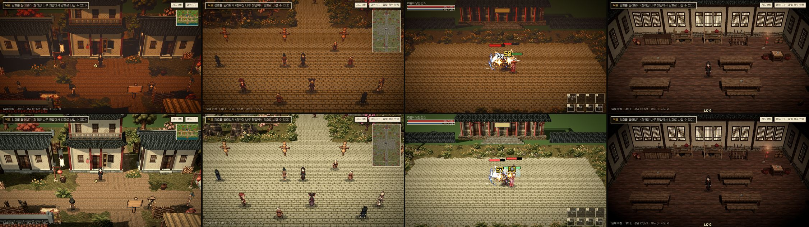

# 일검풍운결을 직접 켜서 잰 것 (2026-11-21)

주인이 "일검풍운결을 더 배우려면 내 컴퓨터에 깔린 게임을 뜯어 보면 도움이 되겠느냐, 어떻게든 해내라"고 하셨다. 게임 파일(6GB짜리 묶음 하나)은 가져올 수 없어서, 주인 컴퓨터에서 게임을 켜 놓고 화면을 찍어 쟀다. 이 문서는 그 기록이다.

**지킨 것.** 그 게임의 그림·모형·코드는 하나도 가져오지 않았다. 찍은 화면은 재는 데만 썼고 저장소에 넣지 않았으며 ChatGPT에게도 주지 않는다. 여기 적힌 것은 숫자(비례, 각도, 빛깔의 몫)뿐이다.

## 어떻게 쟀나

- 주인 컴퓨터(화면 2560×1440)에서 게임을 켜고 15분쯤 예순 장을 찍었다: 마을, 객잔 앞, 큰 지도, 소림사 산문과 마당과 방 하나, 대웅보전 앞 계단, 무당산 산문, 연무장, 삼청전 앞과 안, 싸움 한 판.
- 앞의 것은 주인이 직접 움직여 보여 주셨고, 끝의 몇 장(산문에서 삼청전 안까지)은 Claude가 걸어가서 찍었다.
- 재는 법: 사람과 건물의 화면 속 크기는 눈금을 덧그려 읽었고, 빛깔은 우리 화면을 재던 그 도구(`tools/tone.py`)로 똑같이 쟀다.

**Claude가 잘못한 것 하나.** 삼청전 안을 찍으려고 걸어 들어갔더니 주요 임무의 대화가 시작됐다("무당으로 돌아가 스승에게 보고하기"). 대사를 넘기지는 않았지만 자동 재생으로 흘러가 임무가 다음으로 넘어갔다. 주인이 직접 보셨어야 할 장면이다. 다음부터 남의 저장 파일로는 건물 안에 들어가지 않는다.

## 잰 값

사람 키를 1로 본다.

| 무엇 | 일검풍운결 | 강호행(재던 날) | 한 일 |
|---|---|---|---|
| 사람 키(화면 높이에 대해) | 바깥 1/9.0, 연무장 1/8.5, 방 안 1/8.4 | 바깥 1/8.2, 방 1/7.4 | 그대로 둔다(조금 큰 편이지만 전에 주신 기준 그림에 맞춘 값이다) |
| 사람 도트 | 키 54~55도트 | 키 48도트 | 그대로 |
| 카메라가 내려다보는 각 | 축이 15°쯤, 세로 시야 17~19°. 주인공 발밑의 땅이 깊이 쪽으로 0.34배로 눌린다(연무장의 둥근 태극 무늬가 가로 285 : 세로 96) | 축 35°, 시야 34°, 발밑 눌림 0.61 | **못 낮춘다**(아래 "카메라") |
| 싸움 화면의 카메라 | 따로 42°쯤(격자 칸이 가로 50 : 세로 33.5). 초식을 쓰면 낮게 내려가 옆에서 본다 | 35° | 그대로 |
| 낮의 빛깔(열여덟 장) | 밝기 95~125(숲 그늘 60~70), 누런 올리브빛 50~80%, 붉은·주황 1~13%, 무채 7~29%, 거의 검정 3~12% | 밝기 50~73, 주황 75~93%, 올리브 4~20% | **고쳤다**(아래 "빛깔") |
| 방 안의 빛깔(세 장) | 밝기 37, 거의 검정 47~53%, 주황 20~31%. 등롱과 촛불 둘레만 밝다 | 밝기 52~64, 거의 검정 5~13% | **절반쯤 옮겼다**(밝기 41~50, 거의 검정 15~24%) |
| 흐림 | 주인공이 선 깊이만 또렷하다. 화면 높이의 50~83% 띠가 위(15~40%)와 맨 아래(85~100%)보다 서너 배 또렷하다 | 흐림이 약하다 | 남았다 |
| 화면 가장자리 | 붉은 갈색 테가 늘 둘러져 있다(화면이 까맣게 바뀔 때도 보인다). 폭은 화면의 2~3% | 가장자리를 어둡게만 한다 | 남았다 |
| 산문(패루) | 높이 5.5 넘게(기둥이 화면 위로 나간다), 가운데 칸 폭 2.9, 들보 밑 2.8, 현판 가로 2.9 | 대문 높이 2.5쯤 | 모형 M5의 크기를 키웠다 |
| 담(기와 덮개까지) | 3.0~3.3 | 1.8쯤 | 그대로(카메라가 높아서 담을 높이면 사람이 가려진다) |
| 본전 안 뒷벽 | 4.2 넘게. 위쪽은 어둡고 번(깃발)과 휘장이 드리운다 | 2.7 | 모형 M9(벽에 거는 것)를 요청 |
| 방의 뒷벽(작은 방) | 2.4~2.7 | 2.7 | 같다 |
| 살창 | 폭 0.7, 높이 1.05, 창턱 0.8 | 폭 0.64, 높이 1.05 | 같다 |
| 방 안 기둥 굵기 | 0.62 | 0.22~0.32 | 남았다(굵은 기둥은 사람을 가린다. 방 카메라를 낮출 때 같이 본다) |
| 제단 | 폭 5.4의 낮은 단 위에 조사상(단까지 2.3), 양옆에 서 있는 종이 등롱(1.24)과 촛대, 과일 접시 셋 | 제상 하나와 촛대 | 모형 M8을 요청 |
| 본전 앞 큰 향로 | 2.2~2.5 | 없다 | 모형 M5의 향로를 키웠다 |
| 가운데 돌계단과 난간 | 계단 폭 3.3, 난간 높이 0.75, 난간 기둥 간격 1.6 | 계단 한 칸 폭 1, 난간 0.69 | 난간은 같다. 넓은 계단은 문파 터를 짤 때 |
| 마당의 태극 무늬 | 지름 4.8 | 없다 | 모형 M13의 비무대에 자리를 넣었다 |
| 덤불 | 높이 1~1.5, 폭 1.5~2의 둥근 덩어리. 길가마다 있다 | 그림 판을 세운 고사리와 꽃 | 모형 M12를 요청 |
| 싸움의 격자 칸 | 한 칸이 1.1 | (격자 없음) | 해당 없음 |
| 초식 효과 | 사람 키의 3~4배, 초식 이름이 큰 붓자국 띠에 뜬다 | 코드로 그은 선 | 검기 그림과 붓자국 띠(화면 틀)를 요청 |
| 대화창 | 왼쪽 아래에 상반신 하나(화면 높이의 3분의 1), 이름은 먹 붓자국 위, 글은 테 없이 | 전신 초상 둘이 화면 절반 | 남았다 |

## 카메라: 왜 못 낮추나

그 게임의 화면이 "옆에서 들여다보는 무대"처럼 보이는 까닭은 카메라가 낮고(15°) 멀리서 좁게 보기 때문이다. 건물의 앞면이 화면을 채우고, 땅은 얇게 눌리고, 먼 곳이 안개 속에 겹겹이 보인다. 우리는 35°라서 땅이 화면을 채운다.

우리 게임에서 각도만 낮춰 보았다(주소 끝에 `&pitch=25&fov=22`를 붙이면 볼 수 있다).

| 각도 | 길에서 봤을 때 집이나 소품에 가려지는 사람(서 있는 사람 1,494명 가운데) | 옆에 서도 가려지는 사람 |
|---|---|---|
| 35°(지금) | 21명 | 0명 |
| 25° | 129명 | 0명 |
| 20° | 158명 | 0명 |

그 게임의 지도는 처음부터 낮은 카메라에 맞춰 지었다: 길은 옆으로 길고, 높은 것은 북쪽에만 있고, 카메라 쪽에는 낮은 것만 있다. 우리 지도는 위에서 내려다보는 2D 지도로 지은 것이라 집이 사방에 있다. "사람은 가려지면 안 된다"는 주인의 말씀을 지키면 지금 지도로는 낮출 수 없다.

할 수 있는 길은 둘이다.
1. **방 안만 낮춘다.** 방은 남쪽 벽이 없어서 가릴 것이 가구뿐이다. 낮추면 바닥이 얇아지고 벽이 화면을 채워, 전에 미뤄 둔 "방을 얕고 넓게"가 방을 다시 짜지 않고도 된다. 다음에 할 일로 잡는다.
2. **문파 터를 새로 짤 때 낮은 카메라에 맞춰 짓는다.** 단과 계단을 북쪽으로 올리고 남쪽을 비우면 그 지도만 낮출 수 있다.

## 빛깔: 고친 것

전의 낮 빛은 어두운 홍보 그림 한 장(밝기 44, 주황 24, 거의 검정 37)에 맞춘 것이었고, 그마저 지나쳐서 어디서나 주황이 8~9할이었다. 실제로 켜 본 낮은 그보다 훨씬 밝고 누런 올리브빛이다.

| | 일검풍운결(낮) | 고치기 전 | 고친 뒤 |
|---|---|---|---|
| 밝기 | 95~125 | 50~73 | 87~128 |
| 붉은·주황 | 1~13% | 75~93% | 3~34% |
| 누런 올리브빛 | 50~80% | 4~20% | 45~94% |
| 붉은빛 대 풀빛(R/G) | 0.98~1.10 | 1.5~1.6 | 1.05~1.20 |
| 푸른빛 대 풀빛(B/G) | 0.56~0.75 | 0.54~0.61 | 0.56~0.71 |

청하진(주황 34%)과 흙바닥 싸움판 둘(45~47%)에 주황이 남는 것은 길의 흙 그림이 붉은 갈색이기 때문이다(빛이 아니라 그림의 빛깔. 요청서의 땅 무늬 `GR1`이 오면 바꾼다). 방은 해와 하늘빛을 줄이고 등불을 키워 밝기 41~50(전에는 52~64), 거의 검정 15~24%(전에는 5~13%)로 옮겼다.

 그 게임만큼(거의 검정 5할) 어둡게 하면 검은 옷의 주인공이 바닥에 묻혀서 거기까지는 가지 않았다. 제단 옆에 등롱(M8)이 서면 더 어둡게 할 수 있다.

밤은 재지 못했다(주인이 보여 주신 것이 모두 낮이었다). 밤의 빛깔은 그대로다.

## 이 기록으로 한 일

- 낮과 방의 빛을 고쳤다(`js/hd2d.js`의 `TIMES.day`, `ROOMT.day`).
- ChatGPT 요청서를 처음부터 다시 쓰면서 크기의 기준표를 넣었다(`docs/gpt/index.md`).
- 블렌더 모형 규격에서 산문과 향로를 키우고 묶음 여섯(M8~M13)을 더했다(`tools/blender/spec.json`).
- 각도와 빛을 바꿔 가며 찍는 손잡이를 넣었다: 주소의 `&pitch=`, `&fov=`, 시험 도구 `tools/dev/lt.cjs`.

## 남은 것 (차례대로)

1. 방 안의 카메라를 낮춘다(20~25°). 가구에 사람이 가려지는지 시험과 같이.
2. 흐림을 세게: 주인공 깊이의 띠만 또렷하게.
3. 화면 가장자리의 붉은 갈색 테.
4. 사람의 그림자를 해 방향으로 길게(지금은 발밑의 둥근 얼룩이다).
5. 밤의 빛깔(재야 한다. 주인이 밤 화면을 보여 주시면 같은 방법으로 잰다).
6. 대화창을 상반신 하나로.
